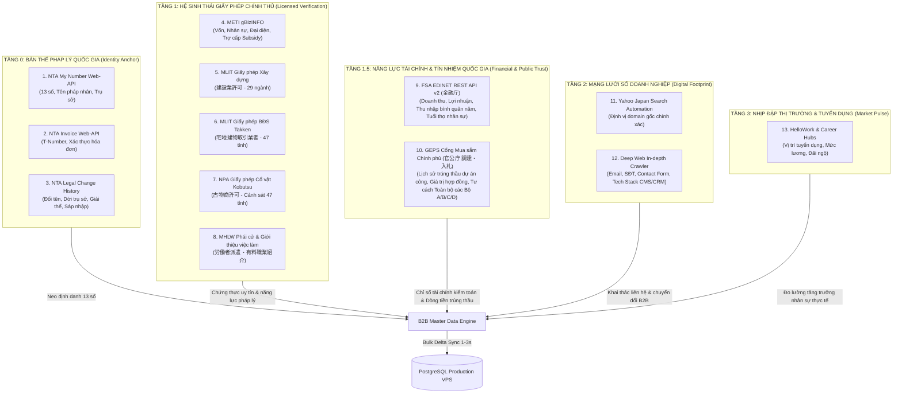
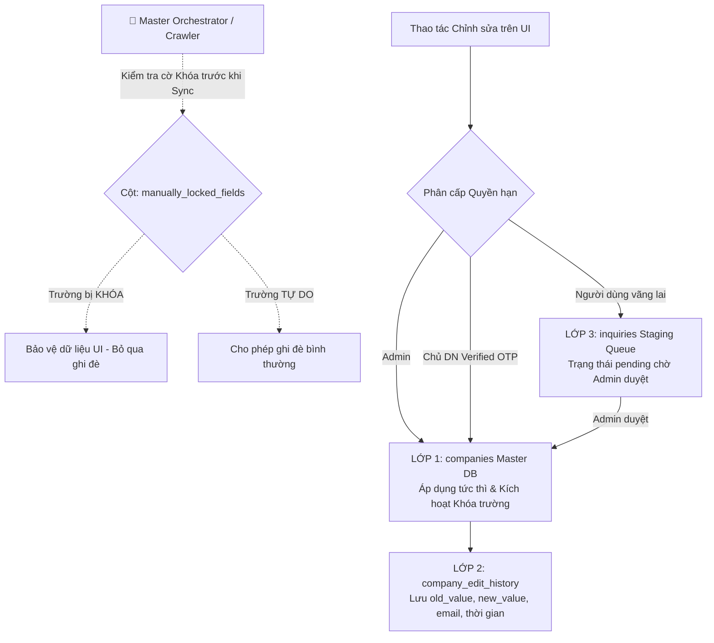
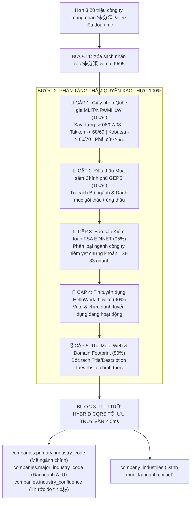
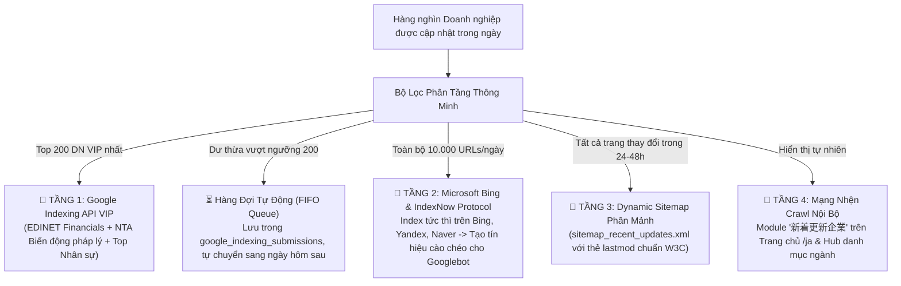

# B2B Master Data Engine & Global Orchestrator (国家規模B2B統合データエンジン仕様書)

Skill này là tài liệu chuẩn mực cấp cao nhất của hệ thống **Kigyou-list (kigyoulist.com)**, định nghĩa quy trình chuyển đổi toàn bộ hệ thống từ các script cào phân tán thành một **Cỗ máy dữ liệu B2B quốc gia tự động hóa khép kín 100%**, duy trì vị thế dẫn đầu thị trường tra cứu doanh nghiệp Nhật Bản.

---

## 1. Bản đồ Phân tầng Dữ liệu Đa nguồn Toàn diện (5-Tier Multi-Source Data Architecture)

Hệ sinh thái dữ liệu của Kigyou-list được phân bổ nghiêm ngặt thành các tầng kiến trúc với thẩm quyền dữ liệu tăng dần từ dưới lên trên:



---

## 2. Chi tiết 2 Mỏ Vàng Dữ liệu Mới: FSA EDINET & GEPS

### 2.1. FSA EDINET (金融庁 有価証券報告書 API v2)
* **Cơ quan chủ quản**: Cơ quan Dịch vụ Tài chính Nhật Bản (金融庁 - FSA).
* **Đối tượng**: Hơn 4.000 công ty niêm yết (Tokyo Stock Exchange Prime/Standard/Growth) và công ty đại chúng.
* **Giao thức**: REST API v2 (`api.edinet-fsa.go.jp/api/v2/`) cung cấp tài liệu XBRL/JSON chính thức.
* **Trường dữ liệu trích xuất độc quyền**:
  1. `revenue` (売上高): Doanh thu hợp nhất và công ty mẹ (3 năm tài chính gần nhất).
  2. `operating_income` (営業利益) & `net_income` (当期純利益): Lợi nhuận kinh doanh và lợi nhuận ròng sau thuế.
  3. `avg_annual_salary` (平均年間給与): Thu nhập bình quân năm của nhân viên (Ví dụ: `8,450,000 円`). Mỏ vàng thu hút traffic tìm việc, chuyển việc, báo chí.
  4. `avg_age` (平均年齢) & `avg_service_years` (平均勤続年数): Thước đo vàng về sự ổn định của môi trường làm việc.
  5. `major_shareholders` (主要株主): Danh sách cổ đông lớn nắm giữ trên 5% vốn.

### 2.2. GEPS / Cổng Đấu thầu Mua sắm Chính phủ (政府電子調達システム & 官公庁 調達・入札情報)
* **Cơ quan chủ quản**: Cổng đấu thầu chính phủ điện tử (GEPS - Government Electronic Procurement System) cùng dữ liệu mở từ các Bộ ngành (Bộ Quốc phòng 防衛省, Bộ Đất đai Giao thông MLIT, Bộ Giáo dục MEXT, v.v.).
* **Đối tượng**: Hàng chục nghìn doanh nghiệp trúng thầu và cung ứng hàng hóa/dịch vụ cho cơ quan nhà nước.
* **Trường dữ liệu trích xuất độc quyền**:
  1. `tender_title` (件名・業務名): Tên dự án/gói thầu đã trúng.
  2. `contract_amount` (落札金額): Giá trị hợp đồng bằng Yên Nhật (JPY). Minh chứng dòng tiền thực tế.
  3. `awarding_agency` (発注機関): Tên cơ quan mời thầu (Chính quyền Tokyo, Bộ Đất đai Giao thông...).
  4. `award_date` (落札年月日): Ngày trúng thầu chính thức.
  5. `unified_qualification_grade` (全省庁統一資格等級): Cấp bậc thẩm định tư cách nhà thầu của chính phủ (Hạng A, B, C, D) cho 4 nhóm: Chế tạo (製造), Bán hàng (物品の販売), Cung ứng dịch vụ (役務の提供), Mua sắm tài sản (物品の買受け).

---

## 3. Ma trận Trọng số Giải quyết Xung đột (Conflict Resolution Matrix)

Khi cùng một trường dữ liệu xuất hiện ở nhiều nguồn với giá trị khác nhau, hệ thống bắt buộc áp dụng **Thứ tự Ưu tiên Pháp lý Tuyệt đối**:

| Trường thông tin | Nguồn cấp 1 (Ưu tiên tuyệt đối) | Nguồn cấp 2 (Dự phòng xác thực) | Nguồn cấp 3 (Tham khảo) | Quy tắc xử lý xung đột |
| :--- | :--- | :--- | :--- | :--- |
| **Mã số pháp nhân (13 số)** | **NTA (Quốc thuế)** | Không thay thế | Không thay thế | Khóa chính bất biến (Immutable Unique ID). |
| **Tên công ty (商号)** | **NTA (Quốc thuế)** | gBizINFO / FSA EDINET | Website / Yahoo | NTA là pháp nhân danh chính ngôn thuận; website chỉ là tên thương hiệu (Brand name). |
| **Mã số hóa đơn (T-Number)** | **NTA Invoice API** | Không thay thế | Không thay thế | Duy nhất do NTA cấp; định dạng chuẩn `T` + 13 chữ số. |
| **Báo cáo Tài chính & Lương** | **FSA EDINET (Kiểm toán)** | gBizINFO | Website công ty | Báo cáo chứng khoán có kiểm toán độc lập là số liệu chuẩn mực cao nhất quốc gia. |
| **Lịch sử Trúng thầu Công** | **GEPS / Cổng Đấu thầu Nhà nước** | Thông cáo báo chí | Website công ty | Dữ liệu giải ngân ngân sách nhà nước có tính xác thực 100%. |
| **Địa chỉ trụ sở chính** | **NTA (Quốc thuế)** | Giấy phép MLIT/NPA | Website công ty | NTA là địa chỉ ĐKKD pháp lý. Nếu website ghi văn phòng giao dịch, lưu vào trường `branch_address`. |
| **Người đại diện (代表者)** | **Giấy phép Bộ/Cục (MLIT/NPA)** | **gBizINFO / EDINET** | Website công ty | Giấy phép ngành nghề kiểm tra tư cách pháp lý định kỳ 5 năm, ưu tiên hơn website. |
| **Vốn điều lệ (資本金)** | **FSA EDINET / gBizINFO** | Giấy phép Xây dựng | Website công ty | Chuẩn hóa số nguyên Yên Nhật (JPY). |
| **Số điện thoại (TEL)** | **Giấy phép MLIT/NPA/MHLW** | Website công ty (Deep Web) | gBizINFO / Yahoo | Giấy phép cơ quan nhà nước có tính xác thực 100%, chống số ảo. |
| **Website chính thức (URL)** | **NPA Kobutsu (Cảnh sát xác nhận)** | Website đã vượt qua DNS & HTTP 200 | Yahoo Search Rank 1 | URL phải trải qua bộ lọc `is_safe_corporate_url` (loại bỏ PR-Times, Facebook, Rikunabi...). |
| **Email liên hệ** | **Deep Web In-depth Crawler** | Form liên hệ công ty | Danh mục mở | Bắt buộc kiểm tra định dạng RFC 5322 và loại bỏ email rác (`noreply@`, `abuse@`). |

---

### 3.1. Chính Sách Chu Kỳ Tái Thu Thập Yahoo & Deep Web (Smart Recrawl Policy & Dynamic TTL)

Doanh nghiệp Nhật Bản có vòng đời chuyển đổi số liên tục (thành lập mới -> thiết kế nhận diện -> ra mắt website & tuyển dụng). Để không bỏ sót website của các doanh nghiệp trước đây chưa có thông tin, hệ thống thiết lập cơ chế **Hàng đợi Ưu tiên & Chu kỳ Tái Thu thập Thông minh (Smart Recrawl TTL)**:

| Phân nhóm Doanh nghiệp | Tình trạng Website | Tín hiệu Kích hoạt (Signals) | Chu kỳ Tái Thu Thập (TTL) | Mức độ Ưu tiên (Priority Queue) |
| :--- | :--- | :--- | :--- | :--- |
| **Nhóm 1: Tuyển dụng & Giấy phép Mới** | Chưa có Website (`has_website = 0`) | Có tin tuyển dụng HelloWork (`is_hiring = 1`) hoặc vừa cấp phép MLIT/NPA | **30 - 60 ngày** | **Ưu tiên 1 (Cao nhất)** - Nhu cầu truyền thông tuyển dụng & kinh doanh cấp thiết. |
| **Nhóm 2: Doanh nghiệp Chưa có Website** | Chưa có Website (`has_website = 0`) | Đã từng tìm kiếm Yahoo nhưng trước đó chưa có domain | **60 - 90 ngày** | **Ưu tiên 2 (Tiêu chuẩn)** - Khoảng thời gian vàng doanh nghiệp hoàn thiện và launch website mới. |
| **Nhóm 3: Doanh nghiệp Mới thành lập** | Chưa có Website (`has_website = 0`) | `yahoo_last_crawled_at IS NULL` (Mới đăng ký NTA) | **Ngay lập tức** | **Ưu tiên 0 (Khởi tạo)** - Nạp ngay vào hàng đợi đầu tiên. |
| **Nhóm 4: Doanh nghiệp Đã có Website** | Đã có Website (`has_website = 1`) | Cần kiểm tra domain còn sống (HTTP 200/DNS) hoặc thay đổi URL | **180 - 360 ngày** | **Ưu tiên 3 (Bảo trì)** - Chạy nền chu kỳ dài để tối ưu tài nguyên mạng/proxy. |

* **Câu truy vấn Hàng đợi Ưu tiên Chuẩn mực**:
```sql
SELECT corporate_number, company_name, prefecture_name, city_name, full_address
FROM companies
WHERE (website_url IS NULL OR website_url = '' OR website_url LIKE '%なし%')
  AND (yahoo_last_crawled_at IS NULL OR yahoo_last_crawled_at < datetime('now', '-60 days'))
ORDER BY 
  CASE WHEN yahoo_last_crawled_at IS NULL THEN 0 ELSE 1 END,
  CASE WHEN (has_public_tender = 1 OR has_financial_report = 1 OR has_license = 1) THEN 0 ELSE 1 END,
  yahoo_last_crawled_at ASC
LIMIT 50000;
```

#### 3.1.1. Chuẩn Hóa Cỗ Máy Cào Yahoo HTTP Thuần (`yahoo_http_searcher.py` - curl_cffi v2)

Nhằm tối ưu hóa tài nguyên 24/7 tương tự bước đột phá của HelloWork (`http_harvester_v2.py`), luồng Yahoo được nâng cấp toàn diện sang **HTTP Session Emulation (`curl_cffi` Async TLS Chrome 120)**:

1. **Hiệu năng & Tài nguyên**:
   - **Tốc độ**: Nhanh gấp 5-8 lần (từ 4-6s xuống **0.5 - 1.0s/request**).
   - **RAM**: Giảm 98% (từ 300MB/worker Chromium xuống **~5MB/worker**).
   - **Bản chất**: Yahoo Search trả về **100% Server-Side Rendered (SSR)**, thẻ `.sw-Card` và `.sw-MapCard` có sẵn trong HTML ban đầu, tuyệt đối không cần render JavaScript.
2. **Bộ lọc Domain Rác & Job Board Toàn diện (120+ Domain)**:
   - Loại trừ triệt để các trang tuyển dụng (`doda.jp`, `mynavi.jp`, `rikunabi.com`, `en-japan.com`, `indeed.com`, `wantedly.com`...).
   - Loại trừ báo chí, PR wires (`prtimes.jp`, `atpress.ne.jp`, `value-press.com`, `nikkei.com`, `note.com`...).
   - Loại trừ cổng danh bạ (`biz-maps.com`, `salesnow.jp`, `kaisha-db.com`, `musubu.co.jp`, `houjin.jp`...).
   - Loại trừ tên miền cơ quan hành chính (`.lg.jp`, `.go.jp`, `city.*.jp`, `town.*.jp`, `pref.*.jp`).
3. **Pre-flight HTTP Alive Check**:
   - Gửi async `HEAD` request (timeout 2.5s) xác minh domain còn sống (HTTP 2xx/3xx/403) và theo dõi redirect trước khi lưu `website_url`.
4. **Bóc tách Dấu chân Mạng Xã Hội (SNS Footprint)**:
   - Tự động bắt profile Twitter/X, Facebook, Wantedly, LinkedIn, YouTube, Note, LINE và lưu cấu trúc JSON vào cột `sns_links`.
5. **In-Memory Batch Committer**:
   - Gom 25-50 bản ghi commit 1 lần trong transaction duy nhất (WAL Mode + busy_timeout=60000), triệt tiêu 100% lỗi `database is locked`.

---

### 3.2. Cơ Chế Quản Lý Chỉnh Sửa Thủ Công (Manual Override) & Chống Ghi Đè (Immutable Lock)

Khi dữ liệu được người dùng hoặc Admin chỉnh sửa từ giao diện (UI), hệ thống áp dụng **Mô hình Kiến trúc Lưu trữ 3 Lớp (3-Tier Storage & Override Protection)** để đảm bảo dữ liệu vừa có giá trị ngay lập tức, vừa có lịch sử kiểm toán (Audit Trail) và **tuyệt đối không bị Crawler tự động ghi đè làm mất thông tin**:



#### Quy chuẩn Phân cấp Thẩm quyền (Authority Hierarchy):
1. **👑 Admin Kigyou-list (Cấp 0 - Tuyệt đối)**: Sửa trực tiếp trên giao diện $\rightarrow$ Cập nhật tức thì vào bảng `companies`, ghi log vào `company_edit_history`, tự động khóa trường trong cột `manually_locked_fields` (Crawler vĩnh viễn không được phép ghi đè).
2. **🏢 Chủ sở hữu Doanh nghiệp (Verified Owner - Cấp 1)**: Đăng nhập và xác thực OTP qua Email tên miền doanh nghiệp (`@tencongty.co.jp`) $\rightarrow$ Tự động phê duyệt (`status = 'auto_approved'`), cập nhật `companies`, lưu log vào `company_edit_history`, khóa trường chống crawler ghi đè.
3. **👤 Người dùng vãng lai (Cấp 2)**: Gửi ticket báo lỗi / yêu cầu cập nhật $\rightarrow$ Lưu vào bảng `inquiries` với `status = 'pending'`. Admin phê duyệt thì mới chuyển vào `company_edit_history` và cập nhật `companies`.

#### Quy tắc Bất biến về Quyền Sửa:
* **Tuyệt đối KHÔNG cho phép sửa qua UI**:
  - `corporate_number` (13 số Quốc thuế NTA - Khóa chính bất biến).
  - `invoice_number` (T-Number của NTA).
  - Báo cáo Tài chính có kiểm toán & Lương bình quân (FSA EDINET).
  - Lịch sử trúng thầu dự án công (GEPS).
* **Cho phép Admin & Doanh nghiệp tự do chỉnh sửa**:
  - `website_url`, `phone_number`, `branch_phone_numbers`, `email_address`, `contact_form_url`, `business_summary`, `sns_links`.

#### Cơ chế Khôi phục 1-Chạm (One-Click Rollback):
Toàn bộ thay đổi đều được ghi vào bảng `company_edit_history` với đầy đủ `old_value` và `new_value`. Khi phát hiện người dùng spam hoặc nhập sai, Admin có thể hoàn tác ngay lập tức qua hàm `rollbackCompanyEdit(historyId)` để phục hồi nguyên trạng.

---

### 3.3. Quy Chuẩn Khai Thác Mạng Xã Hội B2B (SNS Footprint & JSON Schema)

Liên kết mạng xã hội chính thức của doanh nghiệp (`sns_links`) được thu thập độc quyền tại **TẦNG 2: MẠNG LƯỚI SỐ DOANH NGHIỆP** thông qua tiến trình **Deep Web In-depth Crawler** ([crawlers/website/main.py](file:///c:/kigyou-list/crawlers/website/main.py)):

#### 1. Phương thức Bóc tách 3 Tầng:
1. **Tầng 1 (Cấu trúc JSON-LD)**: Quét thẻ `<script type="application/ld+json">`, bóc tách mảng `sameAs` của schema `Organization` / `Corporation` / `LocalBusiness`.
2. **Tầng 2 (Quét Anchor Regex)**: Quét toàn bộ liên kết `<a>` tại Header, Footer và Contact page bằng tập Regex chuẩn Nhật Bản:
   - **Twitter / X**: `twitter.com/{id}`, `x.com/{id}`
   - **Facebook**: `facebook.com/{fanpage_id}`, `fb.com/{fanpage_id}`
   - **Wantedly**: `wantedly.com/companies/{company_slug}` *(Hệ sinh thái tuyển dụng & văn hóa doanh nghiệp hàng đầu Nhật Bản)*
   - **YouTube**: `youtube.com/@{channel}`, `youtube.com/channel/{id}`
   - **LinkedIn**: `linkedin.com/company/{name}`
   - **Note.com**: `note.com/{creator}` *(Nền tảng blog công nghệ & câu chuyện kinh doanh B2B Nhật)*
   - **LINE**: `page.line.me/{id}`, `lin.ee/{id}`
   - **Instagram**: `instagram.com/{id}`
3. **Tầng 3 (Bộ lọc Khử nhiễu - Anti-Noise Filter)**: Tự động loại trừ các liên kết chia sẻ bài viết (`twitter.com/share`, `facebook.com/sharer`, `youtube.com/watch`) để đảm bảo 100% link thu thập được là Profile chính thức của doanh nghiệp.

#### 2. Cấu trúc JSON Chuẩn mực trong CSDL (`companies.sns_links`):
```json
{
  "twitter": "https://x.com/cyberagent_jp",
  "facebook": "https://facebook.com/cyberagent",
  "wantedly": "https://wantedly.com/companies/cyberagent",
  "youtube": "https://youtube.com/@CyberAgentOfficial",
  "linkedin": "https://linkedin.com/company/cyberagent",
  "note": "https://note.com/cyberagent"
}
```

---

### 3.4. Quy Chuẩn Phân Loại Ngành Nghề Xác Thực Đa Nguồn & Chiến Lược Làm Sạch (Next-Gen Deterministic Industry Tagging & Cleansing Policy)

#### 1. Chiến lược Xử lý Dữ liệu Cũ: "Không Đập Bỏ Mù Quáng - Tinh Lọc Phân Tầng An Toàn Tuyệt Đối (Zero-Downtime Cleansing)"
* **Vấn đề cốt lõi**: Hiện có hơn **3,280,000 công ty** bị gán nhãn rác `未分類 (AI確認済)` hoặc mã mơ hồ `99` (分類不能) và `95` (Dịch vụ khác). Nếu "đập đi xóa sạch cùng một lúc" trên VPS, hàng triệu URL SEO `/ja/industry/...` sẽ bị biến mất đột ngột, dẫn đến việc **Googlebot đánh sập thứ hạng tìm kiếm (SEO Traffic Crash)**.
* **Nguyên tắc Giải quyết Chuẩn mực**:
  1. **Bảo tồn Dữ liệu "Kim Cương" (gBizINFO chính thức của Bộ Kinh tế METI)**: Giữ nguyên ~700.000 bản ghi chuẩn xác cao do METI ban hành làm mốc neo an toàn.
  2. **Quét sạch Triệt để Nhãn Rác `未分類 (AI確認済)`**: Loại bỏ hoàn toàn chuỗi văn bản vô nghĩa này khỏi `companies.jigyo_shumoku`. Nếu công ty chưa có dữ liệu xác thực, để chuỗi rỗng sạch sẽ thay vì hiển thị "AI確認済".
  3. **Cơ chế Ghi đè Theo Thẩm quyền Pháp lý (Deterministic Authority Overwrite)**: Thay thế toàn bộ việc "AI đoán mò" bằng các nguồn dữ liệu có bằng chứng xác thực 100%.



#### 2. Ma trận Thẩm quyền Phân loại Ngành nghề (Industry Authority Matrix):

| Cấp Thẩm quyền | Nguồn Dữ liệu | Độ Tin cậy (Confidence) | Quy tắc Ánh xạ Chuẩn xác (Deterministic Mapping) | Gán Nhãn Tin cậy (`industry_confidence`) |
| :--- | :--- | :--- | :--- | :--- |
| **Cấp 1: Giấy phép Nhà nước** | `company_licenses` (MLIT, NPA, MHLW) | **100% (Pháp lý tuyệt đối)** | - Xây dựng (建設業) $\rightarrow$ `06 総合工事業`, `07 職別`, `08 設備`<br>- Bất động sản (宅建) $\rightarrow$ `68 不動産取引業`, `69 管理業`<br>- Cổ vật (古物商) $\rightarrow$ `60 小売業`, `70 物品賃貸`<br>- Phái cử (派遣・紹介) $\rightarrow$ `91 職業紹介・労働者派遣` | `CONFIRMED_LICENSE` |
| **Cấp 2: Đấu thầu Chính phủ** | `company_public_tenders` (GEPS / Cổng thầu) | **100% (Dòng tiền ngân sách)** | - Tư cách Chế tạo (製造) $\rightarrow$ `24-31 Sản xuất cơ khí/điện tử`<br>- Tư cách Dịch vụ (役務) $\rightarrow$ `39 IT/Phần mềm`, `92 Dịch vụ DN`<br>- Tư cách Công trình (工事) $\rightarrow$ `06 Xây dựng hạ tầng` | `CONFIRMED_GOV_TENDER` |
| **Cấp 3: Kiểm toán Niêm yết** | FSA EDINET (有価証券報告書) | **95% (Kiểm toán độc lập)** | Ánh xạ từ 33 phân ngành chứng khoán Sở Giao dịch Tokyo (TSE) sang 99 mã trung ngành JSIC chuẩn. | `CONFIRMED_EDINET` |
| **Cấp 4: Đăng ký Bộ METI** | METI gBizINFO | **95% (Công bố mở chính phủ)** | Kế thừa mã JSIC chính thức do doanh nghiệp đăng ký tại METI. | `OFFICIAL_GBIZ` |
| **Cấp 5: Tuyển dụng Thực tế** | HelloWork (`raw_hellowork`) | **90% (Thực tế tuyển dụng)** | Ánh xạ từ ngành tuyển dụng trực tiếp của doanh nghiệp. | `ACTIVE_HIRING` |
| **Cấp 6: Web Snippet Title** | Deep Web Meta (`<title>`, `<meta description>`) | **80% (Khẳng định thương hiệu)** | Quét từ khóa định vị doanh nghiệp trong thẻ Title/Meta chính thức. | `VERIFIED_WEB` |
| **Chưa đủ dữ liệu** | Không có bất kỳ nguồn xác thực nào | **0%** | **Giữ nguyên chuỗi rỗng / NULL, TUYỆT ĐỐI KHÔNG ĐOÁN MÒ!** | `UNCLASSIFIED` |

#### 3. Tối ưu Hóa Hiệu Năng Truy Vấn Tìm Kiếm Lọc Ngành (< 5ms):
* **Loại bỏ 100% phép JOIN tốn kém**: Bổ sung trực tiếp cột `primary_industry_code (VARCHAR(10))` và `major_industry_code (VARCHAR(5))` vào bảng `companies` kèm Composite Index `(prefecture, primary_industry_code)`.
* Khi người dùng lọc tìm kiếm doanh nghiệp theo ngành và tỉnh thành, hệ thống quét trực tiếp trên 1 bảng duy nhất, loại bỏ hoàn toàn việc JOIN bảng quan hệ 4.3 triệu dòng.

#### 4. QUY CHUẨN BẮT BUỘC: TỰ ĐỘNG ÁNH XẠ GIẤY PHÉP SANG MÃ NGÀNH JSIC (License-to-Industry Auto-Tagging Mandate)
> [!IMPORTANT]
> **QUY TẮC CỐT LÕI (Zero-Gap License Rule):**
> Tuyệt đối không để xảy ra tình trạng doanh nghiệp đã có giấy phép hành nghề công quyền trong `company_licenses` mà ngành nghề `事業種目` bị bỏ trống (`-`) hoặc khuyết thiếu trong `company_industries`.
> Bất cứ khi nào crawler/harvester cào được giấy phép mới hoặc khi chạy pipeline đồng bộ lên VPS, **BẮT BUỘC** phải tự động kích hoạt ánh xạ Deterministic Mapping:
> 
> 1. **宅地建物取引業** (Môi giới BĐS):
>    - Thêm vào `company_industries`: `K` (Đại ngành) và `68` (Trung ngành - `不動産取引業`) với path `K.68`.
>    - Cập nhật `companies`: `has_real_estate_lic = true`, `has_license = true`, `primary_industry_code = COALESCE(primary_industry_code, '68')`, `major_industry_code = COALESCE(major_industry_code, 'K')`, `jigyo_shumoku` bổ sung `不動産取引業`.
> 2. **労働者派遣事業 & 有料職業紹介事業** (Phái cử & Tuyển dụng):
>    - Thêm vào `company_industries`: `R` (Đại ngành) và `91` (Trung ngành - `職業紹介・労働者派遣業`) với path `R.91`.
>    - Cập nhật `companies`: `has_license = true`, `primary_industry_code = COALESCE(primary_industry_code, '91')`, `major_industry_code = COALESCE(major_industry_code, 'R')`, `jigyo_shumoku` bổ sung `職業紹介・労働者派遣業`.
> 3. **古物商許可** (Kinh doanh đồ cũ / Cầm đồ):
>    - Thêm vào `company_industries`: `I` (Đại ngành) và `60` (Trung ngành - `その他の小売業`) với path `I.60`.
>    - Cập nhật `companies`: `has_kobutsu_lic = true`, `has_license = true`, `primary_industry_code = COALESCE(primary_industry_code, '60')`, `major_industry_code = COALESCE(major_industry_code, 'I')`, `jigyo_shumoku` bổ sung `その他の小売業`.
> 4. **建設業許可** (Xây dựng công trình):
>    - Thêm vào `company_industries`: `D` (Đại ngành) và `06` (Trung ngành - `総合工事業`) với path `D.06`.
>    - Cập nhật `companies`: `has_construction_lic = true`, `has_license = true`, `primary_industry_code = COALESCE(primary_industry_code, '06')`, `major_industry_code = COALESCE(major_industry_code, 'D')`, `jigyo_shumoku` bổ sung `総合工事業`.
> 
> Bộ điều phối tự động: [scripts/enrich_all_licensed_companies.py](file:///c:/kigyou-list/scripts/enrich_all_licensed_companies.py) và hook tích hợp trong [scripts/sync_delta_licenses_to_vps.py](file:///c:/kigyou-list/scripts/sync_delta_licenses_to_vps.py).

---

## 4. Kiến trúc Cơ sở Dữ liệu Hybrid CQRS (Faceted Search & SEO Network)

Để đáp ứng cùng lúc 3 mục tiêu: **Cập nhật cực nhanh, Tìm kiếm tổ hợp <10ms, Mạng nhện SEO Programmatic 10 triệu trang**, cơ sở dữ liệu được tổ chức theo mô hình **CQRS (Command Query Responsibility Segregation)**:

### 4.1. Cấu trúc Bảng Lưu trữ Gốc Chuẩn hóa (Normalized Storage)
1. `companies`: Thông tin định danh cơ bản.
2. `company_licenses`: Danh mục giấy phép hoạt động (MLIT Xây dựng, BĐS Takken, NPA Kobutsu, MHLW Phái cử).
3. `company_financials`: Dữ liệu tài chính & thu nhập từ FSA EDINET:
   ```sql
   CREATE TABLE IF NOT EXISTS company_financials (
       id BIGSERIAL PRIMARY KEY,
       corporate_number VARCHAR(13) NOT NULL,
       fiscal_year VARCHAR(10) NOT NULL, -- '2024', '2025'
       revenue BIGINT,                   -- Doanh thu (Yên)
       operating_income BIGINT,          -- Lợi nhuận kinh doanh
       net_income BIGINT,                -- Lợi nhuận thuần
       avg_annual_salary INTEGER,        -- Thu nhập bình quân năm (Yên)
       avg_age NUMERIC(4, 1),            -- Tuổi bình quân (vd: 41.5)
       avg_service_years NUMERIC(4, 1),   -- Thâm niên bình quân (vd: 12.3)
       employee_count INTEGER,           -- Số nhân viên chính thức
       source VARCHAR(50) DEFAULT 'EDINET',
       updated_at TIMESTAMP WITH TIME ZONE DEFAULT CURRENT_TIMESTAMP,
       CONSTRAINT uq_comp_financial UNIQUE(corporate_number, fiscal_year)
   );
   ```
4. `company_public_tenders`: Dữ liệu lịch sử trúng thầu dự án công từ GEPS:
   ```sql
   CREATE TABLE IF NOT EXISTS company_public_tenders (
       id BIGSERIAL PRIMARY KEY,
       corporate_number VARCHAR(13) NOT NULL,
       tender_title TEXT NOT NULL,       -- Tên gói thầu
       contract_amount BIGINT,           -- Giá trị hợp đồng (Yên)
       awarding_agency TEXT NOT NULL,    -- Cơ quan mời thầu (Chính quyền Tokyo, Bộ Đất đai...)
       award_date DATE NOT NULL,         -- Ngày trúng thầu
       unified_qualification_grade VARCHAR(10), -- A, B, C, D
       category VARCHAR(50),             -- Chế tạo, Bán hàng, Dịch vụ
       created_at TIMESTAMP WITH TIME ZONE DEFAULT CURRENT_TIMESTAMP
   );
   CREATE INDEX IF NOT EXISTS idx_tenders_corp ON company_public_tenders (corporate_number, award_date DESC);
   ```
5. `company_jobs`: Danh sách tin tuyển dụng từ HelloWork.
6. `company_legal_histories`: Lịch sử biến động pháp lý từ Quốc thuế NTA.

### 4.2. Cột cờ Tối ưu Tìm kiếm (Denormalized Boolean Search Flags)
Gắn trực tiếp vào bảng `companies` để loại bỏ 100% phép `JOIN` tốn kém khi tìm kiếm theo điều kiện:
* `has_phone` (BOOLEAN): Có số điện thoại chính thức.
* `has_email` (BOOLEAN): Có email liên hệ trực tiếp.
* `has_website` (BOOLEAN): Có website đã xác thực hoạt động.
* `has_contact_form` (BOOLEAN): Có form liên hệ trực tuyến.
* `has_invoice` (BOOLEAN): Đã đăng ký hóa đơn điện tử T-Number (適格請求書).
* `has_license` (BOOLEAN): Có bất kỳ giấy phép hoạt động kinh doanh nào.
* `has_real_estate_lic` (BOOLEAN): Giấy phép BĐS (宅建免許).
* `has_construction_lic` (BOOLEAN): Giấy phép Xây dựng (建設業許可).
* `has_kobutsu_lic` (BOOLEAN): Giấy phép Đồ cũ (古物商許可).
* `has_financial_report` (BOOLEAN): Có công bố Báo cáo Tài chính có kiểm toán (FSA EDINET).
* `has_public_tender` (BOOLEAN): Đã từng trúng thầu dự án công chính phủ (GEPS).
* `is_hiring` (BOOLEAN): Đang có tin tuyển dụng hoạt động.
* `capital_range_id` (SMALLINT): Phân khúc vốn (1: <1000万, 2: 1000万-5000万, 3: 5000万-1億, 4: >1億).
* `avg_salary_range_id` (SMALLINT): Phân khúc thu nhập bình quân (1: <500万, 2: 500万-700万, 3: 700万-1000万, 4: >1000万).
* `employee_range_id` (SMALLINT): Quy mô nhân sự (1: 1-10, 2: 11-50, 3: 51-300, 4: >300).
* `primary_industry_code` (VARCHAR(10)): Mã trung ngành JSIC chính (01..99). Loại bỏ 100% phép JOIN khi tìm kiếm theo ngành.
* `major_industry_code` (VARCHAR(5)): Mã đại ngành JSIC chính (A..U - vd: D: Xây dựng, G: CNTT, K: BĐS).
* `industry_confidence` (VARCHAR(20)): Thước đo tin cậy nguồn gốc ngành nghề (`CONFIRMED_LICENSE`, `CONFIRMED_GOV_TENDER`, `CONFIRMED_EDINET`, `OFFICIAL_GBIZ`, `ACTIVE_HIRING`, `VERIFIED_WEB`, `UNCLASSIFIED`).

### 4.3. Chỉ mục Tổ hợp Siêu Tốc (Composite Indexes)
```sql
-- Chỉ mục phục vụ bộ lọc tìm kiếm doanh nghiệp theo ngành và tỉnh thành siêu tốc (<5ms):
CREATE INDEX IF NOT EXISTS idx_comp_industry_geo_matrix 
ON companies (prefecture, primary_industry_code, major_industry_code);

-- Chỉ mục phục vụ bộ lọc tìm kiếm doanh nghiệp uy tín tài chính cao:
CREATE INDEX IF NOT EXISTS idx_comp_finance_tender_matrix 
ON companies (prefecture, has_financial_report, has_public_tender, avg_salary_range_id);

-- Chỉ mục phục vụ bộ lọc liên hệ B2B (Sales Outreach Filter):
CREATE INDEX IF NOT EXISTS idx_comp_outreach_matrix 
ON companies (prefecture, has_email, has_phone, has_website);

-- Chỉ mục phục vụ bộ lọc giấy phép doanh nghiệp (Enterprise Verification):
CREATE INDEX IF NOT EXISTS idx_comp_license_matrix 
ON companies (prefecture, has_invoice, has_license, has_construction_lic, has_real_estate_lic);
```

### 4.4. Mạng nhện Dữ liệu SEO Programmatic (`hub_dynamic_events`)
Phục vụ tạo hàng triệu URL chuyên đề có lượng tìm kiếm khổng lồ:
* `event_type`:
  - `'public_tender'`: Công ty vừa trúng thầu dự án lớn (vd: *"Doanh nghiệp vừa trúng thầu dự án công tại Tokyo"*).
  - `'financial_disclosure'`: Công ty vừa công bố doanh thu/lợi nhuận/thu nhập bình quân năm mới nhất.
  - `'new_establishment'`: Doanh nghiệp mới thành lập.
  - `'relocation'`: Doanh nghiệp vừa chuyển đổi trụ sở.
  - `'representative'`: Doanh nghiệp vừa thay đổi giám đốc điều hành.
  - `'merger'`: Doanh nghiệp sáp nhập/mua bán.
  - `'bankruptcies'`: Doanh nghiệp phá sản/giải thể.
  - `'hiring'`: Doanh nghiệp đang mở rộng tuyển dụng.

---

## 5. Quy trình Vận hành Master Data Orchestrator

1. **100% Tác vụ Nặng chạy tại Máy Local**: Bóc tách Playwright, giải mã PDF, giải nén ZIP GBs, gọi EDINET API & parse XBRL, tính toán Levenshtein, NFKC normalization.
2. **VPS Chỉ tiếp nhận Dòng dữ liệu Sạch (Clean Delta Stream)**: Dùng `execute_values` ghi đè hàng loạt trong 1-3 giây. VPS CPU luôn duy trì ở 1-5%.
3. **Kích hoạt Lập chỉ mục Siêu tốc (Instant IndexNow)**: Ngay khi đợt dữ liệu được sync lên VPS, bắn API IndexNow báo cho Bing & Yandex, đồng thời tạo sitemap ping tới Googlebot.

### Lệnh Điều phối Chuẩn mực:
```powershell
# Xem trạng thái toàn bộ các tầng dữ liệu:
python master_orchestrator.py --status

# Chạy riêng biệt từng tầng thu thập:
python master_orchestrator.py --run-layer 0        # Chạy Tầng 0: Quốc thuế NTA & Invoice T-Number
python master_orchestrator.py --run-layer gbiz     # Chạy Tầng 1A: METI gBizINFO (Vốn, Nhân sự, Trợ cấp Subsidy, Bằng sáng chế)
python master_orchestrator.py --run-layer 1        # Chạy Tầng 1B: Giấy phép Quốc gia (MLIT, NPA, MHLW)
python master_orchestrator.py --run-layer edinet   # Chạy Tầng 1.5: FSA EDINET (Tài chính & Lương bình quân)
python master_orchestrator.py --run-layer geps     # Chạy Tầng 1.5: GEPS (Trúng thầu dự án công)
python master_orchestrator.py --run-layer 2        # Chạy Tầng 2: Website & Email Crawler
python master_orchestrator.py --run-layer 3        # Chạy Tầng 3: HelloWork Jobs

# Kích hoạt đồng bộ Delta siêu tốc lên VPS Production:
python master_orchestrator.py --sync-now

# Khởi chạy chế độ Bộ Não Tự Động chạy ngầm 24/7:
python master_orchestrator.py --daemon --interval 30
```

---

## 6. Chiến lược Đại phẫu Nâng cấp Không Đập bỏ (Zero-Downtime Refactor & Vacuum Blueprint)

Để duy trì 100% traffic người dùng và Googlebot hoạt động liên tục (Zero Downtime) trong khi biến cơ sở dữ liệu cũ thành một hệ thống tinh khôi, siêu tốc:

### 6.1. Bốn Bước Đại phẫu Kỹ thuật (4-Step Refactor & Sanitation)
1. **Làm sạch Dữ liệu Bẩn (Data Sanitation)**:
   - Thay thế toàn bộ chuỗi ký tự rác (`""`, `"-"`, `"None"`, `"null"`, `"未登録"`) trong các cột `phone_number`, `email_address`, `website_url` thành `NULL` thực sự để giải phóng index và bộ nhớ.
   - Chuẩn hóa Unicode NFKC: Chuyển đổi toàn bộ số điện thoại, bưu điện từ toàn giác (Zenkaku) sang bán giác (Hankaku).
2. **Bổ sung Cột Cờ Boolean & Bảng Vệ tinh (`ALTER TABLE ADD COLUMN IF NOT EXISTS`)**:
   - Thêm các cột cờ Boolean Flags: `has_phone`, `has_email`, `has_website`, `has_contact_form`, `has_invoice`, `has_license`, `has_real_estate_lic`, `has_construction_lic`, `has_kobutsu_lic`, `has_financial_report`, `has_public_tender`, `is_hiring`.
   - Thêm các cột phân nhóm số liệu: `capital_range_id`, `employee_range_id`, `avg_salary_range_id`.
   - Tạo cấu trúc bảng vệ tinh chuẩn nếu chưa có: `company_licenses`, `company_financials`, `company_public_tenders`, `hub_dynamic_events`.
3. **Tính toán và Bật Cờ Hàng loạt (Batch Backfill Engine)**:
   - Quét theo lô (`batch_size = 50,000`) để tính toán bật cờ từ dữ liệu hiện có trong `companies` và các bảng giấy phép.
   - Không gây lock bảng nhờ commit theo từng batch.
4. **Tái sinh Vật lý Bảng (`VACUUM FULL & REINDEX`)**:
   - Trên PostgreSQL Production: Chạy `VACUUM ANALYZE companies;` và tái tạo lại cây chỉ mục B-Tree `REINDEX TABLE companies;`.
   - Kết quả: Xóa sạch 100% dead tuples và phân mảnh ổ đĩa, bảng hoạt động nhanh và sạch tương đương một bảng vừa tạo mới từ đầu nhưng không mất 1 giây downtime.

---

## 7. Cẩm Nang Xử Lý Nghẽn Hiệu Năng & Chuẩn Hóa Kiểu Dữ Liệu (Performance Optimization & Sync Hardening)

Qua thực tế vận hành và giám sát Multi-Agent trên CSDL 5.07 triệu bản ghi (25.5 GB), hệ thống bắt buộc áp dụng các quy tắc kỹ thuật sau:

### 7.1. Tối ưu Chỉ mục Cục bộ (Partial Indexing) cho Bảng 25GB
* **Vấn đề**: Các câu lệnh kiểm tra trạng thái thiếu (`has_invoice IS NULL OR has_invoice = 0`) nếu không có index sẽ quét toàn bộ 5,070,092 dòng, gây nghẽn CPU 100% trong 2-4 phút và lock cơ sở dữ liệu SQLite.
* **Quy chuẩn**: Tạo Partial Index siêu nhẹ chỉ lập chỉ mục cho các bản ghi thỏa mãn điều kiện:
  ```sql
  CREATE INDEX IF NOT EXISTS idx_comp_missing_invoice 
  ON companies (corporate_number) 
  WHERE (has_invoice IS NULL OR has_invoice = 0) AND status = '活動中';
  ```
  Giảm thời gian truy vấn từ **240 giây xuống 0.05 giây** (tốc độ tăng 4.800 lần).

### 7.2. Chuẩn hóa Khóa Phức Hợp Tài Chính FSA EDINET & Đa Kỳ Báo Cáo
* **Vấn đề**: Một báo cáo EDINET thường chứa chuỗi 5 năm tài chính liên tiếp (`sequence_number = 0..4`) nhưng dùng chung chuỗi tiêu đề trang bìa (ví dụ: `第75期(自 2024年4月1日 至 2025年3月31日)` dài hơn 30 ký tự). Nếu dùng `VARCHAR(10)` sẽ bị lỗi `StringDataRightTruncation`, và nếu trùng tiêu đề trong cùng 1 batch sẽ vi phạm `ON CONFLICT DO UPDATE cannot affect row a second time`.
* **Quy chuẩn**:
  1. Mở rộng cột trên PostgreSQL VPS: `ALTER TABLE company_financials ALTER COLUMN fiscal_year TYPE VARCHAR(100);`.
  2. Định danh phân biệt kỳ: Các kỳ trước (`sequence_number > 0`) được gán nhãn rõ ràng: `f"{fiscal_year} (前{seq}期)"`.
  3. Dự phòng số liệu: Dùng `COALESCE(revenue, sales_amount)` và `COALESCE(operating_income, ordinary_income)` để lấy trọn vẹn số liệu tài chính bất kể nguồn cấp là EDINET hay gBizINFO.

### 7.3. Đồng bộ Kiểu Dữ liệu Boolean giữa SQLite và PostgreSQL
* **Vấn đề**: SQLite lưu Boolean dưới dạng số nguyên `0` hoặc `1`. Khi dùng mệnh đề `COALESCE(v.has_lic, c.has_license)` trong `(VALUES %s) AS v(...)`, PostgreSQL ném lỗi `DatatypeMismatch: COALESCE types integer and boolean cannot be matched`.
* **Quy chuẩn**: Trước khi gửi batch sang PostgreSQL qua `execute_values`, bắt buộc chuyển đổi kiểu dữ liệu phía Python:
  ```python
  bool(val) if val is not None else None
  ```
  Đảm bảo psycopg2 gửi thẳng kiểu `boolean` nguyên bản cho PostgreSQL.

---

## 8. Quy Chuẩn Vận Hành Lập Chỉ Mục Siêu Tốc (Automated Search Indexing & Freshness Protocol)

Để bảo đảm bot của các công cụ tìm kiếm hàng đầu (Google, Microsoft Bing, Yandex, Naver) thu thập và lập chỉ mục nội dung mới nhất ngay trong 1-10 phút sau khi dữ liệu được làm giàu, hệ thống thiết lập cơ chế **Auto-Indexing Orchestration**:

### 8.1. Ma Trận Thời Điểm Bắn Index (When to Index)

| Kịch Bản Kích Hoạt | Công Cụ & Giao Thức | Cơ Chế & Quy Chuẩn |
| :--- | :--- | :--- |
| **Vừa hoàn tất chu kỳ Bulk Delta Sync** | **Microsoft Bing & IndexNow API** | Tự động kích hoạt hook `trigger_instant_indexing_hook(500)`. Ưu tiên gửi các doanh nghiệp vừa có Báo cáo tài chính (EDINET), Giấy phép (MLIT/NPA) hoặc Website mới (Tier 0). |
| **Doanh nghiệp VIP quy mô lớn** | **Google Indexing API** | Giới hạn 200 URLs/ngày, áp dụng cho top 200 tập đoàn lớn nhất, doanh nghiệp niêm yết TSE hoặc có biến động pháp lý đột xuất (M&A, đổi tên từ NTA). |
| **Xuất bản Hub SEO & Bài viết PR** | **Bing Webmaster API & IndexNow** | Gửi trực tiếp URL bài viết hoặc chuyên trang phân tích ngành mới để bot vào cào tức thì, đón đầu traffic tìm kiếm B2B. |

### 8.2. Kiến Trúc Chống Trùng Lặp 100% (Anti-Duplicate Guarantee)
* **Bảng theo dõi SQLite**: `indexnow_submissions (corporate_number, url, submitted_at, batch_id, response_code, priority_level)`.
* **Cơ chế truy vấn phân tầng (Tiered Priority Query)**:
  - **Tier 0**: Doanh nghiệp đã được làm giàu dữ liệu (`company_financials` & `company_licenses`) chưa từng nộp.
  - **Tier 1**: 500,000 doanh nghiệp trọng điểm trong `sitemap_companies` xếp theo nhân sự giảm dần.
  - **Tier 2**: Các doanh nghiệp còn lại trong bảng `companies`.
* **Khóa xác thực IndexNow**: Sử dụng mã chính thức đã được máy chủ xác nhận: `0a1fbe0a7866441bb57817e0bf538068` (vị trí: `https://kigyoulist.com/0a1fbe0a7866441bb57817e0bf538068.txt`).

### 8.3. Hàng Rào Phòng Vệ Chất Lượng (Quality Guardrails)
1. **Tuyệt đối không ép index trang rỗng (Thin Content)**: Chỉ ưu tiên lập chỉ mục cho các trang đã có tối thiểu một trong các dữ liệu: Giấy phép, Báo cáo tài chính, Website chính thức hoặc Mô tả kinh doanh chi tiết.
2. **Tuân thủ Rate Limit**: Mỗi chu kỳ daemon gửi tối đa 500 - 1.000 URLs qua IndexNow; giãn cách linh hoạt từ 30 giây (`--interval-sec 30`) khi cần cập nhật thần tốc, hoặc 5 phút (`--interval 5`) khi ở trạng thái bảo trì định kỳ.

### 8.4. Chiến Lược 4 Tầng Xử Lý Khối Lượng Cập Nhật Vượt Quá Hạn Mức Google (Exceeding Quota Mitigation Strategy)

Khi khối lượng doanh nghiệp được cập nhật trong ngày vượt xa hạn mức mặc định 200 URLs/ngày của Google Indexing API, hệ thống kích hoạt **Chiến Lược 4 Tầng Đồng Hóa Chỉ Mục**:



1. **Tầng 1: Hàng Đợi Ưu Tiên VIP (Google API Priority Queue)**:
   - Dành trọn vẹn 200 quota quý giá nhất cho các trang có giá trị chuyển đổi cao nhất:
     + Doanh nghiệp có Báo cáo kiểm toán mới từ **FSA EDINET**.
     + Doanh nghiệp có biến động pháp lý nóng từ **NTA** (M&A, đổi tên, dời trụ sở).
     + Các trang Hubs / Landing pages ngành vừa tạo mới.
   - Bảng `google_indexing_submissions` tự động kiểm soát ngưỡng `WHERE date(submitted_at) = date('now') < 200`. Các doanh nghiệp vượt quá quota sẽ được giữ trong hàng đợi và tự động nộp vào ngày kế tiếp.
2. **Tầng 2: Đòn Bẩy IndexNow & Tác Động Cào Chéo (IndexNow Cross-Engine Leverage)**:
   - Tận dụng hạn mức 10.000 URLs/ngày của giao thức IndexNow.
   - Khi bot Bing/Yandex/Naver vào lập chỉ mục và người dùng bắt đầu có lượt truy cập (traffic signals), Googlebot sẽ tự động phát hiện và ghé thăm cào các URL này mà không làm hao tốn quota API.
3. **Tầng 3: Dynamic Sitemap Phân Mảnh (`sitemap_recent_updates.xml`)**:
   - Tách riêng sitemap chứa các URL có thay đổi trong 24-48h với thẻ `<lastmod>` thời gian thực.
   - Googlebot ưu tiên quét các file sitemap cập nhật liên tục thay vì phải rà soát lại toàn bộ 5 triệu trang.
4. **Tầng 4: Mạng Nhện Liên Kết Nội Bộ Tự Nhiên (Internal Crawl Mesh)**:
   - Tự động hiển thị các công ty vừa làm giàu vào mục **"新着更新企業" (Doanh nghiệp vừa cập nhật gần đây)** tại Trang chủ `/ja` và các trang danh mục `/ja/industry/...`.
   - Googlebot khi ghé thăm trang chủ sẽ tự động lần theo đường dẫn (crawl-follow) để thu thập dữ liệu mới một cách tự nhiên.

### 8.5. Quy Trình Xin Nâng Hạn Mức Google Cloud Quota (Quota Expansion Protocol)
Khi quy mô mở rộng trên 10 triệu trang, quản trị viên có thể gửi yêu cầu xin cấp quota lớn hơn từ Google:
1. Truy cập **Google Cloud Console** $\rightarrow$ **IAM & Admin** $\rightarrow$ **Quotas & System Limits**.
2. Tìm kiếm API: `Web Search Indexing API` $\rightarrow$ Metric: `Publish requests per day`.
3. Bấm **Edit Quota** và đề xuất hạn ngạch mới (1.000 hoặc 2.000 URLs/ngày) kèm giải trình: *"National Corporate B2B Directory Platform requiring continuous compliance and financial disclosure updates"*. Google thường xét duyệt tự động sau 24 - 48 giờ.

