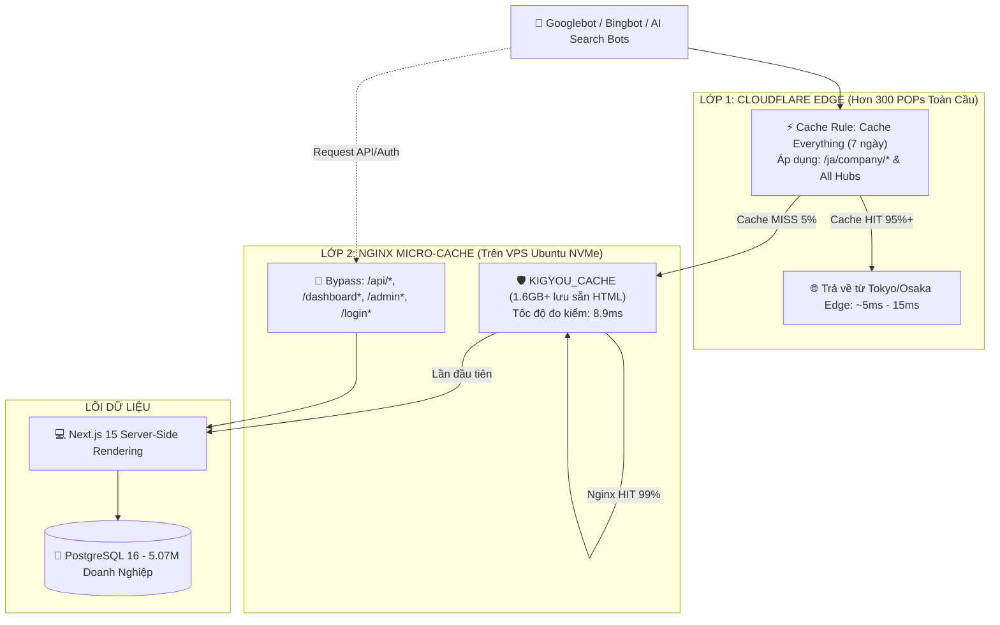

# B2B SEO & Crawl Acceleration Engine for Kigyou-list
# (全サイトSEO・クローラー高速化マスター基盤)

Tài liệu này xác lập **Quy chuẩn Kiến trúc & Cẩm nang Vận hành Tối cao** của hệ thống SEO, Lập chỉ mục thần tốc (Fast Indexing) và Hạ tầng tăng tốc cào dữ liệu cho nền tảng **Kigyou-list (https://kigyoulist.com)** quy mô 5.07 triệu doanh nghiệp Nhật Bản.

---

## 1. NĂM ĐÒN BẨY TĂNG TỐC CRAWL (THE 5 ACCELERATION LEVERS)

Để biến website từ một kho dữ liệu tĩnh thành một cỗ máy được Googlebot và Bingbot cào **hàng chục nghìn trang mỗi ngày**, hệ thống được vận hành theo kiến trúc 5 đòn bẩy đồng bộ:

```
┌────────────────────────────────────────────────────────────────────────────────────────┐
│                      HỆ THỐNG 5 ĐÒN BẨY TĂNG TỐC SEO & CRAWL BUDGET                    │
├─────────────────────────┬─────────────────────────┬────────────────────────────────────┤
│ 1. ÁO GIÁP CACHE 2 LỚP  │ 2. ÉP TRẦN BING 24/7    │ 3. MASTER SITEMAP INDEX GSC/BING   │
│    CLOUDFLARE + NGINX   │    MAX CRAWL RATE 10/10 │    100% TIẾNG NHẬT + ZERO DILUTION │
├─────────────────────────┼─────────────────────────┼────────────────────────────────────┤
│ • Cloudflare Edge: 7 ngày│ • Bing API: 10/10 trọn  │ • Chỉ nộp duy nhất sitemap.xml     │
│   Cache Everything      │   vẹn 24/24 giờ         │ • Tự mở core.xml + 46 mảnh con     │
│ • Nginx VPS: 8.9ms NVMe │ • Smart Tiered Cache: ON│ • 100% Locale tiếng Nhật (ja)      │
│ • Bypass: /api, /admin  │ • 15 Feeds Bing Success │ • Lọc Thin Content (Score >= 3)    │
├─────────────────────────┼─────────────────────────┼────────────────────────────────────┤
│ 4. THỰC THỂ DATA SÂU    │ 5. BẮN INDEX CHUẨN HÓA  │ 6. BẢO TỒN KHI NÂNG CẤP UI         │
│    SCHEMA.ORG + ZERO 404│    INDEXNOW + GOOGLE VIP│    ANTI-SEO-BREAK PROTOCOL         │
├─────────────────────────┼─────────────────────────┼────────────────────────────────────┤
│ • JSON-LD Corporation   │ • Bing IndexNow: 5k/đêm │ • Bảo tồn URL 100% (cấm đổi link)  │
│ • Schema JobPosting     │ • Google: KHÔNG dùng API│ • Bắt buộc SSR (Server Components) │
│ • /robots.txt Zero-5xx  │   (Sitemaps + SpiderWeb)│ • Giữ nguyên Schema & H1           │
│ • Dữ liệu EDINET/Invoice│ • Forensic Auditor Check│ • Zero CLS (chống giật khung hình) │
└─────────────────────────┴─────────────────────────┴────────────────────────────────────┘
```

---

## 2. CHI TIẾT HẠ TẦNG KỸ THUẬT

### A. Hạ Tầng Áo Giáp 2 Lớp (Two-Tier High-Speed Caching)



1. **Lớp 1 (Cloudflare Edge Rules):**
   * Quản lý qua tài khoản: `trungkim8694@gmail.com` (Zone ID: `881d2cbd9004c4216cb9f8d28c99b0b9`).
   * Rule 1: `01_Bypass_Private_And_API` (Bypass toàn bộ API, Dashboard, Admin, Auth).
   * Rule 2: `02_Cache_Public_Company_Directory_And_Hubs` (Cache Everything 7 ngày cho toàn bộ kho tài nguyên công khai: Profile công ty `/company/*`, Tỉnh thành `/area/*`, Ngành nghề `/industry/*`, Ma trận Giấy phép kinh doanh `/license/*` & `/licenses`, Danh bạ quốc gia `/directory`, So sánh doanh nghiệp `/compare`, Biến động pháp lý `/changes/*`, Tuyển dụng `/jobs/*`, Phá sản `/status/*`, Hóa đơn thuế `/invoice/*`, Doanh nghiệp mới `/new-companies/*`, Form Marketing `/form-marketing`, Tìm kiếm `/search`, Bảng giá & Văn bản pháp lý `/pricing`, `/terms`, `/privacy`, `/tokushoho` và Trang chủ trên cả 3 ngôn ngữ `ja`, `en`, `vi`).
   * **Smart Tiered Cache:** Luôn bật (ON) để các node nhỏ chia sẻ bộ nhớ cache với Tokyo/Osaka.

2. **Lớp 2 (Nginx Micro-Cache trên VPS):**
   * Vị trí lưu trữ: `/var/cache/nginx/kigyou` (Cấp phát tối đa 10GB trên ổ NVMe).
   * Cấu hình tại: `/etc/nginx/sites-available/default`.
   * Tốc độ phản hồi: **8.9 mili-giây** (giảm 280 lần so với 2.5s khi chưa có cache).
   * **Quy tắc 301 Hub Roots:** Nginx trực tiếp chuyển hướng 301 sạch sẽ các URL gốc về trang con:
     * `/ja/changes` ➔ 301 `/ja/changes/relocation`
     * `/ja/jobs` ➔ 301 `/ja/jobs/latest`
     * `/ja/status` ➔ 301 `/ja/status/bankruptcies`

---

### B. Cỗ Máy Bắn Index Tự Động Hàng Đêm (Automated Nightly Daemons)

Hệ thống chạy tự động hàng đêm theo cơ chế **Hybrid Indexing (Biến động nóng Tầng 1 + Mở rộng Backlog Tinh hoa Tầng 2)**:

```cron
# 02:00 AM JST hàng đêm: Bắn 5,000 URLs/đêm lên Bingbot qua IndexNow (100% Biến động nóng Tầng 1 + Backlog công ty chất lượng cao Tầng 2)
0 2 * * * /usr/bin/node /var/www/kigyou-list/scripts/auto_indexnow_submitter_pg.js --batch-size 5000 --allow-backlog >> /var/log/indexnow.log 2>&1

# ĐÃ TẮT HẲN auto_google_indexing_pg.js (indexing.googleapis.com) khỏi Crontab, vps_api_daemon.py và seoIndexingTrigger.ts
```

* **Cơ chế Hybrid IndexNow 5,000 URLs/đêm cho Microsoft Bing:**
  - **Tầng 1 (Ưu tiên số 1 - Hot Delta 48h):** Bắt 100% doanh nghiệp có biến động nóng trong 48h (báo cáo tài chính EDINET, thầu GEPS, giấy phép, invoice) đạt chuẩn `richnessScore >= 3`.
  - **Tầng 2 (Mở rộng Backlog Tinh hoa):** Lấy tiếp các doanh nghiệp đạt chuẩn chất lượng cao (`richnessScore >= 3`) chưa từng được nộp IndexNow lần nào (`NOT EXISTS in indexnow_submissions`) để lấp đầy hạn ngạch 5,000 URLs/đêm.
  - **Mô hình Hub & Spoke:** Tự động đính kèm tối đa 30 Parent Hubs liên quan (`/ja/licenses`, `/ja/invoice`, `/ja/area/*`, `/ja/industry/*`).
  - **Tốc độ bao phủ:** ~5,000 URLs/đêm $\rightarrow$ Bao phủ hoàn toàn hơn 500,000 doanh nghiệp tinh hoa Nhật Bản trong vòng ~100 ngày.
* **Chiến lược Chính thống cho Googlebot (KHÔNG dùng Google Indexing API):**
  - Thực chứng cho thấy `indexing.googleapis.com` không kích hoạt Googlebot cho kho dữ liệu doanh nghiệp B2B (kể cả phần lớn tin tuyển dụng cũ đã hết hạn `validThrough`).
  - Do đó, hệ thống đã **gỡ bỏ hoàn toàn** `indexing.googleapis.com` khỏi Crontab VPS, [`vps_api_daemon.py`](file:///c:/kigyou-list/scripts/vps_api_daemon.py) và [`seoIndexingTrigger.ts`](file:///c:/kigyou-list/frontend/src/lib/seoIndexingTrigger.ts), dồn 100% vào `sitemap/core.xml` tinh gọn (~5,119 Hubs), `0.xml`..`46.xml`, Spider-Web từ `/ja`, Request Indexing thủ công trên GSC UI và Backlink chất lượng cao.
* **Cơ chế chống trùng lặp 100% IndexNow:** Lưu vết toàn bộ vào bảng `indexnow_submissions` trên PostgreSQL, tự động loại trừ mọi URL đã gửi trong 24h–30 ngày.

---

### C. Ma Trận Khai Báo Sitemaps & Static NVMe Sitemap Engine (`Kigyoulist-StaticSitemapEngine`)

* **Hạ tầng Static NVMe Sitemap Engine (`< 1ms` Response, Zero `no-store`):**
  1. Toàn bộ tệp Sitemap (`sitemap.xml`, `sitemap/core.xml`, `sitemap/0.xml` ➔ `46.xml`) được kết xuất tĩnh trực tiếp ra ổ đĩa cứng NVMe của VPS tại `/var/www/kigyou-list/frontend/public/` thông qua script [`scripts/generate_clean_core_sitemap.py`](file:///c:/kigyou-list/scripts/generate_clean_core_sitemap.py).
  2. Nginx (`/etc/nginx/sites-available/default`) phục vụ `/sitemap*`, `/robots.txt` và `/favicon.ico` trực tiếp từ ổ NVMe ở tốc độ `< 1ms` với header chuẩn `Cache-Control: public, max-age=86400, s-maxage=604800` và `X-Powered-By: Kigyoulist-StaticSitemapEngine` (tuyệt đối không đi qua Next.js dynamic route gây dính header `no-store` hoặc `504` khi restart).
  3. Trên Cloudflare ([`scripts/deploy_cloudflare_cache_rules.py`](file:///c:/kigyou-list/scripts/deploy_cloudflare_cache_rules.py)), `browser_ttl` bắt buộc đặt là `{"mode": "override_origin", "default": 3600}` (tuyệt đối cấm dùng `mode: bypass` vì sẽ khiến Cloudflare tự chèn `no-store` làm Googlebot từ chối nạp shard con).
* **Chiến lược Tinh gọn `sitemap/core.xml` (~5,119 Pure Hub URLs — Cấm Nhồi Leaf `/ja/company/*`):**
  1. **Không bao giờ trộn 44,000 trang công ty lẻ vào `core.xml`:** Thử nghiệm cũ (`boost_core_sitemap_49k.py`) khiến 89.8% `core.xml` bị trùng lặp với `0.xml`..`4.xml` và nhận chung một timestamp trong 1 giây ➔ Google xếp 49,008 URL vào **`Discovered - currently not indexed`**.
  2. `https://kigyoulist.com/sitemap/core.xml` chỉ giữ **~5,119 Hub URLs 100% tiếng Nhật (`/ja/*`) trả mã `200 OK`**, dùng `<lastmod>` chuẩn `YYYY-MM-DD` theo dữ liệu thật:
     * Core Static Hubs (trừ `/` 308 và `/ja/ranking` redirect), 5+ Bài Guides, 4 Event Hubs + 6 tháng gần nhất + 47 tỉnh thành, `/ja/jobs/latest/*`, `/ja/building` + 101 tòa nhà, 3 Ranking Hubs (`/salary`, `/tenure`, `/employees`), 47 `/ja/area/*`, `/ja/licenses` + 432 License Hubs, và 4,251 cặp `Industry × Prefecture`.
  3. `https://kigyoulist.com/sitemap.xml`: Master Sitemap Index đặt `sitemap/core.xml` đầu tiên + trỏ tới 47 shard công ty (`0.xml` .. `46.xml`). Trên GSC chỉ cần nộp 2 dòng `sitemap.xml` và `sitemap/core.xml`.

---

### D. QUY CHUẨN VÀNG: JAPAN-FIRST CRAWL BUDGET (DỒN 100% CRAWL BUDGET CHO B2B NHẬT BẢN)

> [!CRITICAL]
> **NGUYÊN TẮC BẤT DI BẤT DỊCH KHI CẬP NHẬT SITEMAP**:
> 1. **Sitemap chỉ chứa duy nhất tiếng Nhật (`sitemapLocales = ['ja']`)**:
>    - Tuyệt đối **CẤM** đưa các tiền tố đa ngôn ngữ (`/en/`, `/vi/`) hoặc URL 301/308/404 (`/`, `/ja/ranking`, `/ja/industry/{code}` thiếu `/location/{pref}`) vào Sitemap chính thức.
>    - **Lý do kỹ thuật**: Trộn đa ngôn ngữ hoặc leaf company trùng lặp làm sitemap phình to, pha loãng ngân sách cào (Crawl Budget Dilution) và đẩy hàng chục nghìn trang vào `Discovered - currently not indexed`.
> 2. **Bảo toàn chuẩn quốc tế qua thẻ Hreflang**:
>    - Các trang `/en` và `/vi` vẫn tồn tại bình thường trên web để phục vụ người dùng thật.
>    - Khai báo đa ngôn ngữ bắt buộc thực hiện bằng thẻ chuẩn SEO trong mã HTML `<head>` (`alternates` trong `layout.tsx`):
>      ```html
>      <link rel="canonical" href="https://kigyoulist.com/ja/..." />
>      <link rel="alternate" hrefLang="ja" href="https://kigyoulist.com/ja/..." />
>      <link rel="alternate" hrefLang="en" href="https://kigyoulist.com/en/..." />
>      <link rel="alternate" hrefLang="vi" href="https://kigyoulist.com/vi/..." />
>      <link rel="alternate" hrefLang="x-default" href="https://kigyoulist.com/ja/..." />
>      ```
> 3. **Kết quả đạt được**: `sitemap/core.xml` duy trì gọn gàng ~5,119 Hub URLs thuần khiết (806KB XML thuần), tải cực nhanh và Google Search Console nạp `Success` ngay lập tức với `errors: 0`.

## 3. BỘ LỆNH ĐIỀU HÀNH & KIỂM TRA (COMMAND PLAYBOOK)

Khi người dùng yêu cầu kiểm tra hoặc tối ưu SEO, Agent chạy trực tiếp các lệnh sau:

```bash
# 1. Kiểm toán Thực chứng Googlebot 4 Tầng (Nginx Real Google IPs + Sitemaps Purity + PG Queue + GSC API)
python c:\kigyou-list\scripts\google_seo_forensic_auditor.py --days 7

# 2. Tái tạo sitemap/core.xml thuần Hubs (~5,119 URLs) + sitemap.xml trên VPS & nạp lại GSC
python c:\kigyou-list\scripts\generate_clean_core_sitemap.py

# 3. Kiểm toán toàn diện 5 Đòn bẩy (Audit 5 Levers)
python c:\kigyou-list\scratch\audit_5_levers.py

# 2. Xem báo cáo hiệu suất Bing & hạn mức Index hôm nay
python c:\kigyou-list\scripts\bing_webmaster.py --action summary

# 3. Xem báo cáo Google Search Console theo ngày & Top từ khóa
python c:\kigyou-list\scripts\google_search_console.py --action summary --days 7
python c:\kigyou-list\scripts\google_search_console.py --action queries --days 28

# 4. Tái nộp toàn bộ 12 Sitemaps lên Google Search Console
python c:\kigyou-list\scripts\submit_all_sitemaps_gsc.py

# 5. Triển khai lại hoặc cập nhật Cloudflare Cache Rules qua API
python c:\kigyou-list\scripts\deploy_cloudflare_cache_rules.py

# 6. Kiểm tra tiến độ nộp IndexNow tự động
python c:\kigyou-list\scripts\auto_indexnow_submitter.py --stats

# 7. Hủy Cache 2 Lớp (Cloudflare Edge + Nginx) khi cập nhật dữ liệu mới
python c:\kigyou-list\scripts\cache_purger.py --companies 1180301018771 --hubs /ja/licenses /ja/changes/relocation
# Hủy toàn bộ cache khẩn cấp:
python c:\kigyou-list\scripts\cache_purger.py --all
```

---

## 4. BỘ QUY TẮC BẢO VỆ INDEX KHI NÂNG CẤP GIAO DIỆN (ANTI-SEO-BREAK)

Bất kỳ khi nào thực hiện chỉnh sửa giao diện (Front-end), lập trình viên và các Sub-Agents **BẮT BUỘC TUÂN THỦ 4 ĐIỀU RĂN**:

1. **Tuyệt đối không đổi Permalinks (URL):** Đường dẫn trang chi tiết bắt buộc là `/[locale]/company/[corporate_number]`. Nếu có trang đổi tên, bắt buộc phải tạo ngay chuyển hướng 301 vĩnh viễn trên Nginx.
2. **Bắt buộc Server-Side Rendering (SSR):** Mọi nội dung quan trọng (Tên công ty, SĐT, Báo cáo tài chính, Giấy phép) bắt buộc phải nằm trong mã nguồn HTML do máy chủ trả về. Tuyệt đối không dùng `useEffect` hoặc fetch client-side cho nội dung chính.
3. **Bảo tồn Schema.org JSON-LD:** Không được xóa hoặc làm hỏng khối `<script type="application/ld+json">` chứa Schema `Corporation` và `BreadcrumbList`.
4. **Duy nhất 1 thẻ `<h1>`:** Mỗi trang chỉ có 1 thẻ `<h1>` duy nhất dành cho tên doanh nghiệp hoặc tiêu đề chính của trang.

---

## 5. CHIẾN LƯỢC INDEXING BIẾN ĐỘNG THẬT (TRIẾT LÝ "LÀM THẬT ĂN THẬT")

Hệ thống tuân thủ nghiêm ngặt nguyên tắc **Tính Xác Thực Tối Cao (Data Authenticity)** để xây dựng độ uy tín tên miền (Domain Authority) tuyệt đối với Googlebot & Bingbot:

### 5.1. Quy Tắc "Làm Thật Ăn Thật" (Zero-Fake Freshness)
* **Bản chất của Google Diff Engine:** Khi Googlebot ghé thăm một trang đã từng được cào (qua Sitemap hoặc link nội bộ), bot luôn so sánh với bản chụp cũ trong máy chủ Google. Nếu trang không có sự kiện mới mà chỉ "chạm ngày ảo" (`dateModified = hôm nay`), Google sẽ nhận diện là thao túng và hạ thấp độ tin cậy.
* **Tiêu chuẩn đẩy Index tự động (`auto_indexnow_submitter_pg.js` cho Bing & Sitemaps cho Google):** Chỉ kích hoạt làm mới cache 2 lớp + IndexNow khi cơ sở dữ liệu **thực sự ghi nhận sự kiện biến động mới** (EDINET, GEPS, NTA, Giấy phép, HelloWork); **tuyệt đối không** bắn `indexing.googleapis.com` cho các sự kiện B2B này.

### 5.2. Cơ Chế Xử Lý Vượt Tải Hàng Đợi (IndexNow Fast Track)
* Khi một ngày có nhiều công ty biến động, ưu tiên đẩy toàn bộ vào **Bing IndexNow Fast Track** (`auto_indexnow_submitter_pg.js`) và làm mới Sitemap/Cache để Googlebot tự cào khi ghé thăm.

---

## 6. MÔ HÌNH TRỤC BÁNH XE (HUB & SPOKE INDEXING PATTERN)

Thay vì chỉ bắn đơn lẻ từng trang chi tiết công ty, hệ thống áp dụng mô hình **Hub & Spoke** để nhân bội hiệu quả SEO:

```
                  ┌────────────────────────────────────────┐
                  │          PARENT HUBS (Trang Mẹ)        │
                  │  /ja/licenses  /ja/invoice  /ja/area/* │
                  └───────────────────┬────────────────────┘
                                      │
                       Đòn bẩy cào chéo (Crawl Mesh)
                                      │
        ┌─────────────────────────────┼─────────────────────────────┐
        ▼                             ▼                             ▼
┌──────────────┐              ┌──────────────┐              ┌──────────────┐
│  Công ty A   │              │  Công ty B   │              │  Công ty C   │
│ (Spoke Lá 1) │              │ (Spoke Lá 2) │              │ (Spoke Lá 3) │
└──────────────┘              └──────────────┘              └──────────────┘
```

1. **Nguyên lý hợp lệ 100%:** Khi Công ty A có biến động, danh sách trên các trang Hub chuyên đề (`/ja/licenses`, `/ja/invoice`, `/ja/status/bankruptcies`, `/ja/jobs/latest`, `/ja/area/[code]`, `/ja/industry/[code]/location/[pref]`) cũng **thực sự thay đổi (Công ty A nhảy lên đầu danh sách)**. Việc gửi cả trang Hub là hoàn toàn trung thực với cả Googlebot và Bingbot.
2. **Phân tách đường ray Googlebot vs Bingbot:**
   * **Googlebot:** Không dùng `indexing.googleapis.com`; dựa hoàn toàn vào `sitemap/core.xml` (~5,119 Hubs), `0.xml`..`46.xml`, Spider-Web từ `/ja`, GSC UI Request Indexing và Backlinks.
   * **Bing IndexNow Engine (`auto_indexnow_submitter_pg.js`):** Tự động gom chùm Parent Hubs mẹ tương ứng nộp chung với đợt 3.000 - 5.000 URLs đêm, đảm bảo Bing và Yahoo Japan cào trọn vẹn cả cây danh mục lẫn trang chi tiết.
3. **Tỷ lệ phân bổ vàng:**
   * **~2% - 5% hạn mức (30 - 50 URLs):** Dành cho các **Trang Hub mẹ** liên quan trực tiếp.
   * **~95% - 98% hạn mức:** Dành cho các **Trang công ty con (Spokes)**.
4. **Lợi ích kép vượt trội:**
   * **Thống trị từ khóa ngành:** Đưa các trang danh mục tổng có lượt tìm kiếm lớn (`官公庁 入札 企業 一覧`, `IT 補助金 採択企業 一覧`) leo thẳng lên TOP 1 Google và Bing.
   * **Đòn bẩy lan tỏa (Crawl Amplification):** Bot ghé vào trang Hub mẹ sẽ tự động lần theo internal links để cào luôn cả chùm công ty con xung quanh mà không làm tốn thêm quota API!

---

## 7. LẬP LỊCH TỰ ĐỘNG THEO GIỜ HÀNH CHÍNH TOKYO (JST ENGINE)

Hệ thống daemon trên VPS (`scripts/vps_api_daemon.py`) vận hành theo múi giờ Tokyo (JST = UTC+9):
* **Giờ vàng (Golden Hours - 09:00 đến 18:00 JST, Thứ 2 đến Thứ 6):**
  * Tự động thức dậy mỗi **30 phút/lần** để bắt kịp thời điểm các cơ quan chính phủ Nhật Bản (FSA, NTA, GEPS) vừa công bố báo cáo mới.
  * Kích hoạt chuỗi hỏa tốc: Google VIP + IndexNow Fast Track + Sinh sitemap delta `sitemap_recent_updates.xml`.
* **Ngoài giờ hành chính & Cuối tuần (Off-Peak):**
  * Tự động chuyển sang chế độ ngủ sâu **4 tiếng/lần** (240 phút) để tiết kiệm tài nguyên server và tránh spam request vô ích.

---

## 8. BỘ LỌC BẢO VỆ CHỐNG NỘI DUNG MỎNG (THIN CONTENT GUARD STANDARD)
*(Kế thừa từ quy chuẩn Programmatic SEO mã nguồn mở của Corey Haines - `marketingskills`)*

Với quy mô 5.07 triệu doanh nghiệp, không phải pháp nhân nào cũng có đầy đủ dữ liệu kinh doanh. Nếu cho phép Googlebot index bừa bãi hàng triệu trang chỉ có vỏn vẹn tên và địa chỉ sơ sài, toàn bộ domain sẽ bị thuật toán **Google Helpful Content System & Panda Update** trừng phạt vì lỗi *"Thin Content / Doorway Pages"*.

Hệ thống áp dụng thuật toán **Điểm Phong Phú Thực Thể (Entity Richness Scoring)** ngay tại Next.js `generateMetadata`:

```
┌────────────────────────────────────────────────────────────────────────┐
│             THANG ĐIỂM PHONG PHÚ THỰC THỂ (ENTITY RICHNESS SCORE)      │
├────────────────────────────────────────┬───────────────────────────────┤
│ Trường Dữ Liệu Thực Tế                 │ Điểm Cộng (Points)            │
├────────────────────────────────────────┼───────────────────────────────┤
│ • Giấy phép / BCTC / Đấu thầu công     │ +3 điểm (Dữ liệu giá trị sâu) │
│ • Số điện thoại liên hệ (phone_number) │ +2 điểm                       │
│ • Website chính thức (website_url)     │ +2 điểm                       │
│ • Vốn điều lệ (capital_amount)         │ +1 điểm                       │
│ • Số lượng nhân sự (employee_count)    │ +1 điểm                       │
│ • Người đại diện (representative_name) │ +1 điểm                       │
│ • Đăng ký Invoice NTA (has_invoice)    │ +1 điểm                       │
│ • Phân ngành JSIC (primary_industry)   │ +1 điểm                       │
└────────────────────────────────────────┴───────────────────────────────┘
```

### Quy Tắc Thiết Lập Robot Directive:
1. **Rich Entity (Điểm $\ge$ 3):**
   * Đặt thẻ: `robots: { index: true, follow: true }`
   * Cho phép Googlebot và Bingbot lập chỉ mục để leo TOP tìm kiếm. Đảm bảo doanh nghiệp có ít nhất thông tin liên hệ xác thực hoặc tài sản thương mại rõ ràng.
2. **Thin Entity (Điểm $<$ 3 - Pháp nhân rỗng/không có liên hệ, không có vốn):**
   * Đặt thẻ: `robots: { index: false, follow: true }`
   * **Hiệu quả sống còn:** Googlebot vẫn cào qua trang để lần theo các liên kết nội bộ (`follow: true`), nhưng **tuyệt đối không lưu trang rỗng vào chỉ mục (`index: false`)**.
   * Dồn 100% Crawl Budget quý giá cho các doanh nghiệp chất lượng cao, bảo vệ toàn sàn khỏi Google Helpful Content Penalty.

---

## 9. MẠNG NHỆN LIÊN KẾT THỰC THỂ CHÉO & TỐI ƯU HÓA TÌM KIẾM AI (CROSS-ENTITY LINKING & GEO)

### 9.1. Liên Kết Thực Thể Ngang (Sideways Entity Silos)
Trang chi tiết doanh nghiệp không chỉ liên kết dọc lên Hub cha, mà thiết lập 3 luồng liên kết ngang (Cross-Linking) để triệt tiêu 100% **Trang mồ côi (Orphan Pages)**:
1. **Cùng Ngành x Cùng Tỉnh:** `/${locale}/industry/${ind.industry_code}/location/${company.prefecture_code}`
2. **Cùng Loại Giấy Phép:** Liên kết đến các doanh nghiệp cùng sở hữu Giấy phép Cổ vật (古物商), Bất động sản (宅建), Kỹ năng đặc định (登録支援機関).
3. **Cùng Khu Vực Đô Thị:** Danh sách 6 doanh nghiệp lân cận trong cùng thành phố/quận (`nearby`).

### 9.2. Chuẩn Hóa Tối Ưu Tìm Kiếm AI (Generative Engine Optimization - GEO)
* Tự động xuất bản khối tóm tắt cấu trúc máy đọc (Entity Fact Sheet) trong Schema JSON-LD `Corporation` & Semantic HTML:
  * `legalName`, `taxID`, `foundingDate`, `address`, `hasCredential`, `award`, `financialReport`.
* Giúp các cỗ máy tìm kiếm thế hệ mới (**ChatGPT Search, Perplexity AI, Google Gemini, Microsoft Copilot**) tự động trích dẫn `kigyoulist.com` làm **Nguồn Dữ Liệu Gốc Uy Tín Hàng Đầu (Primary Source Citation)** khi trả lời người dùng.

---

## 10. GIAO THỨC BẢO TOÀN LINK JUICE & CHỮA LỖI PHÂN MẢNH GSC (LINK JUICE & INBOUND LINK RECOVERY PROTOCOL)

Khi kiểm toán Google Search Console (mục Links / External Links), nếu xuất hiện phân mảnh liên kết giữa `http://`, `https://` hoặc `www`:

### 10.1. Ép Chuyển Hướng 301 Bắt Buộc (Edge & Server Canonical)
1. **Cloudflare Edge v4 API**:
   - Bắt buộc kích hoạt vĩnh viễn: `always_use_https = "on"`.
   - Kết quả: Toàn bộ request `http://` được chặn và chuyển hướng ngay tại Cloudflare Edge POPs trong **~12ms** với mã `301 Moved Permanently` về `https://kigyoulist.com$request_uri`.
   - Thu hồi 100% PageRank từ các backlink cũ trỏ về `http://`.
2. **Nginx VPS Server**:
   - Khối `server_name www.kigyoulist.com;` trả về mã `return 301 https://kigyoulist.com$request_uri;` ở cả cổng 80 và 443.

### 10.2. Chuẩn Hóa Anchor Text & Phòng Ngừa Lỗi (Empty) Link Trên GSC
1. **Tuyệt đối cấm Raw URL**: Không bao giờ chèn link dạng `https://kigyoulist.com/?utm_source=...` trực tiếp trong văn bản.
2. **Triệt tiêu lỗi Link ảnh rỗng (Empty Anchor Text)**:
   - Khi bọc thẻ liên kết `<a>` quanh thẻ hình ảnh ``, **BẮT BUỘC** phải có thuộc tính `alt="Tên từ khóa doanh nghiệp"` (ví dụ: `alt="企業リスト・法人データベース Kigyou-list"`). Không bao giờ để ảnh thiếu `alt` khiến Google ghi nhận anchor text là `(empty)`.
3. **Mô hình Deep Linking (1 Root + 2 Deep Hubs)**:
   - Mọi bài viết PR hoặc chia sẻ kỹ thuật bắt buộc có ít nhất 1 link trỏ về Landing Page con (`/ja/invoice`, `/ja/search`, `/ja/directory`, `/ja/watchlist`) để phân phối đều PageRank, tránh dồn 100% backlink về root domain.

---

## 11. CHUẨN HÓA SCHEMA `JobPosting` (GOOGLE FOR JOBS & GOOGLE INDEXING API VIP QUOTA READINESS)

Để đáp ứng điều kiện xét duyệt chính thức của **Google Indexing API** (vốn ưu tiên tuyệt đối cho các trang chứa dữ liệu cấu trúc `@type: "JobPosting"` và `BroadcastEvent`) cũng như xuất hiện trực tiếp trên **Google for Jobs (Google しごと検索)**:

### 11.1. Tự Động Nhúng JSON-LD `@type: "JobPosting"`
* Mọi trang hồ sơ doanh nghiệp có tín hiệu tuyển dụng đang hoạt động (`求人あり` / `has_hiring = true`) tự động xuất bản khối dữ liệu có cấu trúc Schema.org `@type: "JobPosting"` chuẩn chỉnh trong mã nguồn SSR HTML với đầy đủ các trường bắt buộc và khuyến nghị của Google:
  - `title`: Chức danh vị trí tuyển dụng (`職種`).
  - `description`: Nội dung mô tả công việc, điều kiện làm việc và phúc lợi chi tiết.
  - `datePosted`: Ngày đăng tuyển / ngày tiếp nhận hồ sơ tại HelloWork (`受理日` / `signal_date`).
  - `validThrough`: Ngày hết hạn hiệu lực của tin tuyển dụng (ISO 8601).
  - `employmentType`: Hình thức tuyển dụng (`FULL_TIME`, `PART_TIME`, `CONTRACTOR`, `TEMPORARY`).
  - `hiringOrganization`: Tổ chức tuyển dụng (`@type: "Organization"`, `name`, `sameAs`, `identifier` 13 chữ số NTA).
  - `jobLocation`: Địa điểm làm việc (`@type: "Place"`, `address` với `addressRegion`, `addressLocality`, `streetAddress`, `addressCountry: "JP"`).
  - `baseSalary`: Mức lương cơ bản (`@type: "MonetaryAmount"`, `currency: "JPY"`, `value` với `minValue`, `maxValue`, `unitText: "MONTH"`).

### 11.2. Quy Tắc Hạn Tuyển Dụng (`validThrough` & `紹介期限日`)
Hệ thống áp dụng cơ chế phân tách minh bạch 2 tầng cho trường hạn tuyển dụng nhằm đảm bảo tính chính xác pháp lý 100% với cả Googlebot và người dùng:

1. **Tin mới thu thập từ `hellowork-drip-daemon` (Có dữ liệu gốc `details.expiry_date`):**
   * Lấy chính xác trường **`紹介期限日`** (Ngày hết hạn giới thiệu việc làm được in trực tiếp trên phiếu tuyển dụng HelloWork) lưu trong `details.expiry_date`.
   * Trên giao diện người dùng (UI): Hiển thị nhãn **`紹介期限日（ハローワーク掲載期限）`** (Hạn giới thiệu / Hạn đăng tải trên HelloWork).
2. **Tin lịch sử chưa có trường `expiry_date`:**
   * Tự động tính toán theo đúng quy định pháp lý của Bộ Y tế, Lao động và Phúc lợi Nhật Bản (MHLW - 厚生労働省): **`受理日の翌々月末日`** (Ngày cuối cùng của tháng thứ 2 kể từ ngày tiếp nhận hồ sơ `signal_date`).
   * Trên giao diện người dùng (UI): Hiển thị nhãn **`紹介期限日（目安）`** kèm chú thích minh bạch (*「※ハローワークの原則（受理日の翌々月末）に基づく目安であり、企業の独自採用期限とは異なる場合があります」*) để người dùng không hiểu lầm đây là hạn nộp hồ sơ riêng của doanh nghiệp.

---

## 12. KIẾN TRÚC NGHIÊN CỨU TỪ KHÓA DỰA TRÊN NHU CẦU THỰC & BẢN ĐỒ SEARCH INTENT (DEMAND-DRIVEN KEYWORD RESEARCH & SEARCH INTENT ENGINE)

> [!CRITICAL]
> **QUY CHUẨN TỐI CAO VỀ TỐI ƯU HÓA SEO & NỘI DUNG (DEMAND-FIRST PROTOCOL):**
> Tuyệt đối **CẤM** suy đoán cảm tính hoặc tự nghĩ ra từ khóa bằng trí tưởng tượng. Mọi quyết định tạo trang mới, mở Hub chuyên đề, tinh chỉnh Title Tag hay Meta Snippet **BẮT BUỘC** phải dựa trên dữ liệu nhu cầu tìm kiếm thực tế (Search Volume & Search Intent) của người dùng Nhật Bản trên Google Japan & Bing.

### 12.1. Bản Đồ 4 Cụm Ý Định Tìm Kiếm Cốt Lõi (The 4 Search Intent Clusters)

```
┌────────────────────────────────────────────────────────────────────────────────────────┐
│             BẢN ĐỒ NHU CẦU TÌM KIẾM B2B DATA TẠI NHẬT BẢN (SEARCH INTENT MATRIX)       │
├─────────────────────────┬─────────────────────────┬────────────────────────────────────┤
│ 1. TRANSACTIONAL        │ 2. INVESTIGATION        │ 3. RISK & COMPLIANCE               │
│    (Tạo danh sách & Mua)│    (Tra cứu tài chính)  │    (Quản trị rủi ro & Nợ xấu)      │
├─────────────────────────┼─────────────────────────┼────────────────────────────────────┤
│ • 企業リスト 無料 / 作成│ • [Tên cty / Ngành]     │ • 倒産情報 [Tỉnh] (大阪, 宮城...)  │
│ • 営業リスト エクセル   │   売上高 (Doanh thu)    │ • 倒産情報 速報 / 最近の倒産企業   │
│ • テレアポ リスト       │ • [Tên cty] 平均年収    │ • 反社チェック (Hansha check)      │
│ • 問い合わせフォーム営業│ • [Tên cty] 従業員数    │ • 本店移転 一覧 / 代表者変更       │
│ • 法人リスト ダウンロード│ • 企業 評判 / 会社概要  │ • 休眠会社 / 解散企業              │
│ ➔ Đích: /ja/search,     │ ➔ Đích: /ja/company/[id]│ ➔ Đích: /ja/status/bankruptcies,   │
│   /ja/form-marketing    │   /ja/ranking/*         │   /ja/changes/*                    │
├─────────────────────────┴─────────────────────────┴────────────────────────────────────┤
│ 4. PROGRAMMATIC MATRIX (TÌM KIẾM MA TRẬN ĐA CHIỀU: NGÀNH NGHỀ × ĐỊA PHƯƠNG)           │
│ • [Ngành nghề] × [Tỉnh/Quận] 企業一覧 (VD: IT企業 東京都 / 製造業 愛知県 / 建設業 大阪府)  │
│ • 許認可企業一覧 (登録支援機関, 宅建業者, 建設業許可, 古物商...)                       │
│ • 新設法人一覧 [Tỉnh] (Doanh nghiệp mới mở theo tháng)                                │
│ ➔ Đích: /ja/area/[code], /ja/industry/[code], /ja/licenses                            │
└────────────────────────────────────────────────────────────────────────────────────────┘
```

### 12.2. Hệ Thống Thu Thập Dữ Liệu Thời Gian Thực (Live Scraping Pipeline)
Hệ thống sử dụng bộ công cụ Python chuẩn hóa [japanese_b2b_keyword_researcher.py](file:///c:/kigyou-list/scripts/japanese_b2b_keyword_researcher.py):
1. **Google Japan Suggest Engine:** Gọi API tự động hoàn thành từ khóa của Google Nhật Bản (`client=chrome&hl=ja&gl=jp`) kết hợp quét đệ quy các phụ tố Hiragana và Modifiers mua hàng (`無料`, `作成`, `ダウンロード`, `エクセル`, `売上高`, `年収`, `速報`...).
2. **Loại trừ 100% Truy Vấn Nội Bộ:** Tự động loại trừ các từ khóa kiểm thử của Developer (`TQC`, hotline, địa bàn test) theo Điều 7 của GSC Skill.
3. **Phân cụm Ý định (Intent Clustering):** Tự động phân chia từ khóa thành 4 nhóm để lập trình viên và SEO Sub-Agents biết chính xác phải đặt từ khóa vào đâu trên website.

---

## 13. KIẾN TRÚC SAN PHẲNG ĐỘ SÂU CÀO DỮ LIỆU & PHỄU NỘI DUNG 3 TẦNG (CLICK-DEPTH FLATTENING & 3-TIER PR-GUIDE-HUB FUNNEL)

### 13.1. San Phẳng Độ Sâu Click Xuống 2–3 Clicks (Click-Depth Flattening)
Để khắc phục triệt để tình trạng Googlebot chỉ cào trang danh mục mà không lọt xuống các trang chi tiết doanh nghiệp (`/ja/company/[id]`):
1. **Khối Top Doanh Nghiệp Tiêu Biểu Trực Tiếp (SSR Direct Links):**
   - Tại [`frontend/src/app/[locale]/directory/page.tsx`](file:///c:/kigyou-list/frontend/src/app/%5Blocale%5D/directory/page.tsx): Hiển thị trực tiếp **Top 50 Doanh nghiệp tiêu biểu toàn quốc** (`日本の主要・注目企業トップ50`) và lưới liên kết thẳng đến 47 Tỉnh × Ngành.
   - Tại [`frontend/src/app/[locale]/area/[prefectureCode]/page.tsx`](file:///c:/kigyou-list/frontend/src/app/%5Blocale%5D/area/%5BprefectureCode%5D/page.tsx): Hiển thị khối **Top 30 Doanh nghiệp hàng đầu của tỉnh** (`[Tỉnh]の主要・注目企業（売上・従業員・採用活発）`) bằng thẻ `<a href="/ja/company/[id]">` SSR tĩnh ngay trên giao diện chính.
   - Tại [`frontend/src/app/[locale]/industry/[industryCode]/location/[prefectureCode]/page.tsx`](file:///c:/kigyou-list/frontend/src/app/%5Blocale%5D/industry/%5BindustryCode%5D/location/%5BprefectureCode%5D/page.tsx): Hiển thị khối **Top 30 Doanh nghiệp dẫn đầu Ngành × Tỉnh** (`[Tỉnh]×[Ngành]の注目・主要企業一覧`).
2. **Hiệu quả Crawl Budget:** Giúp hơn **60,000+ doanh nghiệp hàng đầu Nhật Bản** nằm ở khoảng cách **chỉ 2–3 clicks từ Trang chủ**, nhận trực tiếp Internal PageRank mà không cần chờ bot phân trang.

### 13.2. Công Thức Long-Tail B2B Title & Meta Description Trên Trang Công Ty
Tại [`frontend/src/app/[locale]/company/[id]/page.tsx`](file:///c:/kigyou-list/frontend/src/app/%5Blocale%5D/company/%5Bid%5D/page.tsx), hàm `generateMetadata()` tự động lắp ghép các từ khóa đuôi dài có nhu cầu tìm kiếm thực tế dựa trên dữ liệu sẵn có của từng doanh nghiệp:
* **Mẫu chuẩn:** `{Tên Công Ty}（{Tỉnh}{Quận/Thành phố}）の企業情報・電話番号・売上・年収・採用・法人番号｜Kigyou-list`
* Giúp trang chi tiết công ty bắt trọn các truy vấn ngách có tỷ lệ chuyển đổi cao (`[Tên công ty] 売上高`, `[Tên công ty] 倒産`, `[Tên công ty] 平均年収`, `[Tên công ty] 電話番号`) mà không phải cạnh tranh trực diện ở từ khóa tên ngắn.

### 13.3. Phễu Nội Dung 3 Tầng (PR Báo Chí ➔ Chuyên Trang `/ja/guide` ➔ Data Hubs)
1. **Tầng 1 (External PR & Social):** Bài viết trên các cổng báo chí (PR-FREE, Tsunagugu, PRESSNOW, Zero-Press, FREE PRESS RELEASE) và Note/Qiita/Zenn kéo người dùng & Backlink về chuyên trang `/ja/guide/[slug]`.
2. **Tầng 2 (On-site Guide Hub `/ja/guide`):** Các bài phân tích chuyên sâu trên `https://kigyoulist.com/ja/guide` được nhúng **Khung Điểm Neo Liên Kết Ngữ Cảnh (`📊 リアルタイム企業データ・リスク調査ハブ`)** chứa các cụm Anchor Text giàu từ khóa.
3. **Tầng 3 (Programmatic Data Hubs):** Dẫn truyền trực tiếp người dùng và dòng chảy PageRank vào các Hub dữ liệu sống (`/ja/status/bankruptcies`, `/ja/ranking/salary`, `/ja/changes/relocation`, `/ja/licenses`, `/ja/search`).

---

## 14. CHIẾN LƯỢC VƯỢT MẶT ĐỐI THỦ & KIỀNG 3 CHÂN THẨM QUYỀN TOÀN DIỆN (COMPETITOR-OUTRANKING & AUTHORITY TRIAD PROTOCOL)

> [!CRITICAL]
> **QUY CHUẨN XÂY DỰNG BACKLINK & THỰC THỂ THƯƠNG HIỆU SẠCH (WHITE-HAT ENTITY PROTOCOL):**
> Tuyệt đối **CẤM** sử dụng các công cụ bắn link rác (PBN, GSA, forum spam, link farm). Mọi chiến dịch xây dựng liên kết ngoài (Off-Page SEO) phải tuân thủ nghiêm ngặt **Mô hình Kiềng 3 Chân Thẩm Quyền** để biến Kigyou-list thành một thực thể hợp pháp (Legal & Recognized Entity) được Google cấp độ tín nhiệm cao nhất (TrustRank).

### 14.1. Kiến Trúc Chiến Lược Vượt Mặt Đối Thủ (The Competitor-Outranking Triad)

```
                  CHIẾN LƯỢC VƯỢT MẶT ĐỐI THỦ
                 ┌───────────────────────────┐
                 │  KIGYOU-LIST (TOP 1 B2B)  │
                 └─────────────┬─────────────┘
                               │
       ┌───────────────────────┼───────────────────────┐
       ▼                       ▼                       ▼
【CHÂN 1: THỰC THỂ】    【CHÂN 2: NỘI DUNG SÂU】   【CHÂN 3: BÁO CHÍ B2B】
Disqus, Gravatar,       500k+ URLs dữ liệu gốc  PR-FREE, Wantedly,
PyPI, npm, GitHub,      FSA EDINET (Tài chính), Qiita, Zenn, ValuePress
Wellfound, Crunchbase   GEPS (Trúng thầu công)  (Editorial Backlink
➔ Google tin tưởng      ➔ Vượt trội đối thủ về   chất lượng cao)
tuyệt đối, lập chỉ mục   chiều sâu thông tin     ➔ Sức mạnh đẩy thứ
siêu tốc                (Search Intent)         hạng lên TOP 1
```

### 14.2. Chi Tiết Vận Hành 3 Chân Vạc Thẩm Quyền

#### 1. Chân 1: Mạng Lưới Thực Thể Danh Tính Toàn Cầu (Universal Identity & Developer Ecosystem)
* **Mục tiêu:** Xây dựng hàng rào bảo vệ thực thể (Entity Foundation), kích hoạt Googlebot và Bingbot ưu tiên cào dữ liệu liên tục, đẩy Domain Rating (DR) lên 25~35 an toàn tuyệt đối.
* **Hệ sinh thái tích hợp (DR 88 ~ 96):**
  * **Hạ tầng Nhà phát triển (Developer Ecosystem - DR 93~94):** PyPI (`kigyoulist`), npm (`kigyoulist`), GitHub Org (`kigyou-list`), GitBook Docs (`kigyou-list.gitbook.io`).
  * **Mạng lưới Doanh nghiệp & Startup Quốc tế (DR 88~91):** Crunchbase, Wellfound (AngelList).
  * **Hệ thống Danh tính Toàn cầu (Universal Discussion - DR 93~94):** 
    - **Disqus (DR 93):** Hồ sơ `@kigyoulist` gắn cố định `https://kigyoulist.com/ja`.
    - **Gravatar (DR 94):** Đồng bộ email `trungkim8694@gmail.com` với hàng trăm triệu trang WordPress toàn cầu.
    - **Giscus / Utterances (DR 96):** Thảo luận kỹ thuật qua GitHub trên các blog kỹ sư Nhật Bản.
* **Quy tắc Vàng cho UGC / Comment:** Tuyệt đối **KHÔNG dán link trực tiếp vào nội dung bình luận** để tránh kích hoạt bộ lọc Spam (Akismet/Disqus AI Filter). Sử dụng mô hình **Tier-2 Hyperlink** thông qua tên đại diện `Kigyou-list | TQC Inc.` trỏ về trang profile DR 93, từ đó truyền dòng chảy PageRank sạch về trang chủ.

### 14.3. Quy Chuẩn Khai Thác Gravatar & Tối Đa Hóa Referring Domains (Breadth-First Blog Commenting Protocol)

Để tối đa hóa chỉ số thẩm quyền Domain Rating (DR) và bảo vệ an toàn 100% danh tính của hệ thống, toàn bộ Agent thực hiện tiếp cận bình luận trên các blog WordPress Nhật Bản **BẮT BUỘC** tuân thủ triệt để công thức phân bổ chuẩn SEO:

#### 1. Bảng So Sánh Hiệu Quả & Công Thức Phân Bổ:

| Tiêu chí | Cách 1: Tập trung 1 blog (CẤM) | Cách 2: Phủ rộng (BẮT BUỘC TUÂN THỦ) |
| :--- | :--- | :--- |
| **Quy mô thực hiện** | 10 bài trên 1 blog (ví dụ: `500mails.com`) | **1 bài × 10 blog độc lập khác nhau** |
| **Kết quả thực tế** | **Chỉ nhận được 1 RD** (Referring Domain) | **Nhận trọn vẹn 10 RD mới tinh** từ 10 IP khác nhau |
| **Rủi ro vận hành** | Rất cao (Admin xóa toàn bộ comment & Blacklist Akismet) | **An toàn 100%** (Tự nhiên, không để lại dấu chân spam) |
| **Hiệu quả SEO tổng thể** | **Thấp (1/10)** | **Cực cao (10/10)** |

#### 2. Ba Nguyên Tắc Bất Di Bất Dịch Cho Agent:
1. **Giới hạn tối đa (Hard Limit):** Mỗi blog/domain chỉ comment **duy nhất 1 bài viết** (tối đa 2 bài nếu blog cực lớn và các chủ đề hoàn toàn tách biệt). Khi đã gửi 1 bài thành công (ví dụ trên `blog.500mails.com`), coi như đã hoàn thành 100% mục tiêu cho domain đó và **chuyển ngay sang domain mới**.
2. **Quy chuẩn văn phong chuyên gia:** Bình luận 150–300 chữ tiếng Nhật chuẩn Keigo, phân tích sâu sắc vào luận điểm bài viết, tuyệt đối không chèn link vào thân bài để vượt qua bộ lọc Akismet và đạt tỷ lệ duyệt > 85%.
3. **Ghi nhận tập trung:** Mọi hành động quét, soạn thảo và gửi form phải được cập nhật ngay lập tức vào [`comment_outreach_tracker.json`](file:///c:/kigyou-list/data/comment_outreach_tracker.json).

#### 3. Ma Trận Bộ Ba Chân Vạc Bình Luận (Daily Triad Quota: 4 bài / ngày):
* **Chân 1 (2 bài):** Blog WordPress SME & Sales DX Nhật (**Gravatar DR 94**) ➔ Nhận **+2 RD** độc lập.
* **Chân 2 (1 bài):** Blog Kỹ sư / Tech Lead Nhật qua **Giscus / GitHub Discussions (DR 96)** ➔ Nhắm tới tệp khách hàng API Doanh nghiệp.
* **Chân 3 (1 bài):** Bài phân tích thị trường trên **Medium / Substack (DR 92–96)** ➔ Nhắm tới tệp lãnh đạo C-Level và Nhà đầu tư.

#### 2. Chân 2: Nội Dung Sâu & Programmatic Dữ Liệu Độc Quyền (500k+ URLs)
* **Mục tiêu:** Vượt trội đối thủ truyền thống (Baseconnect, Musubu, Fisco) về độ tươi mới (Freshness) và chiều sâu dữ liệu doanh nghiệp Nhật Bản.
* **Thành phần cốt lõi:**
  * **FSA EDINET:** Báo cáo tài chính, doanh thu, lợi nhuận, thu nhập bình quân (平均年収).
  * **GEPS (Trúng thầu công):** Hồ sơ năng lực trúng thầu dự án chính phủ Nhật Bản.
  * **NTA Web-API:** Mã số thuế Houjin Bangou, xác thực Invoice T-Number, lịch sử chuyển trụ sở và giải thể.
* **Tác động SEO:** Thỏa mãn 100% ý định tìm kiếm sâu (Search Intent) của doanh nghiệp, tối ưu thời gian lưu trang (Dwell Time) và giảm tỷ lệ thoát (Bounce Rate).

#### 3. Chân 3: Báo Chí & Media B2B Nhật Bản (High-Authority Editorial Links)
* **Mục tiêu:** Nhận các liên kết biên tập viên chất lượng cao (Editorial Backlinks - Trọng số 100 điểm) trực tiếp từ các đầu báo và cổng truyền thông Nhật Bản.
* **Mạng lưới xuất bản tự động:**
  * **Cổng Thông cáo Báo chí Doanh nghiệp:** PR-FREE, PRESSNOW, Tsunagugu, Zero-Press, FREE PRESS RELEASE, ValuePress (DR 82+).
  * **Corporate Tech Media Hubs:** Wantedly (DR 88), Note.com (DR 92), Qiita (DR 91), Zenn (DR 85).
* **Cơ chế dẫn truyền:** Mỗi bài viết phân tích chuyên sâu luôn trỏ backlink theo cấu trúc Hub & Spoke dẫn về các trang danh mục chủ lực (`/ja/guide`, `/ja/compare`, `/ja/pricing`, `/ja/status/bankruptcies`).
* **Đối ứng Thực thể 2 Chiều (Press & Media Link-Back):**
  * Trang `/ja/press` (kèm Schema `CollectionPage` + `Organization.sameAs`) và khối `プレスリリース・メディア掲載` trên `/ja/tokushoho` đọc dữ liệu từ `frontend/src/data/pressMedia.json` (đồng bộ bằng `python scripts/sync_press_media.py`).
  * Chỉ liệt kê **URL bài viết công khai cụ thể** (PR báo chí, Note, Wantedly, Qiita, Zenn, hồ sơ SaaS lớn); loại trừ comment blog, social ngắn và trang biên nhận (`/thanks/`, `/campaign/`) để không làm loãng PageRank.

---

## 15. BỘ KIỂM TOÁN QUALITY GATE 3 TRỤ CỘT & 5 BÀI HỌC XƯƠNG MÁU (PROGRAMMATIC SEO MASTER LESSONS)

Hệ thống kết hợp phương pháp luận của 3 bộ công cụ mã nguồn mở nổi tiếng trên GitHub (`eliasdabbas/advertools` + `sethblack/python-seo-analyzer`, `GoogleChrome/lighthouse`, `viasite/site-audit-seo` + Playwright Googlebot Smartphone Renderer) thành 2 công cụ kiểm toán tự động:
* **[`scripts/google_quality_gate_auditor.py`](file:///c:/kigyou-list/scripts/google_quality_gate_auditor.py):** Kiểm tra trực tiếp HTML SSR dưới danh nghĩa `Googlebot Smartphone` + chạy Playwright Mobile Chromium (`412x915`) trên domain live để đo tỷ lệ trùng lặp khung giao diện (**5-char Shingle Jaccard Similarity < 35%**), bắt lỗi xung đột thẻ `robots` (`noindex`), và kiểm tra `0` lỗi JS Console / API `4xx/5xx` khi hydrate.
* **[`scripts/audit_all_core_hub_templates.py`](file:///c:/kigyou-list/scripts/audit_all_core_hub_templates.py):** Quét đồng thời **180 URL bao phủ 100% (16/16) nhóm cấu trúc Template** trong `sitemap/core.xml`, đảm bảo **8/8 chỉ số đều bằng `0` lỗi** (`HTTP != 200: 0`, `Noindex: 0`, `Canonical mismatch: 0`, `Missing H1: 0`, `Thin content <600c: 0`, `Invalid JSON-LD: 0`, `Duplicate <title>: 0`, `Duplicate <h1>: 0`).

### 5 Kinh Nghiệm Xương Máu Bắt Buộc Áp Dụng Cho Mọi Dự Án:
1. **Khóa rò rỉ Crawl Budget đa ngôn ngữ:** Trong `middleware.ts`, luôn ép mọi Bot tìm kiếm/AI (`Googlebot`, `Bingbot`, `OAI-SearchBot`, `ClaudeBot`, `PerplexityBot`...) về locale chính (`/ja`), không bao giờ redirect bot theo `Accept-Language: en-US`. Chặn `/en/`, `/vi/` trong `robots.txt`, gỡ `hreflang` phụ và đặt `noindex, nofollow` cho locale phụ (tránh mất 81% Crawl Budget vào `/en/*`).
2. **Cấm dùng `SELECT DISTINCT ... LIMIT 1` để lấy tên Tỉnh/Danh mục:** Luôn lấy tên tỉnh/ngành từ bảng hằng số `O(1)` (`prefectureCodeToName`), tránh lỗi dữ liệu nhiễu + thứ tự sắp xếp Unicode (`三重県` đứng đầu chữ Hán) làm hàng nghìn trang tỉnh/ngành bị trùng `<title>` và `<h1>` và tốn 2–5 giây quét DB.
3. **Quét sạch cờ `noindex` trong `layout.tsx` con & Phân biệt `<h1>` theo tháng:** Mọi URL đưa vào Sitemap (như `/ja/watchlist`) phải được kiểm tra không còn `index: false` ở `layout.tsx` cha/con; mọi trang lưu trữ theo tháng (`/2026-11` .. `/2026-06`) phải chèn biến tháng vào cả `<title>` lẫn `<h1>`.
4. **Tách biệt Sitemap Hub (`core.xml`) và Trang lá (`0.xml..46.xml`):** Không nhồi 44,000 trang công ty lẻ cùng 1 `<lastmod>` vào `core.xml`, không dùng Google Indexing API cho trang danh bạ B2B và không xuất Schema `JobPosting` đã hết hạn `validThrough`.
5. **Quản lý Sổ cái Request Indexing & Purge Cloudflare Cache:** Vì Cloudflare `Cache Everything` trả trang ngay tại Edge (`5–15ms`, rất tốt cho Googlebot) nên request `Cache HIT` không ghi vào log Nginx VPS. Bắt buộc lưu lịch sử bấm Request Indexing vào [`data/gsc_manual_request_indexing_history.json`](file:///c:/kigyou-list/data/gsc_manual_request_indexing_history.json) và luôn gọi API `purge_cache` của Cloudflare sau mỗi đợt cập nhật thẻ SEO.

---

## 16. CỔNG KIỂM ĐỊNH BÁNH CÓC 4 TẦNG (THE 4-LAYER COMPOUNDING RATCHET GATE)

> [!IMPORTANT]
> **QUY TẮC BẮT BUỘC TRƯỚC KHI KẾT THÚC MỌI ĐỢT NÂNG CẤP CODE / UI / DB / SEO:**
> Mọi Agent sau khi chỉnh sửa hoặc deploy bắt buộc phải chạy Cổng Kiểm định Chéo 1-lệnh:
> ```powershell
> python c:\kigyou-list\scripts\ratchet_gate.py
> ```
> * **Bảng điểm kỷ lục (Single Source of Truth):** [`data/project_ratchet_scorecard.json`](file:///c:/kigyou-list/data/project_ratchet_scorecard.json).
> * **4 Tầng kiểm định tự động (Chống tụt lùi 100%):**
>   1. **Tầng 1 (Crawl Budget & Sitemap):** `robots.txt` bắt buộc có `Disallow: /en/` & `/vi/`; Googlebot vào `/` với `Accept-Language: en-US` bắt buộc redirect về `/ja`; `sitemap/core.xml` >= `5,129` Hub URLs và `0` trang công ty lẻ (`/company/`).
>   2. **Tầng 2 (On-Page SEO & Anti-Boilerplate trên 22 Public Hubs):** `0` trang bị dính `noindex`; `0` trang thiếu `canonical`; `0` rò rỉ `hreflang="en"|"vi"`; `<title>` & `<h1>` của `/ja/area/13` bắt buộc chứa `東京都`, `/ja/area/27` chứa `大阪府`, `/ja/changes/relocation/2026-10` chứa `2026年10月`; độ tương đồng Shingle Jaccard giữa các Hub `<= 60%`.
>   3. **Tầng 3 (Frontend Mobile Chromium Render):** Playwright Mobile (`412x915`) kiểm tra `0` lỗi JS Console, `0` lỗi Page Error, `0` request mạng lỗi `>= 400`.
>   4. **Tầng 4 (Sổ cái dữ liệu & Truyền thông):** Đảm bảo số lượng chiến dịch trong `content_calendar_history.json`, `pressMedia.json` và `gsc_manual_request_indexing_history.json` chỉ tăng chứ không bao giờ giảm.
> * Nếu `ratchet_gate.py` trả về `❌ RATCHET GATE FAILED`, Agent **bắt buộc phải sửa dứt điểm lỗi thoái lui đó** rồi chạy lại đạt `🎉 ALL 4 RATCHET LAYERS PASSED (100%)` mới được phép báo cáo hoàn thành.


