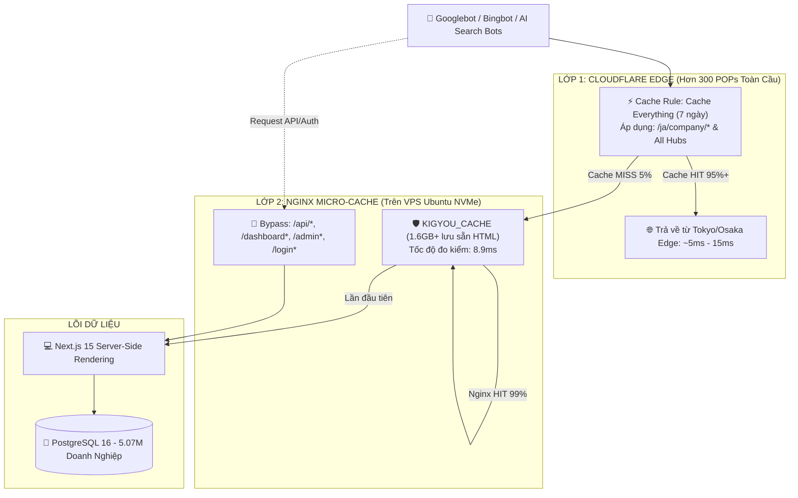

# B2B SEO & Crawl Acceleration Engine for Kigyou-list
# (全サイトSEO・クローラー高速化マスター基盤)

Tài liệu này xác lập **Quy chuẩn Kiến trúc & Cẩm nang Vận hành Tối cao** của hệ thống SEO, Lập chỉ mục thần tốc (Fast Indexing) và Hạ tầng tăng tốc cào dữ liệu cho nền tảng **Kigyou-list (https://kigyoulist.com)** quy mô 5.07 triệu doanh nghiệp Nhật Bản.

---

## 1. NĂM ĐÒN BẨY TĂNG TỐC CRAWL (THE 5 ACCELERATION LEVERS)

Để biến website từ một kho dữ liệu tĩnh thành một cỗ máy được Googlebot và Bingbot cào **hàng chục nghìn trang mỗi ngày**, hệ thống được vận hành theo kiến trúc 5 đòn bẩy đồng bộ:

```
┌────────────────────────────────────────────────────────────────────────────────────────┐
│                      HỆ THỐNG 5 ĐÒN BẨY TĂNG TỐC SEO & CRAWL BUDGET                    │
├─────────────────────────┬─────────────────────────┬────────────────────────────────────┤
│ 1. ÁO GIÁP CACHE 2 LỚP  │ 2. ÉP TRẦN BING 24/7    │ 3. MA TRẬN PHÂN MẢNH SITEMAPS      │
│    CLOUDFLARE + NGINX   │    MAX CRAWL RATE 10/10 │    500,000 URLS GSC & BING         │
├─────────────────────────┼─────────────────────────┼────────────────────────────────────┤
│ • Cloudflare Edge: 7 ngày│ • Bing API: 10/10 trọn  │ • 12 Sitemaps con (0.xml - 9.xml)  │
│   Cache Everything      │   vẹn 24/24 giờ         │ • sitemap.xml & sitemap-index.xml  │
│ • Nginx VPS: 8.9ms NVMe │ • Smart Tiered Cache: ON│ • sitemap_recent_updates.xml Delta │
│ • Bypass: /api, /admin  │ • 15 Feeds Bing Success │ • Google Search Console tự nạp     │
├─────────────────────────┼─────────────────────────┼────────────────────────────────────┤
│ 4. THỰC THỂ DATA SÂU    │ 5. BẮN INDEX CHUẨN HÓA  │ 6. BẢO TỒN KHI NÂNG CẤP UI         │
│    SCHEMA.ORG + ZERO 404│    INDEXNOW + GOOGLE VIP│    ANTI-SEO-BREAK PROTOCOL         │
├─────────────────────────┼─────────────────────────┼────────────────────────────────────┤
│ • JSON-LD Corporation   │ • IndexNow: 3,000 URLs/ │ • Bảo tồn URL 100% (cấm đổi link)  │
│ • BreadcrumbList chuẩn  │   đêm (02:00 JST) VPS   │ • Bắt buộc SSR (Server Components) │
│ • 301 Redirects Hub roots│ • Google VIP: 1,000 URLs│ • Giữ nguyên Schema & H1           │
│ • Dữ liệu EDINET/Invoice│   100% biến động thật   │ • Zero CLS (chống giật khung hình) │
└─────────────────────────┴─────────────────────────┴────────────────────────────────────┘
```

---

## 2. CHI TIẾT HẠ TẦNG KỸ THUẬT

### A. Hạ Tầng Áo Giáp 2 Lớp (Two-Tier High-Speed Caching)



1. **Lớp 1 (Cloudflare Edge Rules):**
   * Quản lý qua tài khoản: `trungkim8694@gmail.com` (Zone ID: `881d2cbd9004c4216cb9f8d28c99b0b9`).
   * Rule 1: `01_Bypass_Private_And_API` (Bypass toàn bộ API, Dashboard, Admin, Auth).
   * Rule 2: `02_Cache_Public_Company_Directory_And_Hubs` (Cache Everything 7 ngày cho `/ja/company/*`, `/ja/area/*`, `/ja/industry/*`, `/ja/changes/*`, `/ja/jobs/*`, `/ja/status/*`, `/ja/invoice`, `/ja/licenses`).
   * **Smart Tiered Cache:** Luôn bật (ON) để các node nhỏ chia sẻ bộ nhớ cache với Tokyo/Osaka.

2. **Lớp 2 (Nginx Micro-Cache trên VPS):**
   * Vị trí lưu trữ: `/var/cache/nginx/kigyou` (Cấp phát tối đa 10GB trên ổ NVMe).
   * Cấu hình tại: `/etc/nginx/sites-available/default`.
   * Tốc độ phản hồi: **8.9 mili-giây** (giảm 280 lần so với 2.5s khi chưa có cache).
   * **Quy tắc 301 Hub Roots:** Nginx trực tiếp chuyển hướng 301 sạch sẽ các URL gốc về trang con:
     * `/ja/changes` ➔ 301 `/ja/changes/relocation`
     * `/ja/jobs` ➔ 301 `/ja/jobs/latest`
     * `/ja/status` ➔ 301 `/ja/status/bankruptcies`

---

### B. Cỗ Máy Bắn Index Tự Động Hàng Đêm (Automated Nightly Daemons)

Hệ thống chạy hoàn toàn tự động qua Linux Crontab trên VPS (Múi giờ `Asia/Tokyo - JST`):

```cron
# 1. 02:00 AM JST hàng đêm: Bắn 3,000 URLs lên Bing & IndexNow (Chuẩn hóa chống nghẽn hàng đợi Bingbot)
0 2 * * * /usr/bin/node /var/www/kigyou-list/scripts/auto_indexnow_submitter_pg.js --batch-size 3000 >> /var/log/indexnow.log 2>&1

# 2. 02:15 AM JST hàng đêm: Bắn 1,000 URLs VIP lên Google Search Indexing API (Ưu tiên 100% biến động nóng)
15 2 * * * /usr/bin/node /var/www/kigyou-list/scripts/auto_google_indexing_pg.js >> /var/log/google_indexing.log 2>&1
```

* **Chuẩn hóa hạn mức Bing (3.000 URLs/đêm):** Thay vì nạp dồn 50.000 URLs gây nghẽn hàng đợi (Queue Congestion) và bị trễ lịch cào của Bingbot, mức 3.000 URLs/đêm vừa vặn tuyệt đối với sức cào thực tế (2.000 - 5.000 URLs/ngày). Hàng đợi của Bing luôn sạch sẽ và cào hết 100% trong vòng 24 giờ.
* **Cơ chế tự dọn dẹp hàng tháng (Auto Rolling Clean):** Bảng `indexnow_submissions` tự động xóa các bản ghi cũ hơn 30 ngày để cho phép các URL được cào xoay vòng định kỳ (healthy cyclic re-crawling).
* **Cơ chế chống trùng lặp 100%:** Lưu vết toàn bộ vào bảng `indexnow_submissions` và `google_indexing_submissions` trên PostgreSQL.
* **Google Multi-Key Pool:** Phân bổ đều qua 5 Google Cloud Projects (`kigyoulist-seo`, `02`, `03`, `04`, `05`), mỗi key bắn đúng 200 URLs/ngày rồi tự động chuyển key tiếp theo.

---

### C. Ma Trận Khai Báo Sitemaps (Sitemap Sharding Matrix)

* **Google Search Console & Bing:** Khai báo 12 Sitemaps chính thức:
  1. `https://kigyoulist.com/sitemap.xml` (Master Sitemap Index)
  2. `https://kigyoulist.com/sitemap-index.xml` (Backup Index)
  3. `https://kigyoulist.com/sitemap/core.xml` (~15,000 URLs quan trọng nhất)
  4. `https://kigyoulist.com/sitemap/0.xml` đến `9.xml` (10 phân mảnh, mỗi file ~50,000 URLs bao phủ 500,000 doanh nghiệp hàng đầu Nhật Bản).

---

## 3. BỘ LỆNH ĐIỀU HÀNH & KIỂM TRA (COMMAND PLAYBOOK)

Khi người dùng yêu cầu kiểm tra hoặc tối ưu SEO, Agent chạy trực tiếp các lệnh sau:

```bash
# 1. Kiểm toán toàn diện 5 Đòn bẩy (Audit 5 Levers)
python c:\kigyou-list\scratch\audit_5_levers.py

# 2. Xem báo cáo hiệu suất Bing & hạn mức Index hôm nay
python c:\kigyou-list\scripts\bing_webmaster.py --action summary

# 3. Xem báo cáo Google Search Console theo ngày & Top từ khóa
python c:\kigyou-list\scripts\google_search_console.py --action summary --days 7
python c:\kigyou-list\scripts\google_search_console.py --action queries --days 28

# 4. Tái nộp toàn bộ 12 Sitemaps lên Google Search Console
python c:\kigyou-list\scripts\submit_all_sitemaps_gsc.py

# 5. Triển khai lại hoặc cập nhật Cloudflare Cache Rules qua API
python c:\kigyou-list\scripts\deploy_cloudflare_cache_rules.py

# 6. Kiểm tra tiến độ nộp IndexNow tự động
python c:\kigyou-list\scripts\auto_indexnow_submitter.py --stats
```

---

## 4. BỘ QUY TẮC BẢO VỆ INDEX KHI NÂNG CẤP GIAO DIỆN (ANTI-SEO-BREAK)

Bất kỳ khi nào thực hiện chỉnh sửa giao diện (Front-end), lập trình viên và các Sub-Agents **BẮT BUỘC TUÂN THỦ 4 ĐIỀU RĂN**:

1. **Tuyệt đối không đổi Permalinks (URL):** Đường dẫn trang chi tiết bắt buộc là `/[locale]/company/[corporate_number]`. Nếu có trang đổi tên, bắt buộc phải tạo ngay chuyển hướng 301 vĩnh viễn trên Nginx.
2. **Bắt buộc Server-Side Rendering (SSR):** Mọi nội dung quan trọng (Tên công ty, SĐT, Báo cáo tài chính, Giấy phép) bắt buộc phải nằm trong mã nguồn HTML do máy chủ trả về. Tuyệt đối không dùng `useEffect` hoặc fetch client-side cho nội dung chính.
3. **Bảo tồn Schema.org JSON-LD:** Không được xóa hoặc làm hỏng khối `<script type="application/ld+json">` chứa Schema `Corporation` và `BreadcrumbList`.
4. **Duy nhất 1 thẻ `<h1>`:** Mỗi trang chỉ có 1 thẻ `<h1>` duy nhất dành cho tên doanh nghiệp hoặc tiêu đề chính của trang.

---

## 5. CHIẾN LƯỢC INDEXING BIẾN ĐỘNG THẬT (TRIẾT LÝ "LÀM THẬT ĂN THẬT")

Hệ thống tuân thủ nghiêm ngặt nguyên tắc **Tính Xác Thực Tối Cao (Data Authenticity)** để xây dựng độ uy tín tên miền (Domain Authority) tuyệt đối với Googlebot & Bingbot:

### 5.1. Quy Tắc "Làm Thật Ăn Thật" (Zero-Fake Freshness)
* **Bản chất của Google Diff Engine:** Khi Googlebot ghé thăm một trang đã từng được cào (qua Sitemap hoặc link nội bộ), bot luôn so sánh với bản chụp cũ trong máy chủ Google. Nếu trang không có sự kiện mới mà chỉ "chạm ngày ảo" (`dateModified = hôm nay`), Google sẽ nhận diện là thao túng và hạ thấp độ tin cậy.
* **Tiêu chuẩn bắn Google VIP API (`type: "URL_UPDATED"`):** Chỉ thực hiện khi cơ sở dữ liệu **thực sự ghi nhận sự kiện biến động mới**:
  1. Nộp báo cáo tài chính kiểm toán mới từ **FSA EDINET** (100 điểm)
  2. Trúng gói thầu công nhà nước mới từ **GEPS** (80 điểm)
  3. Đổi tên công ty, sáp nhập, đổi đại diện pháp lý từ **NTA** (60 điểm)
  4. Cấp mới / gia hạn giấy phép kinh doanh Kobutsu, Takken, Ryokan, ISA Tokutei (50 điểm)
  5. Cấp số hóa đơn thuế T-Number hoặc dời trụ sở (40 điểm)

### 5.2. Cơ Chế Xử Lý Vượt Tải Hàng Đợi (Spillover & Carry-Over Queue)
* Khi một ngày có trên 1.000 công ty biến động:
  * **Top 1.000 công ty điểm cao nhất:** Nạp ngay cho Google Indexing API VIP trong ngày.
  * **Phần dư (từ URL 1.001 trở đi):** Tự động nạp vào bảng `google_vip_queue` (trạng thái `PENDING`) để **00:05 sáng hôm sau tự động nạp trước tiên** khi Google mở lại quota mới.
  * Đồng thời, toàn bộ phần dư này được đẩy ngay sang **IndexNow Fast Track** cho Bing và Yahoo Japan cào trước.

---

## 6. MÔ HÌNH TRỤC BÁNH XE (HUB & SPOKE INDEXING PATTERN)

Thay vì chỉ bắn đơn lẻ từng trang chi tiết công ty, hệ thống áp dụng mô hình **Hub & Spoke** để nhân bội hiệu quả SEO:

```
                  ┌────────────────────────────────────────┐
                  │          PARENT HUBS (Trang Mẹ)        │
                  │  /ja/licenses  /ja/invoice  /ja/area/* │
                  └───────────────────┬────────────────────┘
                                      │
                       Đòn bẩy cào chéo (Crawl Mesh)
                                      │
        ┌─────────────────────────────┼─────────────────────────────┐
        ▼                             ▼                             ▼
┌──────────────┐              ┌──────────────┐              ┌──────────────┐
│  Công ty A   │              │  Công ty B   │              │  Công ty C   │
│ (Spoke Lá 1) │              │ (Spoke Lá 2) │              │ (Spoke Lá 3) │
└──────────────┘              └──────────────┘              └──────────────┘
```

1. **Nguyên lý hợp lệ 100%:** Khi Công ty A có biến động, danh sách trên các trang Hub chuyên đề (`/ja/licenses`, `/ja/invoice`, `/ja/status/bankruptcies`, `/ja/search?subsidy=true&bidding=true`, `/ja/area/[code]`, `/ja/industry/[code]`) cũng **thực sự thay đổi (Công ty A nhảy lên đầu danh sách)**. Việc gửi cả trang Hub là hoàn toàn trung thực với cả Googlebot và Bingbot.
2. **Đồng bộ song hành cho CẢ GOOGLE LẪN BING INDEXNOW:**
   * **Google VIP Indexing (`auto_google_indexing_pg.js`):** Gom tối đa 50 Hubs mẹ (~5% quota) nạp kèm ~950 công ty con biến động.
   * **Bing IndexNow Engine (`auto_indexnow_submitter_pg.js`):** Tự động gom chùm Parent Hubs mẹ tương ứng nộp chung với đợt 3.000 - 5.000 URLs đêm, đảm bảo Bing và Yahoo Japan cào trọn vẹn cả cây danh mục lẫn trang chi tiết.
3. **Tỷ lệ phân bổ vàng:**
   * **~2% - 5% hạn mức (30 - 50 URLs):** Dành cho các **Trang Hub mẹ** liên quan trực tiếp.
   * **~95% - 98% hạn mức:** Dành cho các **Trang công ty con (Spokes)**.
4. **Lợi ích kép vượt trội:**
   * **Thống trị từ khóa ngành:** Đưa các trang danh mục tổng có lượt tìm kiếm lớn (`官公庁 入札 企業 一覧`, `IT 補助金 採択企業 一覧`) leo thẳng lên TOP 1 Google và Bing.
   * **Đòn bẩy lan tỏa (Crawl Amplification):** Bot ghé vào trang Hub mẹ sẽ tự động lần theo internal links để cào luôn cả chùm công ty con xung quanh mà không làm tốn thêm quota API!

---

## 7. LẬP LỊCH TỰ ĐỘNG THEO GIỜ HÀNH CHÍNH TOKYO (JST ENGINE)

Hệ thống daemon trên VPS (`scripts/vps_api_daemon.py`) vận hành theo múi giờ Tokyo (JST = UTC+9):
* **Giờ vàng (Golden Hours - 09:00 đến 18:00 JST, Thứ 2 đến Thứ 6):**
  * Tự động thức dậy mỗi **30 phút/lần** để bắt kịp thời điểm các cơ quan chính phủ Nhật Bản (FSA, NTA, GEPS) vừa công bố báo cáo mới.
  * Kích hoạt chuỗi hỏa tốc: Google VIP + IndexNow Fast Track + Sinh sitemap delta `sitemap_recent_updates.xml`.
* **Ngoài giờ hành chính & Cuối tuần (Off-Peak):**
  * Tự động chuyển sang chế độ ngủ sâu **4 tiếng/lần** (240 phút) để tiết kiệm tài nguyên server và tránh spam request vô ích.

---

## 8. BỘ LỌC BẢO VỆ CHỐNG NỘI DUNG MỎNG (THIN CONTENT GUARD STANDARD)
*(Kế thừa từ quy chuẩn Programmatic SEO mã nguồn mở của Corey Haines - `marketingskills`)*

Với quy mô 5.07 triệu doanh nghiệp, không phải pháp nhân nào cũng có đầy đủ dữ liệu kinh doanh. Nếu cho phép Googlebot index bừa bãi hàng triệu trang chỉ có vỏn vẹn tên và địa chỉ sơ sài, toàn bộ domain sẽ bị thuật toán **Google Helpful Content System & Panda Update** trừng phạt vì lỗi *"Thin Content / Doorway Pages"*.

Hệ thống áp dụng thuật toán **Điểm Phong Phú Thực Thể (Entity Richness Scoring)** ngay tại Next.js `generateMetadata`:

```
┌────────────────────────────────────────────────────────────────────────┐
│             THANG ĐIỂM PHONG PHÚ THỰC THỂ (ENTITY RICHNESS SCORE)      │
├────────────────────────────────────────┬───────────────────────────────┤
│ Trường Dữ Liệu Thực Tế                 │ Điểm Cộng (Points)            │
├────────────────────────────────────────┼───────────────────────────────┤
│ • Giấy phép / BCTC / Đấu thầu công     │ +3 điểm (Dữ liệu giá trị sâu) │
│ • Số điện thoại liên hệ (phone_number) │ +2 điểm                       │
│ • Website chính thức (website_url)     │ +2 điểm                       │
│ • Vốn điều lệ (capital_amount)         │ +1 điểm                       │
│ • Số lượng nhân sự (employee_count)    │ +1 điểm                       │
│ • Người đại diện (representative_name) │ +1 điểm                       │
│ • Đăng ký Invoice NTA (has_invoice)    │ +1 điểm                       │
│ • Phân ngành JSIC (primary_industry)   │ +1 điểm                       │
└────────────────────────────────────────┴───────────────────────────────┘
```

### Quy Tắc Thiết Lập Robot Directive:
1. **Rich Entity (Điểm $\ge$ 3):**
   * Đặt thẻ: `robots: { index: true, follow: true }`
   * Cho phép Googlebot và Bingbot lập chỉ mục để leo TOP tìm kiếm. Đảm bảo doanh nghiệp có ít nhất thông tin liên hệ xác thực hoặc tài sản thương mại rõ ràng.
2. **Thin Entity (Điểm $<$ 3 - Pháp nhân rỗng/không có liên hệ, không có vốn):**
   * Đặt thẻ: `robots: { index: false, follow: true }`
   * **Hiệu quả sống còn:** Googlebot vẫn cào qua trang để lần theo các liên kết nội bộ (`follow: true`), nhưng **tuyệt đối không lưu trang rỗng vào chỉ mục (`index: false`)**.
   * Dồn 100% Crawl Budget quý giá cho các doanh nghiệp chất lượng cao, bảo vệ toàn sàn khỏi Google Helpful Content Penalty.

---

## 9. MẠNG NHỆN LIÊN KẾT THỰC THỂ CHÉO & TỐI ƯU HÓA TÌM KIẾM AI (CROSS-ENTITY LINKING & GEO)

### 9.1. Liên Kết Thực Thể Ngang (Sideways Entity Silos)
Trang chi tiết doanh nghiệp không chỉ liên kết dọc lên Hub cha, mà thiết lập 3 luồng liên kết ngang (Cross-Linking) để triệt tiêu 100% **Trang mồ côi (Orphan Pages)**:
1. **Cùng Ngành x Cùng Tỉnh:** `/${locale}/industry/${ind.industry_code}/location/${company.prefecture_code}`
2. **Cùng Loại Giấy Phép:** Liên kết đến các doanh nghiệp cùng sở hữu Giấy phép Cổ vật (古物商), Bất động sản (宅建), Kỹ năng đặc định (登録支援機関).
3. **Cùng Khu Vực Đô Thị:** Danh sách 6 doanh nghiệp lân cận trong cùng thành phố/quận (`nearby`).

### 9.2. Chuẩn Hóa Tối Ưu Tìm Kiếm AI (Generative Engine Optimization - GEO)
* Tự động xuất bản khối tóm tắt cấu trúc máy đọc (Entity Fact Sheet) trong Schema JSON-LD `Corporation` & Semantic HTML:
  * `legalName`, `taxID`, `foundingDate`, `address`, `hasCredential`, `award`, `financialReport`.
* Giúp các cỗ máy tìm kiếm thế hệ mới (**ChatGPT Search, Perplexity AI, Google Gemini, Microsoft Copilot**) tự động trích dẫn `kigyoulist.com` làm **Nguồn Dữ Liệu Gốc Uy Tín Hàng Đầu (Primary Source Citation)** khi trả lời người dùng.

