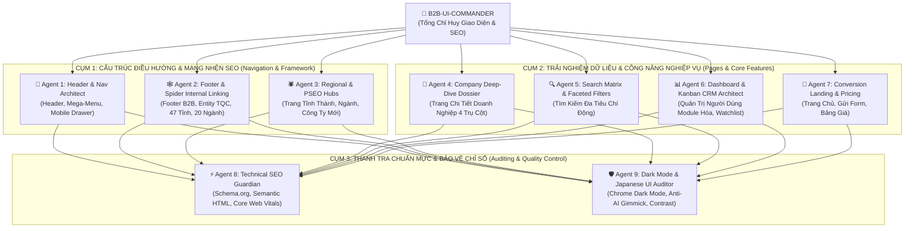

# B2B UI & SEO Supreme Multi-Agent Orchestrator (全サイトUI刷新・SEO最高司令部)

Tài liệu này xác lập cơ cấu chỉ huy tối cao **`b2b-ui-commander`** và mạng lưới **9 Sub-Agents Chuyên Trách** chịu trách nhiệm tái thiết kế, nâng cấp và đồng bộ hóa toàn bộ giao diện website **Kigyou-list (https://kigyoulist.com)** dựa trên **BỐN TRỤ CỘT TÍNH NĂNG CỐT LÕI** và kho dữ liệu 5.07 triệu doanh nghiệp đang mở rộng liên tục.

---

## 1. BỐN TRỤ CỘT TÍNH NĂNG CỐT LÕI (THE 4 CORE PILLARS)

Mọi thay đổi giao diện từ Header, Footer cho đến từng trang con bắt buộc phải xoay quanh và làm nổi bật 4 giá trị công năng này:

```
┌─────────────────────────────────────────────────────────────────────────────────────────┐
│                    BỐN TRỤ CỘT TÍNH NĂNG CỐT LÕI CỦA KIGYOU-LIST                        │
├──────────────────────────┬──────────────────────────┬───────────────────────────────────┤
│ 1. KHO DỮ LIỆU CHUYÊN SÂU│ 2. TÍN HIỆU Ý ĐỊNH       │ 3. FORM OUTREACH TỰ ĐỘNG          │ 4. KANBAN CRM & THEO DÕI
│    5.07M DOANH NGHIỆP    │    & BIẾN ĐỘNG LIVE      │    TIẾP CẬN QUYẾT ĐỊNH GIA        │    BIẾN ĐỘNG DOANH NGHIỆP
├──────────────────────────┼──────────────────────────┼───────────────────────────────────┼──────────────────────────┤
│ • Pháp nhân NTA & Invoice│ • Tuyển dụng HelloWork   │ • AI gửi Form liên hệ tự động     │ • Theo dõi Watchlist     │
│ • Tài chính 5 năm EDINET │ • Trúng thầu công GEPS   │ • Tự lọc web cấm quảng cáo        │ • Cảnh báo biến động mail│
│ • Thu nhập bình quân     │ • Biến động pháp lý      │ • Báo cáo URL gửi thành công CSV  │ • Phễu bán hàng 4 bước   │
│ • Giấy phép chuyên ngành │ • Tín hiệu đầu tư mới    │ • Tỷ lệ mở 50% - 90%              │ • B2B API Hub & MCP      │
└──────────────────────────┴──────────────────────────┴───────────────────────────────────┴──────────────────────────┘
```

---

## 2. KIẾN TRÚC MẠNG LƯỚI MULTI-AGENT (9 SUB-AGENTS CHUYÊN TRÁCH)

Hệ thống được tổ chức thành 3 Cụm Tác Chiến dưới quyền chỉ huy trực tiếp của **`b2b-ui-commander`**:



---

## 3. CHI TIẾT NHIỆM VỤ CỦA TỪNG SUB-AGENT

### 🧭 Agent 1: `agent-nav-header` (Kiến Trúc Sư Điều Hướng & Menu)
* **Phạm vi quản lý**: [Header.tsx](file:///c:/kigyou-list/frontend/src/components/Header.tsx), Navigation Drawer di động, Chuyển ngữ (JA / EN / VI), Trạng thái tài khoản.
* **Nhiệm vụ cốt lõi**:
  1. Tái cấu trúc menu chính rõ ràng theo 4 Trụ Cột: `[企業検索]` (Tìm kiếm DB), `[シグナル分析]` (Tín hiệu ý định), `[フォーム営業]` (Gửi Form tự động), `[料金プラン]` (Bảng giá), `[開発者・API]` (B2B Hub).
  2. Bổ sung nút truy cập nhanh tính năng mới: `[監視リスト 🔔]` (Watchlist) và `[カンバンSFA]` khi đã đăng nhập.
  3. Menu di động: Dùng drawer trượt nhẹ nhàng, nền sáng sạch sẽ, khoảng chạm ngón tay tối thiểu `48px` (Mobile Accessibility).
  4. Chuẩn SEO: Dùng thẻ `<header role="banner">`, `<nav aria-label="Main Navigation">`, gắn thuộc tính microdata Schema `SiteNavigationElement`.

---

### 🕸️ Agent 2: `agent-seo-footer` (Chân Trang Tập Đoàn & Mạng Nhện Liên Kết SEO)
* **Phạm vi quản lý**: [Footer.tsx](file:///c:/kigyou-list/frontend/src/components/Footer.tsx), Ma trận Internal Linking toàn website.
* **Nhiệm vụ cốt lõi**:
  1. Thiết kế phong cách **Tập đoàn B2B Nhật Bản uy tín (Corporate Stature)**: Tương tự chân trang của Teikoku Databank, Nikkei, Uzabase SPEEDA.
  2. Xây dựng **Mạng nhện liên kết nội bộ khổng lồ (Spider Web SEO)**:
     - Khối 47 tỉnh thành (Hokkaido đến Okinawa).
     - Khối 20 ngành kinh tế chính JSIC (Sản xuất, IT, Xây dựng, Bất động sản, Bán lẻ...).
     - Khối tra cứu chuyên biệt: Tra cứu SĐT doanh nghiệp, Danh bạ công ty mới thành lập, Doanh nghiệp có tuyển dụng, Doanh nghiệp trúng thầu công.
  3. Củng cố thực thể pháp lý thương hiệu (Brand Entity Authority):
     - Thông tin đơn vị vận hành: **TQC株式会社 (TQC Inc.)**, Mã số pháp nhân NTA, Địa chỉ trụ sở, Email liên hệ, Đạo luật Giao dịch Thương mại Điện tử (特定商取引法に基づく表記), Chính sách quyền riêng tư (プライバシーポリシー), Điều khoản sử dụng (利用規約).
     - Liên kết hồ sơ mạng xã hội chính thức: X (Twitter), Note.com, LinkedIn, Qiita, Zenn, Facebook.
  4. Chuẩn SEO: Thẻ `<footer>`, Schema `Organization` với đầy đủ thuộc tính `sameAs`, `hasCredential`, `contactPoint`.

---

### 🏢 Agent 4: `agent-company-deepdive` (Hồ Sơ Năng Lực Doanh Nghiệp Toàn Diện)
* **Phạm vi quản lý**: [frontend/src/app/[locale]/company/[id]/page.tsx](file:///c:/kigyou-list/frontend/src/app/[locale]/company/[id]/page.tsx) và các component con trong `components/company/`.
* **Nhiệm vụ cốt lõi**:
  1. Biến trang chi tiết thành một **Bản Báo Cáo Thẩm Định Doanh Nghiệp Toàn Diện (B2B Credit & Signal Dossier)**.
  2. Tổ chức bố cục thành các Tab thông tin chuyên sâu rõ ràng:
     - **Tab 1: Tổng quan & Định danh Pháp lý**: Mã số pháp nhân NTA, Trạng thái Hóa đơn Invoice T-Number, Tên đại diện, Trụ sở chính, Bản đồ, SĐT đã chuẩn hóa.
     - **Tab 2: Tài chính 5 Năm & Nhân sự (FSA EDINET)**: Biểu đồ cột doanh thu 5 năm, lợi nhuận thuần, vốn chủ sở hữu, mức lương trung bình hàng năm của nhân viên.
     - **Tab 3: Tín hiệu Mua hàng & Hoạt động (Intent Signals)**: Lịch sử trúng thầu công GEPS, tuyển dụng đang mở HelloWork, thay đổi pháp lý gần nhất.
     - **Tab 4: Giấy phép Kinh doanh (Bộ Đất đai & Bất động sản MLIT)**: Giấy phép môi giới BĐS, xây dựng, phái cử lao động.
  3. **Hành động chuyển đổi người dùng (Action Triggers)**:
     - Nút nổi bật: `[★ 監視リストに追加]` (Thêm vào danh sách theo dõi biến động - Gửi email khi có thay đổi).
     - Nút tiếp cận: `[✉️ この企業にフォーム営業する]` (Gửi thông điệp tiếp cận tự động vào Form liên hệ của doanh nghiệp).
  4. Chuẩn SEO: Schema `Corporation` siêu chi tiết (CEO, Telephone, Address, FoundingDate, NumberOfEmployees, FinancialReports).

---

### 🔍 Agent 5: `agent-search-explorer` (Ma Trận Tìm Kiếm Đa Chiều & Faceted Navigation)
* **Phạm vi quản lý**: [frontend/src/app/[locale]/search/page.tsx](file:///c:/kigyou-list/frontend/src/app/[locale]/search/page.tsx) & [SearchSidebar.tsx](file:///c:/kigyou-list/frontend/src/components/SearchSidebar.tsx).
* **Nhiệm vụ cốt lõi**:
  1. Tích hợp bộ lọc 4 Trụ Cột: Lọc kết hợp Tỉnh/Huyện + Ngành JSIC + Mức vốn + Tín hiệu tuyển dụng live + Có báo cáo tài chính + Đã xác thực Invoice.
  2. Danh sách kết quả: Mật độ thông tin cao (High Information Density), định dạng số `tabular-nums`, hiển thị các badge tín hiệu nhỏ gọn bằng chấm màu chuẩn B2B Nhật.
  3. Tối ưu trải nghiệm: Thao tác tìm kiếm dưới 100ms, bộ lọc đóng mở nhẹ nhàng, không giật màn hình.
  4. Chuẩn SEO: Quản lý URL tham số sạch, canonical hợp lý để Googlebot không bị rơi vào bẫy crawl lặp vô tận (Spider Trap).

---

### 📊 Agent 6: `agent-dashboard-crm` (Khu Vực Quản Trị Module Hóa & Kanban CRM)
* **Phạm vi quản lý**: [frontend/src/app/[locale]/dashboard/page.tsx](file:///c:/kigyou-list/frontend/src/app/[locale]/dashboard/page.tsx) và thư mục `components/dashboard/`.
* **Nhiệm vụ cốt lõi**:
  1. Đập bỏ cấu trúc monolithic cũ, module hóa thành các file riêng biệt:
     - `WatchlistTab.tsx`: Quản lý danh sách công ty theo dõi, bật/tắt nhận thông báo email, xem dòng thời gian biến động (Change Event Timeline).
     - `KanbanTab.tsx`: Bảng phễu bán hàng B2B 4 bước (Chưa liên hệ ➔ Đã gửi ➔ Đang đàm phán ➔ Ký hợp đồng).
     - `MyListTab.tsx`: Danh sách lưu trữ, gắn tag phân loại, xuất CSV cho Salesforce / HubSpot / kintone.
     - `FormCampaignsTab.tsx`: Báo cáo số chiến dịch gửi Form, số URL đã gửi thành công, tải log CSV.
     - `DeveloperTab.tsx`: Quản lý API Key, hướng dẫn kết nối MCP Server, khung code xám sáng dịu mắt.
  2. Chuẩn UI: Giao diện làm việc chuyên nghiệp, nền xám ngà `#F8FAFC`, thẻ trắng viền xám 1px, không mỏi mắt khi làm việc 8 tiếng/ngày.

---

### 🚀 Agent 7: `agent-conversion-landing` (Trang Chủ & Trang Giới Thiệu Chuyển Đổi)
* **Phạm vi quản lý**: [page.tsx](file:///c:/kigyou-list/frontend/src/app/[locale]/page.tsx), `/form-marketing`, `/pricing`, `/tokushoho`.
* **Nhiệm vụ cốt lõi**:
  1. Trang chủ: Cấu trúc rõ ràng 4 Trụ Cột, thống kê số liệu thực tế (5.07M doanh nghiệp, 47 tỉnh thành, 50,000+ tín hiệu mới mỗi tuần).
  2. Trang Bảng Giá (`/pricing`): Minh bạch ranh giới giữa Gói Miễn Phí (Tra cứu, theo dõi 10 công ty) và Gói Trả Phí Pro / Enterprise.
  3. Khối bằng chứng xã hội (Social Proof): Logo các đối tác và định dạng xuất chuẩn cho các phần mềm CRM phổ biến tại Nhật.

---

### ⚡ Agent 8: `agent-seo-technical-guardian` (Thanh Tra Kỹ Thuật & Tối Ưu SEO)
* **Nhiệm vụ cốt lõi kiểm định mọi trang trước khi xuất bản**:
  1. **Semantic HTML5 Hierarchy**: Mỗi trang chỉ có DUY NHẤT 1 thẻ `<h1>`, các đề mục cấp dưới dùng `<h2>`, `<h3>` chuẩn mực.
  2. **Schema.org Structured Data**: Tự động sinh và kiểm tra JSON-LD: `BreadcrumbList`, `Corporation`, `Organization`, `WebSite`, `ItemPage`.
  3. **Core Web Vitals**:
     - Cumulative Layout Shift (CLS) = 0 (tất cả hình ảnh, khung dữ liệu đều có kích thước cố định).
     - First Contentful Paint (FCP) < 1.0s.
     - Next.js Server Components kết xuất SSR / ISR, Googlebot và Bingbot cào được 100% nội dung không cần chờ Javascript.
  4. **Dynamic Metadata**: Đảm bảo đầy đủ `title`, `description`, `canonical`, `hreflang` (ja, en, vi, x-default), OpenGraph và Twitter Card.

---

### 🛡️ Agent 9: `agent-darkmode-japanese-ui-auditor` (Thanh Tra Thẩm Mỹ B2B Nhật & Chrome Dark Mode)
* **Nhiệm vụ kiểm định trải nghiệm người dùng**:
  1. **Tương thích 100% Google Chrome ở Chế độ Tối (Chrome Dark Mode)**:
     - Mở thử nghiệm trên Google Chrome ở Chế độ Tối: Thẻ card tự động chuyển sang `#161B22`, viền `#30363D`, chữ sáng dịu `#F8FAFC`.
     - Tuyệt đối KHÔNG có hiện tượng thẻ trắng bệch chói mắt trên nền đen hoặc thẻ nọ tối thẻ kia sáng.
  2. **Triệt tiêu cảm giác AI (Anti-AI Gimmick)**:
     - Trong Light Mode: KHÔNG dùng các khối nền đen xì hoặc xanh navy đậm (`#0F172A`, `#0B1221`). Bắt buộc dùng màu trắng hoặc xám ngà dịu mắt (`bg-slate-50`, `text-slate-800`).
     - KHÔNG lạm dụng icon trang trí thừa thãi trước từng dòng chữ.
     - KHÔNG dùng gradient neon hay bo góc tròn xoe đồ chơi.
     - Giữ vững phong thái điềm đạm, tin cậy của một cổng dữ liệu tài chính B2B Nhật Bản.

---

## 4. QUY TRÌNH PHỐI HỢP VẬN HÀNH (ORCHESTRATION PIPELINE)

Bất kỳ khi nào thực hiện nâng cấp một trang hoặc component, Commander sẽ điều phối theo quy trình 4 bước:

```
[BƯỚC 1: QUY HOẠCH NỘI DUNG] ➔ Agent chuyên trách (Agent 1-7) soạn thảo cấu trúc dựa trên 4 Trụ Cột.
         │
[BƯỚC 2: RÀ SOÁT KỸ THUẬT SEO] ➔ Agent 8 (Technical SEO) thẩm định Semantic HTML, Schema, Breadcrumbs.
         │
[BƯỚC 3: NGHIỆM THU THẨM MỸ & DARK MODE] ➔ Agent 9 (UI Auditor) kiểm tra Chrome Dark Mode & phong cách B2B Nhật.
         │
[BƯỚC 4: TRIỂN KHAI & ĐỒNG BỘ VPS] ➔ Build production Next.js và reload PM2 trên VPS (160.251.203.84).
```
