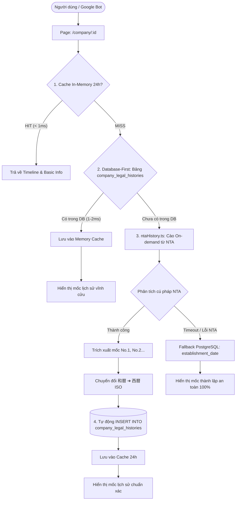

# NTA Web-API Orchestrator (国税庁 法人番号・インボイス Web-API 運用仕様書)

Skill này là tài liệu chuẩn mực và sổ tay vận hành dành riêng cho hệ thống **Kigyou-list** trong việc kết nối, trích xuất và đồng bộ dữ liệu từ 2 cổng dịch vụ công của **Tổng cục Thuế Quốc gia Nhật Bản (国税庁 - NTA)**:
1. **Cổng 1**: 法人番号公表サイト Web-API (`houjin-bangou.nta.go.jp`)
2. **Cổng 2**: 適格請求書発行事業者公表システム Web-API (`invoice-kohyo.nta.go.jp`)

---

## 1. Bản đồ dữ liệu khai thác từ 2 cổng NTA

| Cổng NTA | API / Nguồn | Dữ liệu trích xuất | Vị trí hiển thị trên Kigyou-list | Ghi chú pháp lý |
| :--- | :--- | :--- | :--- | :--- |
| **法人番号システム** | `houjin-bangou.nta.go.jp` | **Mã số pháp nhân (13 số)**, Thương hiệu (商号), Loại hình (種別), Trụ sở (所在地) | Khung Tiêu đề & Thông tin cơ bản (`基本情報`) | Thuộc **基本4情報** theo Luật My Number (マイナンバー法). |
| **法人番号システム** | `henkorireki-johoto.html` & Web-API | **変更履歴情報 (Lịch sử biến động pháp lý)**: <br>• `No.1, No.2...`: Ngày phát sinh (`事由発生年月日`), Lý do (`変更の事由`), Thông tin cũ (`旧情報`)<br>• `新規`: Ngày chỉ định (`法人番号指定年月日`) | Khung **主な変更履歴** (`#history` - `CompanyLegalHistoryTimeline`) | Phản ánh đúng các mốc biến động do Pháp vụ cục (法務局) chuyển sang Quốc thuế. |
| **インボイス公表** | `invoice-kohyo.nta.go.jp` | **Mã số đăng ký hóa đơn (T-Number)**: <br>• Cấu trúc: `T` + 13 số pháp nhân<br>• Trạng thái hiệu lực đăng ký | Khung **基本情報** (`適格請求書発行事業者登録番号`) | Tuân thủ Điều 57-2 Luật Thuế tiêu dùng Nhật Bản (消費税法第57条の2). |

> [!WARNING]
> **Những thông tin API Quốc thuế KHÔNG CUNG CẤP:**
> * **Vốn điều lệ (資本金)** và **Người đại diện (代表者)**: Thuộc thẩm quyền của **Pháp vụ cục (法務局)** và **Bộ Kinh tế, Thương mại & Công nghiệp (gBizINFO)**, Quốc thuế không mở API trường này. Đối với các công ty chưa có dữ liệu nguồn mở, bắt buộc hiển thị `未登録` (`-`).
> * **最終更新年月日**: Đây chỉ là ngày admin NTA ấn cập nhật hệ thống, **tuyệt đối không gom vào bảng Lịch sử thay đổi pháp lý**.

---

## 2. Kiến trúc & Cơ chế đồng bộ dữ liệu (Data Sync Pipeline)

Hệ thống hoạt động theo mô hình 4 tầng tự bảo vệ (4-Tier Resilient Database-First Architecture):



### Cấu trúc bảng Database (`company_legal_histories`):
* **Bảng PostgreSQL**: `company_legal_histories`
* **Khóa chính / Unique**: `UNIQUE(corporate_number, event_type, event_date)`
* **Chỉ mục tăng tốc**: `idx_legal_histories_corp` (13 chữ số pháp nhân) và `idx_legal_histories_date` (sắp xếp mốc thời gian giảm dần).
* **Đồng bộ song song**: Được tạo trên cả PostgreSQL chính và SQLite local fallback.

### Các quy tắc cốt lõi:
1. **Chuẩn hóa niên hiệu Nhật Bản (和暦 ➔ 西暦 ISO 8601)**:
   * 令和 (Reiwa): `Năm dương lịch = 2018 + n` (Ví dụ: `令和4年` ➔ `2022`).
   * 平成 (Heisei): `Năm dương lịch = 1988 + n`.
   * 昭和 (Showa): `Năm dương lịch = 1925 + n`.
   * Xuất bản theo định dạng ISO chuẩn `YYYY-MM-DD` để đa ngôn ngữ tự động format (JA: `YYYY年MM月DD日`, VI: `DD/MM/YYYY`, EN: `YYYY-MM-DD`).
2. **Cơ chế Phương án B (Khớp nguyên bản NTA)**:
   * Mốc thành lập (`新規`): Ghi nhận thuần túy: *"国税庁長官により13桁の法人番号「...」が新規指定され、商号「...」の公表が行われました。"*
   * Không tự ý suy đoán hoặc truy ngược địa chỉ ban đầu nếu công ty đã chuyển nhiều lần.
3. **Chống rò rỉ người dùng (Zero Outbound Links Policy)**:
   * Tuyệt đối không chèn link `<a href="https://...nta.go.jp">` ra ngoài.
   * Toàn bộ dữ liệu được chứng thực nội bộ bằng nhãn `[登記確認済]` hoặc `[国税庁登録済]` và ghi công văn bản ở footer: *「出典：国税庁 法人番号公表システム・適格請求書発行事業者公表サイト（商業登記データ同期）」*.

---

## 3. Quản lý Tài khoản & Application ID NTA

* **Đơn vị chủ quản**: TQC株式会社 (`4013301048678`)
* **Email quản trị**: `listkigyou@gmail.com`
* **Hồ sơ giải trình kỹ thuật**: `NTA_WebAPI_Program_Overview_TQC.docx` (đã lưu trữ trên S3 của Quốc thuế).
* **Trạng thái**: Đã hoàn tất thủ tục đăng ký chính thức (本登録完了).

### Khi nhận Application ID chính thức từ NTA:
Cấu hình vào tệp biến môi trường `frontend/.env.local`:
```bash
NTA_APP_ID="<APPLICATION_ID_DO_NTA_CAP>"
NTA_INVOICE_APP_ID="<INVOICE_APP_ID_DO_NTA_CAP>"
```

---

## 4. Danh mục tệp mã nguồn quản lý

* [ntaHistory.ts](file:///c:/kigyou-list/frontend/src/lib/ntaHistory.ts): Bộ máy trích xuất, phân tích cú pháp `dl.corpHistory`, chuyển đổi niên hiệu và bộ đệm cache.
* [CompanyLegalHistoryTimeline.tsx](file:///c:/kigyou-list/frontend/src/components/company/CompanyLegalHistoryTimeline.tsx): Giao diện Timeline Lịch sử thay đổi pháp lý chuẩn B2B Nhật Bản.
* [company/[id]/page.tsx](file:///c:/kigyou-list/frontend/src/app/[locale]/company/[id]/page.tsx): Khung hiển thị `基本情報` (Mã số pháp nhân, Vốn điều lệ, Mã số Invoice `T...`, Địa chỉ, Đại diện) và Jump Ribbon điều hướng `#history`.
