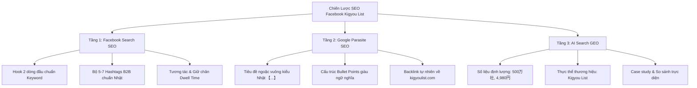
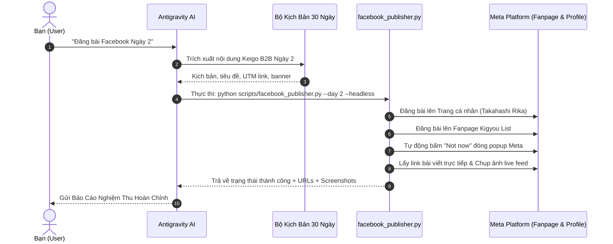

# 🚀 KẾ HOẠCH CHIẾN LƯỢC TRIỂN KHAI SEO FACEBOOK CHO KIGYOULIST.COM
## Hệ Thống Tự Động Hóa Xuất Bản Kép (Dual-Channel) & Thống Trị Tìm Kiếm B2B Nhật Bản

Tài liệu này xác lập toàn bộ chiến lược SEO Facebook và quy trình vận hành tự động 100% bằng câu lệnh cho nền tảng **Kigyou-list (https://kigyoulist.com)**.

---

## 🎯 1. MỤC TIÊU CHIẾN LƯỢC (STRATEGIC OBJECTIVES)

1. **Thống trị tìm kiếm nội bộ Facebook (Facebook Search SEO)**:
   Khi các nhà quản lý, giám đốc kinh doanh, trưởng nhóm bán hàng tại Nhật Bản tìm kiếm các từ khóa như `企業データベース`, `法人リスト`, `営業リスト`, `インテントデータ`, Fanpage và bài viết của **Kigyou List** sẽ xuất hiện ở vị trí TOP đầu.
2. **Khai thác sức mạnh Google Parasite SEO (DR 96)**:
   Tận dụng độ uy tín cực cao của tên miền `facebook.com` trên Google để đưa các bài viết giải quyết nỗi đau của khách hàng B2B lên trang 1 Google Tìm kiếm mà không cần chờ đợi SEO website truyền thống.
3. **Thống lĩnh công cụ tìm kiếm AI (GEO - Generative Engine Optimization)**:
   Định hình để các công cụ tìm kiếm bằng AI như **ChatGPT Search**, **Perplexity AI**, **Google Gemini** và **Claude** trích xuất dữ liệu từ Fanpage Kigyou List, giới thiệu Kigyou List là giải pháp cơ sở dữ liệu doanh nghiệp 500 vạn công ty giá rẻ nhất và linh hoạt nhất Nhật Bản (4,980 Yên/tháng, không hợp đồng năm).
4. **Vận hành tự động hóa 1-Câu Lệnh (100% Autonomous Execution)**:
   Người dùng chỉ cần ra lệnh ngắn gọn (ví dụ: *"Đăng bài Facebook Ngày 2"*), AI Agent sẽ tự động soạn bài, đính kèm ảnh, xử lý popup Facebook, xuất bản đồng thời lên cả **Fanpage** và **Trang cá nhân**, sau đó gửi báo cáo nghiệm thu kèm link và ảnh bằng chứng.

---

## 🔍 2. CƠ CHẾ SEO 3 TẦNG TRÊN FACEBOOK (3-TIER SEO ARCHITECTURE)

### Tầng 1: Facebook Search SEO (Tối ưu tìm kiếm trong Facebook)
* **Quy tắc vàng 90 ký tự đầu**: Thuật toán tìm kiếm của Facebook ưu tiên quét tiêu đề và 2 dòng đầu tiên trước nút "See more" (Xem thêm). Mọi bài viết đều phải mở đầu bằng tiêu đề đóng ngoặc `【...】` chứa từ khóa trọng tâm.
* **Bộ Hashtag B2B chuyên biệt**: Facebook đánh chỉ mục theo hashtag. Mỗi bài viết luôn có từ 5-7 hashtag chọn lọc:
  `#営業リスト #法人データ #新規開拓 #営業DX #コスト削減 #B2Bマーケティング #KigyouList`
* **Thời gian dừng đọc (Dwell Time)**: Cấu trúc bài viết mạch lạc, sử dụng các icon số `1️⃣ 2️⃣ 3️⃣` và phân cách `━━━━━━━━━━━━━━━━━━` giúp người đọc dừng lại đọc lâu hơn, báo hiệu cho Facebook phân phối bài viết mạnh hơn.

### Tầng 2: Google Parasite SEO (Khai thác Domain Authority DR 96)
* Google bot lập chỉ mục các bài viết công khai trên Fanpage. Khi bài viết có văn phong hoàn chỉnh, giải quyết trọn vẹn câu hỏi của người dùng (ví dụ: *"Chi phí mua danh bạ doanh nghiệp tại Nhật Bản bao nhiêu?"*), Google sẽ xếp hạng bài viết Facebook đó lên trang nhất.
* Cấu trúc URL đích: Mọi bài viết đều dẫn link về trang con chuyên sâu có liên quan trên `kigyoulist.com` (như trang so sánh `/ja/compare` hoặc trang tìm kiếm `/ja/search`) kèm mã UTM tracking cụ thể.

### Tầng 3: AI Search Optimization (GEO)
* Các mô hình AI tìm kiếm tìm kiếm các câu trả lời ngắn gọn, có số liệu cụ thể và tính khách quan cao.
* Mọi bài viết trên Fanpage đều nhấn mạnh các dữ kiện thực thể:
  - Quy mô: **全国500万社以上のオープンデータ** (Hơn 5 triệu công ty)
  - Mức giá: **月額4,980円（税込）・年間縛りなし** (4,980 yên/tháng, 0 ràng buộc)
  - Nguồn dữ liệu: **国税庁法人番号・経済産業省gBizINFO・自治体データ** (Quốc thuế, Bộ Kinh tế, Chính quyền địa phương)

---

## 🎨 3. TIÊU CHUẨN THIẾT KẾ HÌNH ẢNH B2B NHẬT BẢN ĐỘC BẢN (CUSTOM B2B VISUAL DESIGN)

⚠️ **Nguyên tắc cốt lõi: 100% không dùng ảnh trùng lặp.** Mỗi bài đăng đều phải được thiết kế riêng một bức ảnh độc bản phản ánh chính xác chủ đề bài viết.

* **Phong cách (Aesthetic)**: Modern Japanese B2B Corporate / SaaS Infographic. Tối giản, thanh lịch, mang đậm văn hóa thẩm mỹ công nghệ Tokyo.
* **Bảng màu dịu mắt (Calm & Soft Colors)**:
  - Tông màu chủ đạo: Pastel Navy (`#1E293B`), Soft Teal (`#0D9488`), Muted Cyan (`#0EA5E9`).
  - Tông màu nền: Clean Off-White (`#F8FAFC`, `#FAFAF9`), Warm Gray nhạt.
  - Tuyệt đối tránh: Màu neon chói gắt, tương phản quá mạnh hoặc màu sắc bão hòa gây mỏi mắt.
* **Yếu tố đồ họa trực quan (Visual Elements)**:
  - Minh họa biểu đồ dữ liệu tối giản (bar charts, line graphs, matrix comparison).
  - Giao diện người dùng sạch sẽ (clean dashboard UI, card layout, subtle glassmorphism).
  - Nhân vật kinh doanh phong thái lịch lãm, điềm tĩnh theo phong cách minh họa phẳng Nhật Bản (Japanese flat vector illustration).
* **Tỷ lệ hiển thị**: Chuẩn `16:9` tối ưu cho Facebook Feed máy tính và điện thoại.

---

## 📑 4. BẢNG BỘ TỪ KHÓA B2B TIẾNG NHẬT TRỌNG TÂM

| Nhóm Từ Khóa | Từ Khóa Tiếng Nhật | Ý Định Tìm Kiếm (Search Intent) | Trang Đích (Landing Page) |
| :--- | :--- | :--- | :--- |
| **Quy mô & Cơ sở dữ liệu** | `企業データベース`, `法人データベース`, `全国企業一覧` | Tìm kiếm kho dữ liệu doanh nghiệp lớn | `kigyoulist.com` |
| **Danh sách bán hàng & Chi phí** | `営業リスト 格安`, `法人名簿 購入`, `名簿ツール 比較` | Tìm giải pháp giá tốt, so sánh chi phí | `kigyoulist.com/ja/compare` |
| **Tín hiệu mua hàng (Intent Data)** | `インテントデータ`, `シグナル営業`, `ハローワーク求人データ 営業` | Tìm khách hàng đang có nhu cầu chi tiêu | `kigyoulist.com/ja/search` |
| **Chuyển đổi số & Bán hàng B2B** | `営業DX`, `新規開拓 効率化`, `インサイドセールス ツール` | Tìm giải pháp tự động hóa quy trình sales | `kigyoulist.com` |
| **Hỗ trợ công & Dự án** | `補助金採択企業 リスト`, `入札情報 落札企業 営業` | Tiếp cận doanh nghiệp vừa nhận vốn nhà nước | `kigyoulist.com/ja/search` |

---

## 🗓️ 5. PHÂN BỔ 5 TRỤ CỘT NỘI DUNG 30 NGÀY (CONTENT PILLARS)

| Tuần | Trụ Cột Nội Dung (Pillar) | Mục Tiêu Chiến Lược | Thông Điệp Cốt Lõi |
| :--- | :--- | :--- | :--- |
| **Tuần 1 (Ngày 1-7)** | **Cost Disruption & ROI** | Bóc trần nghịch lý chi phí cao của các nhà cung cấp cũ | Chấm dứt hợp đồng năm hàng trăm vạn yên; Chuyển sang 4,980 Yên/tháng linh hoạt |
| **Tuần 2 (Ngày 8-14)** | **Intent Data & Signal Selling** | Giáo dục thị trường về cách bán hàng dựa trên tín hiệu | Bỏ qua cold call mù quáng; Bắt tín hiệu tuyển dụng Hello Work, trợ cấp, trúng thầu |
| **Tuần 3 (Ngày 15-21)** | **Industry Deep-Dives** | Đánh trúng nỗi đau cụ thể theo từng ngành nghề B2B | Hướng dẫn cách lọc data cho SaaS/IT, Xây dựng, Nhân sự HR, Chế tạo, F&B |
| **Tuần 4 (Ngày 22-28)** | **Sales Automation & Outbound** | Hướng dẫn tự động hóa quy trình sales in-house | Gửi Form Inquiry hiệu quả, xuất CSV vào CRM (HubSpot/Salesforce), đo lường 10 KPI |
| **Tuần 5 (Ngày 29-30)** | **Grand Finale & Zero-Risk CTA** | Kêu gọi hành động chuyển đổi tối đa | Trải nghiệm tìm kiếm 5 triệu công ty miễn phí không cần thẻ tín dụng |

---

## ⚡ 6. QUY TRÌNH RA LỆNH 1-CLICK VÀ BÁO CÁO NGHIỆM THU

### 1. Cách bạn ra lệnh (User Commands):
Bạn chỉ cần nhắn vào khung chat một trong các câu lệnh đơn giản sau:
* `Đăng bài Facebook Ngày 2` *(hoặc Ngày 3, Ngày 4, ...)*
* `Hôm nay đăng bài Facebook gì`
* `Đăng bài Facebook kết nối bài Note mới nhất`
* `Đăng bài Facebook về chủ đề [X]`

### 2. Quy trình Agent tự động vận hành (A-Z):

### 3. Mẫu Báo Cáo Nghiệm Thu gửi bạn:
Khi bài đăng hoàn tất, Agent sẽ gửi ngay báo cáo trực quan gồm:
1. 🔗 **Link bài viết trực tiếp trên Fanpage**
2. 🔗 **Link Fanpage chính thức**
3. 👤 **Link Trang cá nhân song song**
4. 📊 **Link đích kèm mã UTM tracking tương ứng**
5. 📸 **Ảnh chụp màn hình thực tế minh chứng bài đã lên sóng công khai**

---

## 📈 7. THÔNG SỐ ĐO LƯỜNG UTM TRACKING THEO NGÀY

Mỗi bài viết đều gắn mã định danh nguồn để đo lường chính xác lượng truy cập và tỷ lệ chuyển đổi:
* **Chiến dịch theo ngày**: `https://kigyoulist.com/ja/search?utm_source=facebook&utm_medium=day_XX`
* **Chiến dịch thông cáo báo chí**: `https://kigyoulist.com/?utm_source=facebook&utm_medium=pr_announcement`
* **Chiến dịch so sánh chi phí**: `https://kigyoulist.com/ja/compare?utm_source=facebook&utm_medium=cost_comparison`

Toàn bộ hệ thống kỹ thuật, skill, kịch bản 30 ngày và cơ chế tự động báo cáo đã sẵn sàng 100%!
