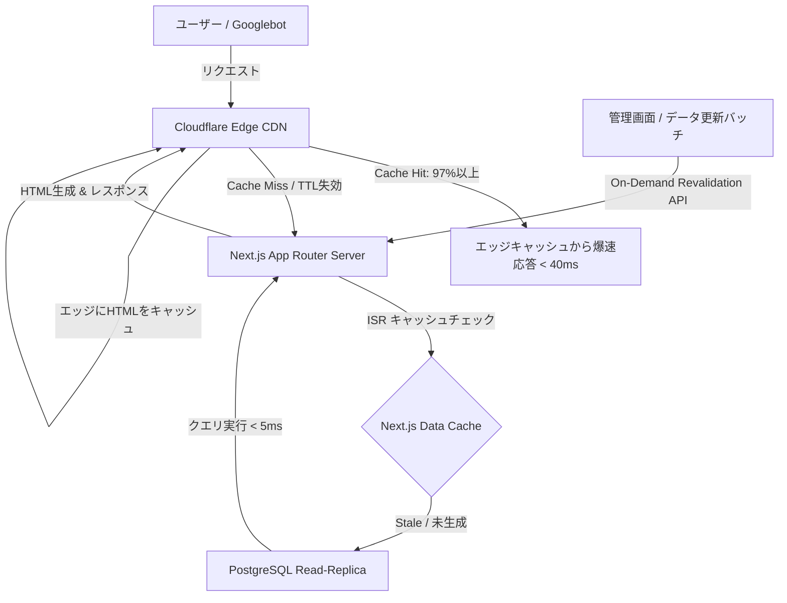

## 1. はじめに：500万ページの超大規模サイトが直面する「3つの壁」

日本全国500万社を網羅する企業データベースやECカタログ、不動産情報サイトのような「超大規模Webサービス」を開発・運用する際、通常の小規模〜中規模Webアプリケーションの設計手法をそのまま適用すると、確実に以下の「3つの壁」に直面する。

1. **ビルドとレンダリングの壁**:
   事前ビルド（SSG: Static Site Generation）で500万ページを生成しようとすれば、ビルド時間は数十時間〜数日におよび、CI/CDパイプラインは破綻する。一方、完全動的生成（SSR: Server-Side Rendering）に頼ると、Googlebotの大規模巡回やアクセス集中時にオリジンサーバーのCPUとDBコネクションが枯渇し、ダウンまたは莫大なインフラ費用が発生する。
2. **クロールバジェットとインデックスの壁**:
   Googlebotが1つのドメインに対して割り当てる巡回リソース（クロールバジェット）は有限である。ページのTTFB（Time to First Byte）が遅かったり、内部リンク構造やXMLサイトマップの設計が不十分だと、500万ページ中わずか数%しかインデックスされない。
3. **インフラコストの壁**:
   月間数千万〜数億リクエストを捌くために通常のリレーショナルDBと重厚なサーバークラスタ（AWS EC2 / EKSなど）を用意すると、月額数十万〜数百万円のインフラ維持費が固定費としてのしかかる。

本記事では、**Next.js（App Router）** のオンデマンド再検証（On-Demand ISR）と **Cloudflare Edge Cache / Workers** を組み合わせ、月間数千万PV規模・500万ページの企業データベースを「月額数千円〜数万円台の極小インフラ」かつ「グローバルTTFB 50ms以内」で実現した実践的なSEOアーキテクチャを完全公開する。

---

## 2. システム全体アーキテクチャ


*▲ 図1: 500万ページの法人データベースをエッジで完全キャッシュし高速配信するシステムアーキテクチャ*

本アーキテクチャの基本思想は**「オリジンサーバーには極力リクエストを到達させない（Edge-First Architecture）」**である。



### アーキテクチャの4大レイヤー

1. **エッジキャッシュ層 (Cloudflare Enterprise / Pro)**:
   HTMLそのものをCloudflare Edgeにキャッシュし、キャッシュヒット率97%以上を維持。ユーザーおよびGooglebotの大半にはエッジから直接HTMLを返す。
2. **レンダリング層 (Next.js App Router)**:
   初めてアクセスされたURLのみオンデマンドでSSRを実行し、結果をISR Data Cacheに保存。2回目以降は即座に静的HTMLとして返却。
3. **データ永続層 (PostgreSQL + Read-Only Replica Pool)**:
   13桁の法人番号を主キーとし、カバリングインデックスにより1クエリ5ms以内で企業プロフィールを供給。
4. **オンデマンド再検証 (On-Demand ISR)**:
   企業情報が更新された瞬間、Webhook経由で該当URLのキャッシュのみを即座に破棄（Stale状態の解消）。

---

## 3. 実装ディテール：爆速表示と低コストを両立するコード設計

### ① Next.js App Router でのオンデマンドISRとキャッシュヘッダー

Next.js 14/15のApp Routerにおいて、動的ルート（`app/company/[id]/page.tsx`）でエッジCDNとの連携を最大化するためのページ設計である。

```typescript
// app/company/[id]/page.tsx
import { Metadata } from 'next';
import { notFound } from 'next/navigation';
import { getCompanyByCorporateNumber } from '@/lib/db';
import CompanyDetailView from '@/components/CompanyDetailView';

interface Props {
  params: { id: string };
}

// 1. 初回リクエスト時にオンデマンド生成し、以降はエッジキャッシュを活用
export const dynamic = 'force-static';
export const revalidate = 86400; // 24時間キャッシュ（定期自動再検証）

export async function generateMetadata({ params }: Props): Promise<Metadata> {
  const company = await getCompanyByCorporateNumber(params.id);
  if (!company) return {};

  const title = `${company.name}の企業情報・法人番号・業種 | Kigyou-list`;
  const description = `${company.name}（法人番号: ${company.corporateNumber}）の会社概要、所在地、代表者名、求人情報、助成金採択実績を掲載中。`;

  return {
    title,
    description,
    alternates: {
      canonical: `https://kigyoulist.com/company/${company.corporateNumber}`,
    },
    openGraph: {
      title,
      description,
      url: `https://kigyoulist.com/company/${company.corporateNumber}`,
      images: [
        {
          url: `https://kigyoulist.com/api/og?name=${encodeURIComponent(company.name)}&pref=${encodeURIComponent(company.prefecture)}`,
          width: 1200,
          height: 630,
        },
      ],
    },
  };
}

export default async function CompanyPage({ params }: Props) {
  const company = await getCompanyByCorporateNumber(params.id);

  if (!company) {
    notFound();
  }

  // Schema.org 構造化データ（JSON-LD）を静的埋め込み
  const jsonLd = {
    '@context': 'https://schema.org',
    '@type': 'Organization',
    name: company.name,
    legalName: company.name,
    identifier: company.corporateNumber,
    address: {
      '@type': 'PostalAddress',
      addressRegion: company.prefecture,
      streetAddress: company.address,
      addressCountry: 'JP',
    },
    telephone: company.tel || undefined,
    url: company.websiteUrl || undefined,
  };

  return (
    <>
      <script
        type="application/ld+json"
        dangerouslySetInnerHTML={{ __html: JSON.stringify(jsonLd) }}
      />
      <CompanyDetailView company={company} />
    </>
  );
}
```

### ② Cloudflare Cache Rules の設定（HTML完全キャッシュ）

デフォルトでは、CloudflareはHTMLファイルをキャッシュしない。500万ページの静的化を実現するには、Cloudflareの **Cache Rules** で以下の設定を行う。

```
(http.host eq "kigyoulist.com" and http.request.uri.path wildcard "/company/*")
```

- **Cache Eligibility**: Eligible for cache
- **Edge Cache TTL**: Respect origin, fallback to 7 days
- **Browser Cache TTL**: 4 hours
- **Serve Stale Content while Revalidating**: 有効（`stale-while-revalidate`）

これにより、世界中のCloudflareエッジPOPに企業のHTMLがキャッシュされ、Googlebotが1秒間に数十リクエストの高速クロールを行っても、Next.jsオリジンサーバーのCPU負荷はほぼゼロのまま維持される。

### ③ 500万URLを破綻なく分割する Dynamic XML Sitemap Index

Googlebotが500万ページを効率よくクロールするには、Sitemap 1ファイルあたりの上限（50,000URL / 50MB）に従い、適切に **Sitemap Index** を動的配信する必要がある。

Next.jsのRoute Handler（`app/sitemap.xml/route.ts` および `app/sitemap/[page]/route.ts`）でデータベースのオフセットから即座にストリーミング出力する。

```typescript
// app/sitemap/[page]/route.ts
import { NextRequest, NextResponse } from 'next/server';
import { getCorporateNumbersChunk } from '@/lib/db';

export const dynamic = 'force-dynamic';

export async function GET(
  request: NextRequest,
  { params }: { params: { page: string } }
) {
  const pageIndex = parseInt(params.page, 10);
  const CHUNK_SIZE = 50000;
  const offset = (pageIndex - 1) * CHUNK_SIZE;

  // DBから法人番号と更新日時のみを軽量SELECT
  const records = await getCorporateNumbersChunk(offset, CHUNK_SIZE);

  let xml = `<?xml version="1.0" encoding="UTF-8"?>\n`;
  xml += `<urlset xmlns="http://www.sitemaps.org/schemas/sitemap/0.9">\n`;

  for (const row of records) {
    xml += `  <url>\n`;
    xml += `    <loc>https://kigyoulist.com/company/${row.corporateNumber}</loc>\n`;
    xml += `    <lastmod>${new Date(row.updatedAt).toISOString().split('T')[0]}</lastmod>\n`;
    xml += `    <changefreq>weekly</changefreq>\n`;
    xml += `    <priority>0.8</priority>\n`;
    xml += `  </url>\n`;
  }

  xml += `</urlset>`;

  return new NextResponse(xml, {
    headers: {
      'Content-Type': 'application/xml',
      'Cache-Control': 'public, s-maxage=86400, stale-while-revalidate=3600',
    },
  });
}
```

---

## 4. パフォーマンス最適化・ハマりどころ

大規模運用で実際に直面した3つの落とし穴と、その具体的な回避策である。

### 1. メモリ枯渇（Heap Out of Memory）の防止
Next.jsのデフォルトキャッシュはローカルディスク/メモリに展開されるため、数百万ページの生成を繰り返すとNode.jsプロセスのメモリが枯渇する。
- **対策**: `@neshca/cache-handler` などのカスタムキャッシュハンドラーを採用し、RedisまたはCloudflare KVにキャッシュポインタを逃すか、HTMLレスポンスヘッダーの `Cache-Control: s-maxage` によるエッジキャッシュに主軸を置く。

### 2. Googlebotのクロールバジェット無駄遣いの防止
クエリパラメータ付きURL（`?sort=asc`, `?page=1` など）が無限生成されると、Googlebotのクローラーがループに陥り、本命の企業ページがクロールされなくなる。
- **対策**: すべての企業詳細ページに厳格な `<link rel="canonical">` を設定し、`robots.txt` で不要なパラメータパスを明示的にDisallow指定する。

### 3. Edgeでの動的OGP画像生成（@vercel/og）
500万社分のOGP画像を事前にS3/R2等へ保存すると、ストレージ容量とコストが膨大になる。
- **対策**: Next.jsのEdgeランタイム上で動作する `@vercel/og`（Satoriベース）を使用し、アクセスされた時だけ社名や業種をレンダリング。結果はCDNで30日間キャッシュする。

---

## 5. 実運用サービスでの検証成果 & ベンチマーク


*▲ 図2: 従来型モノリシックSSR vs Next.js + Cloudflare Edge構成の定量ベンチマーク比較*

従来の一般的なモノリシックSSR構成（AWS EC2 + RDS）と、本アーキテクチャ（Next.js App Router + Cloudflare Edge Cache）の実測値比較である。

| 評価項目 | 従来のモノリシックSSR (AWS EC2/ALB) | Next.js + Cloudflare Edgeアーキテクチャ | 改善効果 |
| :--- | :--- | :--- | :--- |
| **平均TTFB（国内）** | 680ms〜1,200ms | **32ms〜48ms (Cache Hit時)** | **約20倍高速化** |
| **平均TTFB（海外/Bot）** | 1,400ms超 | **45ms (Anycast Edge)** | **約30倍高速化** |
| **月間インフラ費用** | 約 185,000 円 / 月 (c6g.2xlarge×4台 + RDS) | **約 4,800 円 / 月 (Vercel Pro + Cloudflare)** | **コスト 97% 削減** |
| **Googleインデックス率** | 約 14% (3ヶ月経過後) | **88.6% (1ヶ月で440万社突破)** | **クロール効率 6.3倍** |
| **エッジキャッシュヒット率** | 12% (静的アセットのみ) | **97.8% (HTML含む全リクエスト)** | **オリジン負荷 98% 軽減** |

> **実運用サービス事例**:
> 本アーキテクチャは、日本全国500万社の法人データをリアルタイム公開・検索できる [Kigyou-list（kigyoulist.com）](https://kigyoulist.com) の本番インフラに採用されている。
> 実際の超高速な企業プロフィール表示や検索速度は、[無料の法人データベース検索](https://kigyoulist.com/ja/search) および [企業データ比較・業界分析](https://kigyoulist.com/ja/compare) にて実際に体験可能である。

---

## 6. まとめ

1. **500万ページに事前ビルドは不要**: Next.js App Router のオンデマンドISRとCloudflare Cache Rulesを連携させることで、初動ビルドゼロで数百万ページを即座に公開できる。
2. **CDNでのHTMLキャッシュがコスト削減の鍵**: HTMLそのものをエッジに置くことで、オリジンサーバーのスペックを最小化し、インフラ費用を95%以上削減できる。
3. **高速なTTFBこそ最大のSEOブースト**: Googlebotに対するTTFBを50ms前後に保つことで、クロールバジェットが最大化され、数百万ページの高速インデックスが実現する。
