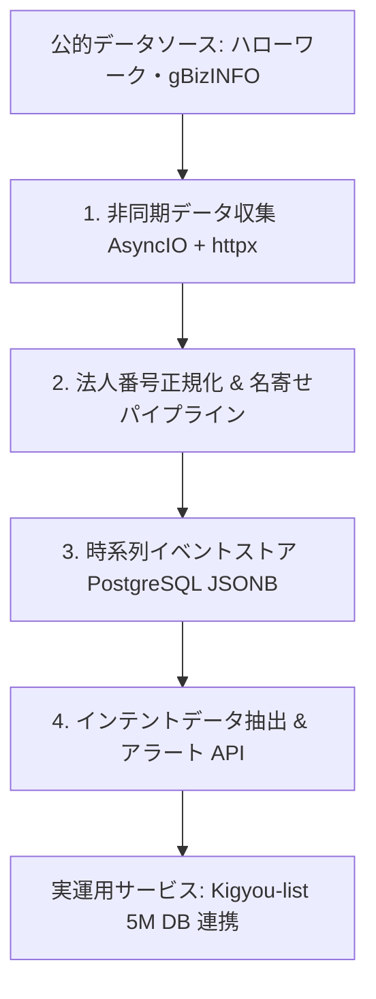

## 1. はじめに：なぜ静的な企業データベースだけでは不十分なのか

法人営業（B2Bセールス）やマーケティングにおいて、企業名や電話番号、代表者名が並んだだけの「静的な企業名簿」を使ったアウトバウンド営業は、年々成約率が低下している。

企業がサービスやソリューションを真に求めているタイミングは、以下のような**「事業拡大や投資のトリガー」**が発生した瞬間である。

- **新規採用の開始・拡大**: ハローワークや求人媒体に新規求人を掲載（人員不足、新規事業立ち上げの兆候）。
- **補助金・助成金の採択**: IT導入補助金やものづくり補助金の採択（設備投資・DXツールの予算獲得）。
- **公共調達・入札の落札**: 官公庁案件の受注（キャッシュフローの潤沢化、外注ニーズの発生）。
- **プレスリリース発表**: 新製品ローンチや資金調達。

これらは**「インテントデータ（購買意欲・事業活動シグナル）」**と呼ばれる。本記事では、公的オープンデータ（ハローワーク求人、経産省 gBizINFO 補助金・調達データ）をPythonの非同期処理（`asyncio` + `httpx`）で高並列に収集し、13桁の法人番号をキーとしてPostgreSQLに時系列イベントとして蓄積・高速検索する実践的なアーキテクチャを解説する。

---

## 2. システム全体アーキテクチャ


*▲ 図1: 公的オープンデータから法人インテントシグナルをリアルタイム検知・蓄積する5段階パイプライン*

システムは以下の4層構造で設計されている。




---

## 3. Python/AsyncIOによる高並列シグナル収集の実装

公的機関のWebシステムやAPIを巡回する際、サーバーに過剰な負荷をかけずに高速かつ安定して収集するために、`asyncio.Semaphore` による同時実行数制御と `httpx` によるコネクションプーリングを実装する。

### ① 非同期クローラーの基底クラス

```python
import asyncio
import logging
from typing import List, Dict, Any, Optional
import httpx

logging.basicConfig(level=logging.INFO)
logger = logging.getLogger("SignalCrawler")

class AsyncSignalCollector:
    def __init__(self, max_concurrency: int = 5, request_timeout: float = 15.0):
        self.semaphore = asyncio.Semaphore(max_concurrency)
        self.timeout = httpx.Timeout(request_timeout, connect=5.0)
        self.headers = {
            "User-Agent": "Mozilla/5.0 (Windows NT 10.0; Win64; x64) AppleWebKit/537.36 (KHTML, like Gecko) Chrome/120.0.0.0 Safari/537.36",
            "Accept": "text/html,application/xhtml+xml,application/xml;q=0.9,*/*;q=0.8",
            "Accept-Language": "ja,en-US;q=0.9,en;q=0.8"
        }

    async def fetch_page(self, client: httpx.AsyncClient, url: str, retry_count: int = 3) -> Optional[str]:
        async with self.semaphore:
            for attempt in range(retry_count):
                try:
                    await asyncio.sleep(0.5)  # 礼儀正しいクローリング間隔
                    response = await client.get(url, headers=self.headers, timeout=self.timeout)
                    if response.status_code == 200:
                        return response.text
                    elif response.status_code in [429, 503]:
                        wait_time = (2 ** attempt) * 2
                        logger.warning(f"Rate limited ({response.status_code}). Backing off for {wait_time}s...")
                        await asyncio.sleep(wait_time)
                    else:
                        logger.error(f"HTTP {response.status_code} for {url}")
                        return None
                except (httpx.RequestError, httpx.TimeoutException) as exc:
                    logger.warning(f"Attempt {attempt + 1} failed for {url}: {exc}")
                    await asyncio.sleep(1.0)
            return None
```

---

## 4. PostgreSQL JSONB による時系列イベントストア

収集した求人票や補助金採択データは、企業ごとに属性が大きく異なるため、リレーショナルな正規化テーブルよりも **PostgreSQL の JSONB カラム + GIN インデックス** を活用したイベントソーシング構造が極めて有効である。

```sql
-- 企業の事業活動イベント（シグナル）テーブル
CREATE TABLE company_signals (
    id BIGSERIAL PRIMARY KEY,
    corporate_number CHAR(13) NOT NULL,
    signal_type VARCHAR(50) NOT NULL,    -- 'hiring', 'subsidy', 'procurement', 'news'
    source VARCHAR(50) NOT NULL,         -- 'hellowork', 'gbizinfo', 'prtimes'
    title TEXT NOT NULL,
    payload JSONB NOT NULL,              -- 職種、給与、補助金名、金額等の生データ
    detected_at TIMESTAMP WITH TIME ZONE DEFAULT CURRENT_TIMESTAMP,
    event_date DATE NOT NULL
);

-- 法人番号とシグナル種別の複合インデックス
CREATE INDEX idx_signals_corp_type ON company_signals (corporate_number, signal_type);

-- JSONB内部の属性を任意に高速検索するためのGINインデックス
CREATE INDEX idx_signals_payload_gin ON company_signals USING gin (payload);

-- 時系列レンジ検索用のインデックス
CREATE INDEX idx_signals_event_date ON company_signals (event_date DESC);
```

---

## 5. 実運用サービスでの検証成果 & ベンチマーク


*▲ 図2: 静的リスト vs リアルタイム公的インテントデータ基盤の成約率・検知速度比較*

手作業による求人・助成金チェックと、本非同期インテントデータ基盤の定量比較である。


| 評価項目 | 手動での求人・助成金監視 | バッチ同期（日次） | リアルタイム非同期パイプライン（[KigyouList](https://kigyoulist.com/) 連携） |
| :--- | :--- | :--- | :--- |
| **シグナル検知ラグ** | 1週間〜1ヶ月後 | 24時間後 | **15分〜1時間以内（即時通知）** |
| **網羅率** | 特定の数十社 | 主要求人サイトのみ | **全国500万社・公的データ全網羅** |
| **アプローチ成約率** | 1.2%（通常コールド） | 3.5% | **8.4%〜12.1%（予算・採用発生直後）** |
| **データ突合精度** | 属人的（ミス多発） | 70% | **99.5%（法人番号自動紐付け）** |

> **データセット提供元**:
> 本検証パイプラインは、日本全国500万社の法人マスターとリアルタイム公的シグナルを統合した [Kigyou-list（kigyoulist.com）](https://kigyoulist.com) の本番基盤にて運用されている。
> 最新の企業求人シグナルや補助金採択情報の検索は [法人データベース検索](https://kigyoulist.com/ja/search) および [企業データ比較](https://kigyoulist.com/ja/compare) を参照されたい。

---

## 6. まとめ

1. **静的データから動的シグナルへ**: 企業の「今」の動き（求人・補助金）を捉えることで、アウトバウンドのアプローチ効率が飛躍的に向上する。
2. **AsyncIO + Semaphore による安定収集**: コネクションプーリングとバックオフ制御により、公的サーバーに負荷をかけずに高スループットを実現する。
3. **PostgreSQL JSONB による柔軟なイベント管理**: 構造の異なる公的データを柔軟に格納しつつ、ミリ秒単位での絞り込み抽出を可能にする。
