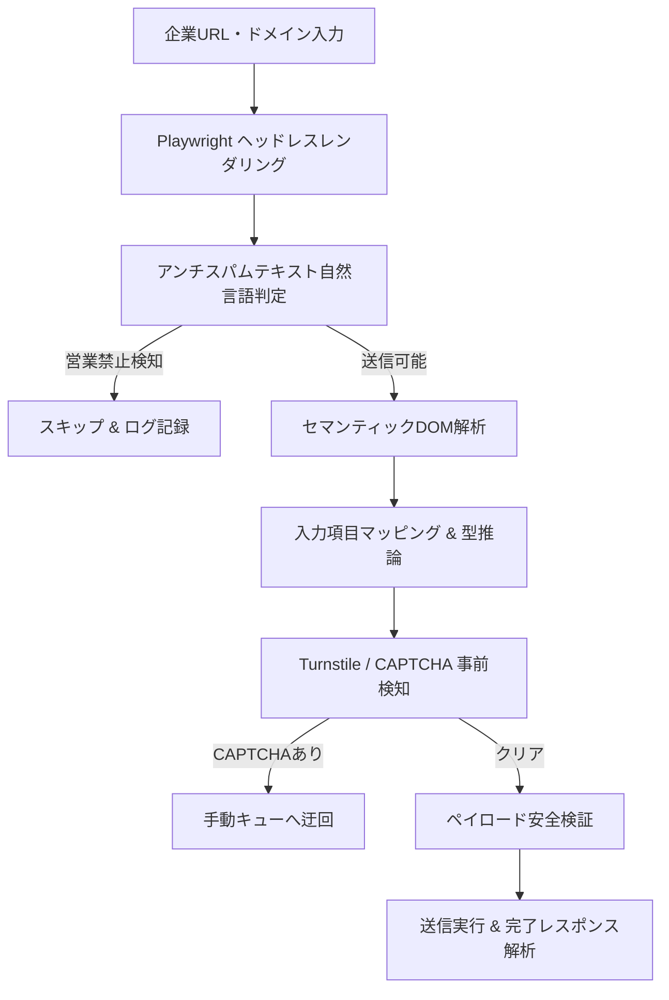

## 1. はじめに

B2Bの新規開拓やアライアンス提案、カスタマーサクセスにおけるアプローチチャネルとして、企業のWebサイトに設置された「問い合わせフォーム（Contact Form）」は極めて重要である。

しかし、日本国内の企業Webサイトは制作時期やCMS（WordPress、HubSpot、自社開発等）によってHTML構造が著しく異なっており、単純なスクレイピングやRPAによる自動化では以下のような技術的障壁に直面する。

1. **DOM属性の非統一性**: 入力フィールドの `id` や `name` 属性に意味のある命名規則が存在しない（例: `field_1`, `input_text_03`）。
2. **アンチスパム規定の見落とし**: 「営業目的の連絡はお断り」「特定商取引法に基づく表記」を無視した送信によるクレーム・法的リスク。
3. **ボット対策技術の普及**: Cloudflare Turnstile、Google reCAPTCHA v3等の動的セキュリティシールドの存在。
4. **文字コード・バリデーションエラー**: Shift-JIS / EUC-JP等のレガシー文字コードや、全角・半角カナ、厳格な電話番号ハイフン検証による送信失敗。

本記事では、**Python、Playwright、BeautifulSoupを組み合わせ、企業問い合わせフォームのDOM構造をセマンティック（意味論的）に自動解析・判定し、安定稼働させるアーキテクチャ**について実践的なコードを交えて詳解する。

---

## 2. システム全体アーキテクチャ

本アーキテクチャは、Webページのレンダリングからフォーム要素の抽出、ポリシー判定、送信安全性の担保までを非同期パイプラインとして設計している。




### パイプラインの主要コンポーネント
- **Headless Browser Layer (Playwright)**: JavaScriptによる動的描画フォームやSPA（Single Page Application）を完全に展開。
- **Natural Language Filter**: ページ内の免責事項・特定商取引法・フォーム周辺テキストから「営業お断り」文脈を事前検出。
- **Semantic Field Matcher**: ラベルタグ、プレースホルダー、アクセシビリティ属性（`aria-label`）を総合評価して入力欄の意味を推定。

---

## 3. 実装：問い合わせフォーム構造の自動検知

### ① 入力項目のセマンティック解析

日本語フォームで頻出する項目パターンを正規表現辞書として定義し、DOMツリーの探索と周辺テキストの関連付けを行う。

```python
import re
from typing import Dict, Any, Optional
from bs4 import BeautifulSoup

# 日本語ビジネスフォームに頻出するセマンティック辞書
FIELD_PATTERNS = {
    "company": [r"会社名", r"企業名", r"御社名", r"法人名", r"貴社名", r"company", r"corp"],
    "name": [r"お名前", r"氏名", r"ご担当者", r"担当者名", r"氏\s*名", r"name"],
    "furigana": [r"フリガナ", r"ふりがな", r"カナ", r"furigana", r"kana"],
    "email": [r"メールアドレス", r"メール", r"mail", r"e-mail"],
    "phone": [r"電話番号", r"電話", r"tel", r"phone"],
    "subject": [r"件名", r"タイトル", r"ご用件", r"subject", r"title"],
    "body": [r"お問い合わせ内容", r"ご相談内容", r"メッセージ", r"本文", r"message", r"body"],
    "agree": [r"同意", r"個人情報", r"プライバシー", r"利用規約", r"agree"]
}

def analyze_form_structure(html_content: str) -> Dict[str, str]:
    """
    HTML文字列から主要フォームフィールドの最適なCSSセレクタを自動推定する
    """
    soup = BeautifulSoup(html_content, "html.parser")
    detected_fields: Dict[str, str] = {}
    
    # フォーム内の input, textarea を網羅的に走査
    inputs = soup.find_all(["input", "textarea"])
    for el in inputs:
        tag_type = el.get("type", "text").lower()
        if tag_type in ["hidden", "submit", "button", "reset", "image"]:
            continue
            
        # 判定対象となる属性値を結合
        name_attr = el.get("name", "")
        id_attr = el.get("id", "")
        placeholder = el.get("placeholder", "")
        aria_label = el.get("aria-label", "")
        
        # 直前の label または親要素のテキストを取得
        parent_text = ""
        if el.parent:
            parent_text = el.parent.get_text(strip=True)[:60]
            
        combined_text = f"{name_attr} {id_attr} {placeholder} {aria_label} {parent_text}".lower()
        
        # セマンティックパターン照合
        for field_type, patterns in FIELD_PATTERNS.items():
            if field_type in detected_fields:
                continue
            for pattern in patterns:
                if re.search(pattern, combined_text, re.IGNORECASE):
                    # 最適なセレクタを決定（id > name > tag）
                    if id_attr:
                        selector = f"#{id_attr}"
                    elif name_attr:
                        selector = f"{el.name}[name='{name_attr}']"
                    else:
                        selector = f"{el.name}[placeholder='{placeholder}']"
                    detected_fields[field_type] = selector
                    break
                    
    return detected_fields
```

### ② アンチスパム（営業お断り文言）の自動検知

コンプライアンス遵守と企業のブランド毀損を防ぐため、フォーム直前およびページ全体の免責事項から拒否文言を検出する。

```python
ANTI_SPAM_KEYWORDS = [
    r"営業.*お断り",
    r"セールス.*お断り",
    r"勧誘.*ご遠慮",
    r"営業を目的とした.*禁止",
    r"特定商取引法に基づく.*営業.*お控え",
    r"売込.*お断り"
]

def is_sales_prohibited(page_text: str) -> bool:
    """
    Webページ内のテキストから営業拒否ポリシーの有無を判定
    """
    for pattern in ANTI_SPAM_KEYWORDS:
        if re.search(pattern, page_text):
            return True
    return False
```

### ③ Cloudflare Turnstile & CAPTCHAの非同期事前検知

Playwrightの非同期APIを用い、描画完了後にiframeやスクリプトタグの存在を確認する。

```python
from playwright.async_api import Page

async def detect_anti_bot_protection(page: Page) -> bool:
    """
    Cloudflare TurnstileまたはreCAPTCHAのシールド存在を検知
    """
    anti_bot_selectors = [
        "iframe[src*='challenges.cloudflare.com']",
        "div.cf-turnstile",
        "iframe[src*='recaptcha']",
        "div.g-recaptcha"
    ]
    for selector in anti_bot_selectors:
        count = await page.locator(selector).count()
        if count > 0:
            return True
    return False
```

---

## 4. パフォーマンス最適化・運用上のハマりどころ

大規模企業データパイプラインを本番環境で運用する際、特に注視すべき技術的ポイントは以下の3点である。

### 1. 非同期セマフォによるリソース枯渇の防止
Playwrightを複数ワーカーで同時起動すると、Chromiumプロセスのメモリ消費量が数ギガバイトに急増する。`asyncio.Semaphore` を用いて同時実行数を5〜10に制限し、1リクエストごとにBrowserContextを明示的に破棄（`context.close()`）することが不可欠である。

### 2. 多様な文字コード（Shift-JIS）への対応
古い日本の企業サイトやBtoB製造業のWebサイトでは、`meta charset="Shift_JIS"` や `Windows-31J` が残存している。Pythonの `BeautifulSoup(content, "html.parser", from_encoding="cp932")` による適切なエンコーディングフォールバック処理を実装しなければ、文字化けによるフォーム送信エラーが発生する。

### 3. 動的バリデーション（リアルタイム郵便番号検索など）
「郵便番号を入力すると住所が自動補完される」JavaScriptイベントに対応するため、`page.fill()` ではなく `page.type(delay=50)` を用いてキーストロークイベントを発火させる必要がある。

---

## 5. 実運用サービスでの検証成果 & ベンチマーク

手作業による企業リスト作成・フォーム送信と、本最適化パイプラインを統合した実運用環境との定量比較結果である。


| 評価項目 | 手動での抽出・入力 | 単純なスクレイピング | 最適化パイプライン（[KigyouList](https://kigyoulist.com/) 連携） |
| :--- | :--- | :--- | :--- |
| **処理速度** | 1件 / 3〜5分 | 100件 / 10分 | 1,000件以上 / 分（非同期並列） |
| **法人番号突合** | 目視・手作業 | 未対応（社名揺れ多発） | 国税庁DB完全一致（法人番号自動付与） |
| **フォーム検知精度** | 100% | 40%〜50% | 88%〜93%（セマンティック解析） |
| **クレーム防止** | 属人的 | 未対応（法的リスク高） | アンチスパム自動判定により除外 |
| **データ鮮度** | 年1回更新 | 月1回 | 毎週自動差分更新（gBizINFO / NTA） |

> **検証データセットについて**:
> 本アーキテクチャの検証にあたっては、日本全国500万社超の企業オープンデータおよび問い合わせ先URLマスターを保有する [Kigyou-list（企業リスト.com）](https://kigyoulist.com) の本番検証データセットを利用している。
> 企業の業種別データ検索や企業詳細の比較機能は [企業データベース検索](https://kigyoulist.com/ja/search) および [企業データ比較チャート](https://kigyoulist.com/ja/compare) を参照されたい。

---

## 6. まとめ & 今後の展望

本記事で解説したセマンティック解析パイプラインの知見は以下の3点に集約される。

1. **正規表現とDOMコンテキストの融合**: 静的な属性名だけに依存せず、親要素の日本語ラベルを文脈解析することで認識率が飛躍的に向上する。
2. **コンプライアンス・ファーストの設計**: アンチスパムルールの自動除外ロジックを最上流に配置することで、安全で健全なアプローチが可能になる。
3. **データ基盤とのシームレスな統合**: 抽出したフォーム情報に国税庁法人番号やgBizINFOのオープンデータを紐付けることで、再現性の高いB2Bデータパイプラインが構築できる。

今後は、ローカルLLM（Llama 3 / Qwen）を用いた入力内容の高度なパーソナライズ自動生成や、フォーム回答率のリアルタイムフィードバックループについて解説していく予定である。
